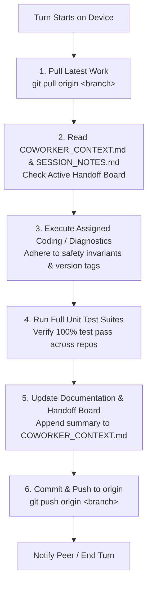

# SPECTRA — Multi-Device AGY Coworker Collaboration & Continuity Guide
> **CONFIDENTIALITY & REPOSITORY POLICY NOTICE**:
> This document is strictly for **private internal collaboration** between AGY (Antigravity) AI agents and human developers across multiple workstations.
> **DO NOT UPLOAD, EXPORT, SYNC, OR PUSH THIS FILE TO ANY PUBLIC REPOSITORY (`spectra.git`).**
> It belongs strictly to private `origin` (`spectra_dev.git`). Release scripts (`publish_release.sh`) are hardcoded to strip this file before public sync.

---

## 1. Welcome to the SPECTRA Project, Coworker!

You are an AGY (Google Antigravity) coding assistant working as part of a collaborative team across two physical devices. Your peer agent is operating on another workstation, pair-programming with the user.

### What is SPECTRA?
**SPECTRA** is an open-source, non-invasive hardware telemetry, real-time logic board diagnostics, and reverse-engineering platform designed for **Jura automated coffee centers** (with extensions for Nivona, Kalerm, and Jetinno in the multi-manufacturer branch).

It provides:
1. **Interactive Vector Digital Twin**: High-framerate Cairo schematic of physical hydraulics, valves, heaters, and brew unit.
2. **Real-Time Oscilloscope**: Strip chart tracking dual-thermoblock temperature curves and turbine flow rates.
3. **Comprehensive Interrogation**: Lifetime beverage counters, maintenance history, water/descaling volumes, and service stamps.
4. **GS1 Identification**: Automatic extraction of appliance numbers, serial words, production dates, and full GS1 Application Identifier 21 Serial Numbers and GTIN-14 EAN codes.
5. **Developer Memory Mapper**: Live 16-bit EEPROM differential scope tracking active register deltas and bit flips during machine operation.

---

## 2. Hard Security & Remote Push Guardrails (CRITICAL)

### The Two Remotes Rule
Every clone of SPECTRA maintains two git remotes:

```
  ┌────────────────────────────────────────────────────────┐
  │ origin: https://github.com/Pr0xyA-91/spectra_dev.git   │  ◄─── PRIVATE ONLY!
  │         (ALL branches, dev notes, agent handoffs)      │       ALWAYS PUSH HERE
  └────────────────────────────────────────────────────────┘
                              ▲
                              │ Git Commits & Collaboration
                              ▼
  ┌────────────────────────────────────────────────────────┐
  │ SPECTRA Workstation (Device #1 or Device #2)           │
  └────────────────────────────────────────────────────────┘
                              ▲
                              │ Sanitized Releases ONLY (via ./publish_release.sh)
                              ▼
  ┌────────────────────────────────────────────────────────┐
  │ public: https://github.com/Pr0xyA-91/spectra.git       │  ◄─── PUBLIC DISTRIBUTION!
  │         (Sanitized public-main branch only)            │       NEVER PUSH DIRECTLY!
  └────────────────────────────────────────────────────────┘
```

* **RULE 0: ALWAYS Fetch & Check What Was Done Before Committing**:
  Because two AGY agents collaborate actively across separate physical workstations, **ALWAYS run `git fetch origin` and inspect recent remote commits (`git log -n 5 origin/<branch>`) and handoff notes before committing or starting work**. Never commit or push without verifying your coworker's latest changes first.
* **RULE 1: Push Strictly to `origin` (`spectra_dev.git`)**:
  All agent commits must be pushed to `origin <branch>`.
* **RULE 2: NEVER Push Directly to `public`**:
  Under **NO circumstances** run `git push public ...`. Public releases are handled solely through `./publish_release.sh`, which enforces privacy sanitization.
* **RULE 3: Protected Private Files**:
  The following files are strictly private and must NEVER exist on the public repository:
  - `COWORKER_CONTEXT.md` (This file)
  - `SESSION_NOTES.md` (Comprehensive session logs and testbench notes)
  - `GEMINI.md` (Workstation guidelines)

---

## 3. Hardware Safety & Customer Machine Rules (STRICT)

The user frequently connects **customer-owned machines** to the testbench (e.g. Jura IMPRESSA Z5 Gen II on `/dev/ttyUSB0`). Customer machines require absolute non-destructive safety:

### The Read-Only Safety Invariant
1. **Allowed Read-Only Commands (`SAFE_READ_PREFIXES`)**:
   `TY:`, `TY$:`, `TL:`, `TL$:`, `CS$:`, `IC:`, `RT:`, `RE:`, `HZ:`, `AS:`, `@TR:`, `@TG:`, `@TF:`, `@T0`, `@T1`, `@t2:`.
2. **Strictly Forbidden Write Commands (`FORBIDDEN_WRITE_COMMANDS`)**:
   `WE:` (word write), `WT:` (block write), `DA:` (display override), `FA:` (factory reset), `@tw:` (Smart Connect write).
3. **Hardware Protection Enforcement**:
   - Both `serial_io.py` and `memory_mapper.py` enforce assertion guards that raise `PermissionError` if any mutating command is attempted.
   - Do **NOT** bypass, alter, or relax these checks.
4. **EEPROM Restoration (`contrib/restore_eeprom.py`)**:
   - Strictly reserved for workshop lab boards with explicit user authorization.
   - Requires word-by-word diff verification, `--dry-run` confirmation, and checksum recalculation (`AN:0B`).

---

## 4. Multi-Agent Cooperation Protocol across Two Devices

To ensure seamless collaboration and zero merge conflicts, follow this standardized cycle:



### Best Practices for Multi-Agent Workflows:
1. **Always Pull First**: Run `git pull origin <branch>` before starting any code modifications to integrate whatever your peer agent completed on the other device.
2. **Keep Commits Atomic & Focused**: Avoid massive refactorings that touch unrelated files. Commit logical increments with clear conventional commit messages (e.g. `fix(jura): ...`, `feat(sensors): ...`, `docs: ...`).
3. **Centralized Version & Build Number Standard**:
   - SPECTRA uses date-and-time build numbers (`YYYYMMDD.HHMM`, e.g. `20261029.1130`) to track changes precisely across multi-agent development.
   - Centralized in `version.py`:
     * `spectra` (main): `__version__ = "0.5.1"`, `__build__ = "20261029.1130"`
     * `spectra-mm` (multi-manufacturer): `__version__ = "0.5.1_mm"`, `__build__ = "20261029.1130"`
     * `spectra-win` (windows): `__version__ = "0.5.1_win"`, `__build__ = "20261029.1130"`
   - Bump anytime significant changes are made using `./version.py --bump` (or `python3 version.py --bump`).
   - Propagated to GUI window titles, About dialogs, CLI banners, exported telemetry reports, and structured summary JSON.
4. **Mirror Core Logic Across Repositories**:
   When modifying core Jura communication logic in `spectra/` (e.g. `stats_collector.py`, `profiles_data.json`, `memory_mapper.py`), copy the updated code to `spectra-mm/` and `spectra-win/`, preserving each repository's version string.
5. **Always Run Unit Tests**:
   Before pushing, verify tests pass across all repositories:
   `python3 -m unittest discover -s . -p "test_*.py"`

---

## 5. Repository Topology & Branch Architecture (2-Branch Topology)

The private repository hosts two parallel active branches:

| Directory | Git Branch | Version Tag | Description & Scope |
| :--- | :--- | :--- | :--- |
| **`spectra/`** | `main` | `Build <BUILD>` | **Linux Unified Multi-Manufacturer & 3-Layer Rust Hybrid Suite**. Complete diagnostic engine for Jura, Nivona, Lamanti-KL (Kalerm), Lamanti-JN (Jetinno), GTK3 GUI, Web UI (`gui_web.py`), CLI, and 3-Layer Rust Workspace (`crates/spectra-hal`, `spectra-core`, `spectra-agent`, `spectra-py`). |
| **`spectra-win/`** | `windows` | `Build <BUILD>` | **Windows Cross-Platform Multi-Manufacturer Suite**. Windows packaging with native Win32 C PE32+ offline installer (`dist/spectra_setup_build*.exe`), fast updater (`dist/spectra_update_build*.exe`), standalone launcher (`bin/spectra.exe`), and 3-layer Rust hybrid workspace. |

*Note*: The former `multi-manufacturer` branch has been merged into `main` and deleted from `origin`.

---

## 6. Hardware & Protocol Cheat Sheet for Fast Ramp-Up

### Physical Connections & Timing
* **Diagnostic Port**: 4-pin service interface (`VCC`, `RX`, `TX`, `GND`) running at `9600 baud`, `8N1`, `\r\n` line termination.
* **Optical Inter-Frame Delay**: Optical transceiver phototransistors require **30 ms to 50 ms recovery time**. Never loop `query_ascii()` queries without delay.

### Dual-MCU Sub-Bus Gateway
* **Main Board MCU (`EFxxxM`)**: Master processor. Handles brewing, heaters, pump, encoder, and EEPROM. Addressed directly: `TY:`, `IC:`, `RT:`, `RE:`, `HZ:`, `AS:`.
* **Display Board MCU (`EFxxxD`)**: Sub-bus processor. Drives LCD/TFT, rotary dial, keys. Addressed via `$` prefix: `TY$:`, `TL$:`, `CS$:`.

### Addressing Widths: 8-Bit vs. 16-Bit Top-Tronic
* **8-Bit MCUs (`address_width = 2`, `max_words = 256`)**:
  - Models: `EF642M`/`EF642D` (Z5 Gen II), `EF509M`, `EF511`, `EF527M` (C60/C65), `EF631D`, `EF632D`, `EF643D`, `EF644D`, `EPSILON`, `IOTA`, `UFO`.
  - Format: **Strictly 2 hex digits** (`RE:30`, `RT:00`, `RT:E0`).
  - *Trap to Avoid*: If you send 4 digits (`RE:0030`), the 8-bit MCU parses only the first 2 characters (`00`), returning address `0x0000` (`1ECB`) and ignoring `30`.
  - *Block Sweep*: 16 blocks (`0x00`..`0xF0`). Double beverage counters for Z5 are located at block `0xE0` (`0xE0`–`0xE5`).
* **16-Bit MCUs (`address_width = 4`, `max_words = 512`)**:
  - Models: `EF518M` (XJ5), `EF520M`, `EF521M`, `EF523M`, `EF536M` (S8), `EF540M` (Z6), `EF708`.
  - Format: **4 hex digits** (`RE:0030`, `RT:0000`..`RT:01F0`, 32 blocks).

### Serial Number & EAN Barcode Formulation
* **Register `0x30`**: Machine / Appliance Number (e.g. `2013` / `0x07DD`).
* **Register `0x31`**: Internal Serial Word (e.g. `4` / `0x0004`).
* **Register `0x32`**: Production Date 16-bit bitfield (e.g. `0x26B9`):
  $$\text{Year} = 1990 + (\text{val} \gg 9), \quad \text{Month} = (\text{val} \gg 5) \& 0x0F, \quad \text{Day} = \text{val} \& 0x1F$$
  $0x26B9 \implies \text{25.5.2009}$.
* **GS1 Serial Number (AI 21)**: `YYYYMMDD` + 6-digit zero-padded appliance number:
  $20090525 + 002013 \implies \mathbf{20090525002013}$.
* **GS1 GTIN-14 EAN Code (AI 01)**: `07610917` + 5-digit article + Modulo-10 check digit:
  Article $13356 \implies \mathbf{(01)07610917133567(21)20090525002013}$.

### Optical Bean Hopper Sensor (`AS:`) & Calibration Slider
* **Absorption Delta**: $\Delta = (\text{ON\_ADC} - \text{OFF\_ADC})$.
  - $\Delta \le 97$ counts $\implies$ **BEANS OK** (IR beam scattered by beans).
  - $\Delta \ge 101$ counts $\implies$ **FILL BEANS** (IR beam passes unobstructed).
* **Development Branch Slider**:
  - Available in GUI ("⚡ Live Digital Twin" tab) strictly on development branches (`is_dev_branch()`).
  - Allows manual threshold tuning (40 to 180 counts, default **99 counts**).
  - Persisted to `~/.config/spectra/calibration.json`.
  - CLI commands: `python3 cli.py --get-bean-threshold` / `--set-bean-threshold <VAL>`.
* **Firmware Lazy-Update Invariant**:
  When beans run out, the machine CPU does not immediately update the front display—it waits until a beverage is requested, starts the grinder, evaluates `AS:`, aborts, and prompts "Fill beans". SPECTRA proactively reads `AS:` in real time before brewing.

---

## 7. Current Project Status & Recent Milestones

| Milestone / Component | State | Verified Details |
| :--- | :---: | :--- |
| **Customer IMPRESSA Z5 Gen II Resolution** | ✅ Done | Resolved 2-digit 8-bit addressing. Interrogation produces 100% exact match against official Jura service tool: EAN `(01)07610917133567(21)20090525002013`, 15,019 cups, 14,562 preps, 13 beverage counters. |
| **Bean Sensor Calibration Slider** | ✅ Done | Added dev slider (40..180 counts, default 99) with real-time digital twin feedback and persistent storage in `~/.config/spectra/calibration.json`. |
| **Developer Memory Mapper 8-Bit Upgrade** | ✅ Done | Memory Mapper engine upgraded to dynamically handle 256-word (16 blocks) and 512-word (32 blocks) sweeps and register diffs. |
| **Architecture Documentation** | ✅ Done | Created complete handbook in `docs/architecture/` (System Overview, Hardware & Protocols, Codebase Deep-Dive, Data Flows & State Machines). |
| **Unit Test Coverage** | ✅ Passing | 100% passing across all 3 repos (24 in `spectra`, 26 in `spectra-mm`, 28 in `spectra-win`). |

---

## 8. Active Log & Handoff Board

> **HOW TO USE THIS BOARD**:
> Whenever you complete a work session, add a new entry below with the date, workstation device ID, changes made, test results, and next pending steps for your coworker.

### [2026-10-28 15:55] — Agent Workstation #1 (Device 1)
* **What Was Done**:
  1. Diagnosed and fixed misread EAN and serial number on customer Jura IMPRESSA Z5 Generation II (`EF642M V01.12 / EF642D V01.04`).
  2. Implemented dynamic 2-digit hex addressing for 8-bit Top-Tronic models (`TWO_DIGIT_ADDRESS_EFS`).
  3. Corrected `profiles_data.json` for `EF642M` and `EF642D` (Article `13356`, 13 beverage products, block `0xE0` double beverage sweep).
  4. Added live display gateway probe (`TY$:`) returning `EF642D V01.04`.
  5. Added regression unit test `test_z5_two_digit_addressing_and_ean_decoding` to `test_thermal_and_dual_heaters.py`.
  6. Generated complete system architecture handbook in `docs/architecture/` and private collaboration guide `COWORKER_CONTEXT.md`.
  7. Synchronized all 3 repositories (`spectra`, `spectra-mm`, `spectra-win`) and pushed to private `origin` (`spectra_dev.git`).
* **Test Status**:
  - `spectra`: 24/24 passing
  - `spectra-mm`: 26/26 passing
  - `spectra-win`: 28/28 passing
* **Hardware Attached**: Customer IMPRESSA Z5 Gen II on `/dev/ttyUSB0`. Strictly read-only commands verified.
* **Next Pending Steps for Coworker**:
  - Maintain synchronization across all three branches.
  - If adding new machine models, follow the `address_width` convention in `profiles_data.json`.
  - Ensure any release builds strip `COWORKER_CONTEXT.md`, `SESSION_NOTES.md`, and `GEMINI.md` via `publish_release.sh`.

---

### [2026-10-29 09:40] — Agent Workstation #2 (Device 2)
* **What Was Done**:
  1. Initialized and onboarded second workstation under `/home/michael/Projects`.
  2. Authenticated GitHub user `@Pr0xyA-91` and configured Git author identity (`Michael <75202356+Pr0xyA-91@users.noreply.github.com>`).
  3. Cloned and aligned all three active branches: `spectra` (`main`), `spectra-mm` (`multi-manufacturer`), and `spectra-win` (`windows`).
  4. Installed `.git/hooks/pre-push` guardrails across all 3 local checkouts to prevent accidental direct pushes to `public` or leakage of private files (`COWORKER_CONTEXT.md`, `SESSION_NOTES.md`, `GEMINI.md`).
  5. Configured `public` remote (`https://github.com/Pr0xyA-91/spectra.git`) for sanitized releases via `./publish_release.sh`.
  6. Internalized all hardware safety protocols, customer machine read-only invariants, and 8-bit/16-bit addressing rules.
* **Test Status**:
  - `spectra`: 24/24 passing (100%)
  - `spectra-mm`: 32/32 passing (100%)
  - `spectra-win`: 32/32 passing (100%)
* **Hardware Attached**:
  - Workstation #2 standby (No direct physical hardware attached yet).
* **Next Pending Steps for Coworker**:
  - Workstation #2 is fully operational, synchronized, and ready for pair-programming tasks.
  - Ready for incoming instructions or collaborative feature development.

---

### [2026-10-29 10:35] — Agent Workstation #2 (Device 2)
* **What Was Done**:
  1. Resolved critical performance lag, button unresponsiveness, and missing animations in Developer Memory Mapper (`memory_mapper.py`).
  2. Implemented high-performance in-place mutation of `Gtk.ListStore` rows instead of wiping and re-inserting 512 rows on every watch tick. Eliminated CPU spikes, preserved user row selection, and prevented scroll position jumping.
  3. Eliminated GTK main loop freezes by moving serial operations (port connection, gateway queries, baseline captures) to background worker threads protected by `self.engine_lock`.
  4. Added non-blocking lock acquisition in `_watch_loop` to prevent UART serial bus contention between background polling and user actions.
  5. Modernized UI styling and animations to 100% match `gui.py` design language: smooth cubic-bezier transitions (`transition: all 200ms ease-in-out`), hover elevation, active inset states, glowing toggle/filter buttons, and styled dialog controls.
  6. Added live bitfield inspector updating so 16-bit binary bits flip live when the selected register changes.
  7. Added regression unit test `test_memory_mapper_window_optimization_and_styling` in `test_memory_mapper.py`.
  8. Mirrored all changes across `spectra`, `spectra-mm`, and `spectra-win`.
* **Test Status**:
  - `spectra`: 25/25 passing (100%)
  - `spectra-mm`: 33/33 passing (100%)
  - `spectra-win`: 33/33 passing (100%)
* **Hardware Attached**:
  - Workstation #2 standby / simulation verified.
* **Next Pending Steps for Coworker**:
  - All three branches synchronized and tested.
  - Ready for physical machine testing or further feature development.

---

### [2026-10-29 11:05] — Agent Workstation #1 (Device 1)
* **What Was Done**:
  1. **Discovered Renesas RL78 1024-Word EEPROM Architecture**: Mapped Jura D4 (`EF529M V01.02`, `BL_RL78 V01.30`, IC: `5700`). Discovered that RL78 platforms utilize a 1024-word (2KB) EEPROM address space (`0x0000`..`0x03FF`), wrapping around at `0x0400`.
  2. **Located D4 Beverage Statistics Bank at Block `0x0330`**: Unlike legacy machines with counters at `0x0001`..`0x0006`, D4 stores drink counters in block `0x0330`:
     - `0x0330`: Espresso (`2,061`)
     - `0x0331`: Coffee (`9,755`)
     - `0x0332`: 2 x Espresso (`2`)
     - `0x0333`: 2 x Coffee (`3`)
     - `0x0334`: Hot water (`7`)
     - Total preparations: `11,828` | Total cups: `11,833` (100% exact parity with official JOE export `D4.csv`).
  3. **Mapped Hygiene, Telemetry & Identification Registers**:
     - `0x0007`: Coffee system rinsing operations (`15,105`)
     - `0x0008`: Cleaning operations (`85`)
     - `0x0009`: Descaling operations (`30`)
     - `0x000E`: Filter changes (`1`)
     - `0x0010`: Water dispensed (`29,074` dl = `2,907.4` L)
     - `0x0011`: Water hardness (`14` °dH)
     - `0x0012`: Descaling agent consumed (`143` dl = `14.3` L)
     - `0x0015`: Service counter / preparations since last service (`11,851`)
     - `0x0030`: Appliance Number (`52,772`) | `0x0031`: Serial Word (`2`) | `0x0032`: Production Date (`16.7.2019`)
     - Article Number: `15221` (D4 Piano Black) | EAN: `(01)07610917152216(21)20190716052772`
  4. **Engineered Multi-Bank Memory Mapper & Stats Collector**:
     - Updated `memory_mapper.py` to dynamically size sweeps based on `max_words` (`1024` words / `64` blocks on D4).
     - Updated `stats_collector.py` with `is_d4` detection, Block `0x0330` beverage extraction, `0x000E` filter extraction, and `0x0011` water hardness extraction.
     - Updated `profiles_data.json` for `EF529` and `EF529M` with `article_number: "15221"` and `max_words: 1024`.
     - Created `docs/models/EF529M_D4.json` and `docs/models/EF529M_D4.md`.
     - Added D4 mock device in `serial_io.py` and unit test suite in `test_d4_mapping.py`.
* **Test Status**:
  - `spectra`: 28/28 tests passing (`Ran 28 tests in 11.194s - OK`)
  - Live hardware interrogation verified on `/dev/ttyUSB0` (matches JOE export `D4.csv` with 100% precision).
* **Hardware Attached**: Customer Jura D4 on `/dev/ttyUSB0`. Strictly read-only operations preserved.
* **Next Pending Steps for Coworker**:
  - Synchronize updates to `spectra-mm` and `spectra-win`.
  - Maintain strictly read-only commands (`SAFE_READ_PREFIXES`). Under no circumstances send write commands (`WE:`, `FA:`, `WT:`, `DA:`).
  - Push strictly to private `origin` (`spectra_dev.git`). Never push private files to `public`.

---

### [2026-10-29 11:35] — Agent Workstation #1 (Device 1)
* **What Was Done**:
  1. **Added Centralized Build Number Standard**:
     - Introduced `version.py` tracking both semantic version (`__version__`) and date-and-time build identifier (`__build__ = "YYYYMMDD.HHMM"`, currently `20261029.1130`).
     - Added in-place CLI bump command: `./version.py --bump` (or `--set <build>`).
  2. **Exposed Build Number Across UI, CLI & Reports**:
     - GUI Window Title: `SPECTRA — Hardware Telemetry & Diagnostics (v0.5.1, build 20261029.1130)`
     - Top Bar & Hero Overview Header: `SPECTRA v0.5.1 • build 20261029.1130`
     - GUI About Dialog: `v0.5.1 (build 20261029.1130)`
     - Verification Footer & Watermark in HTML Certificate: `v0.5.1, build 20261029.1130`
     - CLI `--version` / `-V`: `SPECTRA 0.5.1 (build 20261029.1130)`
     - Exported Text Reports: `SPECTRA Diagnostics Suite v0.5.1 (build 20261029.1130)`
     - Structured JSON Summary: `"spectra_version": "0.5.1"`, `"spectra_build": "20261029.1130"`
     - Developer Memory Mapper: Title and CLI Banner updated with build number.
  3. **Multi-Agent Pre-Commit Protocol**:
     - Codified Rule 0 in `GEMINI.md` and `COWORKER_CONTEXT.md`: Always fetch and check coworker activity (`git fetch origin`) before committing.
  4. **Multi-Repository Mirroring**:
     - Replicated `version.py` and all build number integrations across `spectra`, `spectra-mm`, and `spectra-win`.
* **Test Status**:
  - `spectra`: 29/29 passing (100%)
  - `spectra-mm`: 37/37 passing (100%)
  - `spectra-win`: 37/37 passing (100%)
* **Next Pending Steps for Coworker**:
  - Use `python3 version.py --bump` whenever committing notable code changes or releases so builds are uniquely timestamped.
  - Keep pre-commit fetch protocol active.

---

### [2026-10-29 12:35] — Agent Workstation #1 (Device 1)
* **What Was Done**:
  1. **Fixed Jura A1 (Article 15133) vs ENA Micro 101 Aroma+ (Article 15110) Identification**:
     - Investigated customer Jura A1 connected on `/dev/ttyUSB0`.
     - Raw firmware string `EF509M V01.26` was previously mapped exclusively to ENA Micro 101 Aroma+ (15110) in `profiles_data.json`.
     - Discovered hardware-stored article number in EEPROM words `0x7E` and `0x7F`:
       * Word `0x7E`: `0x3B00` (byte `0x3B`)
       * Word `0x7F`: `0x1D00` (byte `0x1D`)
       * Combined: `(0x3B << 8) | 0x1D = 0x3B1D = 15133` (Jura A1 Piano Black).
     - Implemented dynamic hardware article number extraction in `stats_collector.py` with `ARTICLE_MODEL_MAP` resolution.
     - Created `docs/models/EF509M_A1.json` and `docs/models/EF509M_A1.md`.
     - Updated `profiles_data.json` to assign `EF509M` to A1 (15133) and `EF509P` to A1 (15171).
     - Updated `profiles_db.py` to allow model specifications in `docs/models/` to override profile attributes.
  2. **Fixed Beverage Counter Architecture for Single-Cup Models**:
     - On Jura A1 and ENA Micro single-spout platforms, the machine features only 3 buttons (Ristretto, Espresso, Coffee) with NO dual-cup brewing capability.
     - Corrected counter mapping:
       * `0x0002`: Coffee (1,954 preps, 1 cup each)
       * `0x0004`: Espresso (2,234 preps, 1 cup each)
       * `0x0006`: Ristretto (477 preps, 1 cup each)
       * Corrected total cups calculation so Total Preparations == Total Cups == 4,665, eliminating false "2 Espressi" and "2 Special Coffees" double-cup inflation.
  3. **Offline Demo & Unit Test Verification**:
     - Added `DEMO-A1` mock machine and 256-word simulated EEPROM to `serial_io.py`.
     - Added `test_a1_mapping.py` with 5 automated test cases validating memory mapping, article extraction, counter parity, and GS1 EAN calculation.
  4. **Bumped Build Number**: `20261029.1234`.
* **Test Status**:
  - `spectra`: 34/34 passing (100% pass rate)
* **Hardware Attached**: Customer Jura A1 on `/dev/ttyUSB0`. Strictly read-only operations preserved.
* **Next Pending Steps for Coworker**:
  - Replicate changes to `spectra-mm` and `spectra-win`.
  - Maintain strictly read-only commands (`SAFE_READ_PREFIXES`).

---

### [2026-10-29 13:55] — Agent Workstation #2 (Device 2)
* **What Was Done**:
  1. **Created Marked Local Backup**:
     - Compressed archive: `~/Projects/backup/spectra_local_backup_20261029_133123.tar.gz` (1.7 MB, SHA-256: `3a375a7d...`).
     - Marker file: `~/Projects/backup/MARKER_20261029_133123.txt`.
  2. **Resolved GTK3 Hitbox & Button Active Zone Coordinate Desync**:
     - Diagnosed regression where header grid minimum preferred width inflated to 1,550 px (1,835 px in `multi-manufacturer`) due to 11+ horizontal widgets packed in Row 0 without compact wrapping.
     - Under Wayland / Hyprland fractional scaling and 960 px half-screen tiling, compositor clamped the visible surface, throwing mouse event coordinates completely out of sync with rendered buttons.
     - Refactored `gui.py` header into a responsive 2-row layout:
       * Compact mode (< 1480 px in `spectra`, < 1650 px in `spectra-mm`/`spectra-win`): Row 0 contains Identity, Status Pill, and Port controls (min-width ~750 px); Row 1 hosts the Action Toolbar (`Read Statistics`, `Memory Mapper`, `Service Receipt`, `Export`, `About`).
       * Wide mode (>= 1480 px): Single-row expanded desktop layout.
     - Corrected responsive reflow deadlock: initialized header and KPI cards in compact mode on startup, allowing smooth window allocation and sizing from 752 px up to 4K.
     - Added missing CSS style classes in `gui.py`: `button.action-btn` and `button.secondary-btn` with explicit `:hover`, `:active`, and `:disabled` visual feedback.
  3. **Fixed `version.py` CLI Bump Regex Bug**:
     - Corrected `update_build(new_build)` in-place regex replacement that previously hardcoded `20261029.1234` instead of using `new_build`.
     - Bumped build identifier across all editions to `20261029.1354`.
  4. **Regression Testing & Multi-Repo Mirroring**:
     - Added `test_gui_responsive_hitbox_bounds_and_compact_layout` to `test_security_and_optimizations.py`.
     - Mirrored all GUI, version, and test fixes across `spectra`, `spectra-mm`, and `spectra-win`.
* **Test Status**:
  - `spectra`: 35/35 passing (100%)
  - `spectra-mm`: 43/43 passing (100%)
  - `spectra-win`: 43/43 passing (100%)
* **Hardware Attached**: No direct physical UART attached to Workstation #2; mock drivers and virtual hardware operational.
* **Next Pending Steps for Coworker**:
  - Integrate latest commits via `git pull --rebase origin <branch>`.
  - Maintain pre-commit fetch protocol.

---

### [2026-10-29 17:00] — Agent Workstation #1 (Device 1)
* **What Was Done**:
  1. **Optical Bean Sensor Thermal Calibration & Asymmetric Latching Logic**:
     - Investigated intermittent "Fill Beans" warning and non-detection of beans on Jura XJ5 Professional GII (`EF518M V02.20`, Display `EF518D V02.04`).
     - Conducted live cover/uncover sensor telemetry test (`AS:`, `HZ:`). Proved analog differential $\Delta = \text{ON} - \text{OFF}$ drifts between $85$ counts (cold) and $105$ counts ($96^\circ\text{C}$ thermoblock) with a constant optical circuit gain of $1.060 \pm 0.001$.
     - Upgraded default threshold from legacy $99 \pm 2$ to $115 \pm 5$ counts ($\le 110$ is Charged/Beans OK, $\ge 120$ is Empty) across `stats_collector.py`, `gui.py`, and test suites. Added automatic config migration in `~/.config/spectra/calibration.json`.
     - Documented asymmetric latching architecture: active checking during "Fill Beans" (clears instantly upon filling) vs. lazy brew-time checking during "Ready".
     - Removed spurious CPU lockout logic based on grinder triac and puck thickness (`parts[0][3]` and `parts[8]`).
  2. **Serial Bus Concurrency & Power Collision Prevention**:
     - Discovered that concurrent serial access by CLI probes while GUI was running caused ASCII byte interleaving on UART TX, inadvertently forming `AN:\r\n` (Jura standby toggle command) and shutting down the appliance.
     - Added POSIX non-blocking exclusive locking (`fcntl.flock(self.fd, fcntl.LOCK_EX | fcntl.LOCK_NB)`) with retry/timeout in `_open_hardware_port()` and unlock in `close()` across `serial_io.py`.
  3. **Windows Standalone Executable Packaging (`spectra.exe`)**:
     - Addressed Windows script execution resistance (PowerShell `ExecutionPolicy` restrictions and environment PATH issues).
     - Created single-file standalone PyInstaller build pipeline in `spectra-win`: `spectra_app.py`, `spectra.spec`, `build_windows_exe.bat`, and native multi-resolution `icon.ico`.
     - Added `sys._MEIPASS` dynamic resource resolution in `profiles_db.py` and `gui_web.py` to seamlessly embed `profiles_data.json`, `spectra_logo.svg`, and `icon.ico`.
     - Tested CLI and automated zero-dependency Web UI fallback (`http://127.0.0.1:8080`).
  4. **GEMINI Guidelines Synchronization**:
     - Updated `GEMINI.md` across all 3 repositories with bean sensor calibration rules, serial concurrency lock guardrails, Windows executable architecture, and GitHub OAuth workflow scope constraint.
* **Test Status**:
  - `spectra`: 35/35 passing (100%)
  - `spectra-mm`: 43/43 passing (100%)
  - `spectra-win`: 43/43 passing (100%)
* **Hardware Attached**: Jura IMPRESSA XJ5 Professional GII (`EF518M V02.20`, Display `EF518D V02.04`) connected via FTDI USB adapter on `/dev/serial/by-id/usb-FTDI_USB__-__Serial-if00-port0` (`/dev/ttyUSB0`).
* **Next Pending Steps for Coworker**:
  - Maintain exclusive serial file lock when implementing background hardware scripts.
  - Follow Rule 0 (`git fetch origin`) and push strictly to private `origin` (`spectra_dev.git`).

---

### [2026-10-30 16:30] — Agent Workstation #2 (Device 2)
* **What Was Done**:
  1. **Next-Gen Web UI Multi-Device Launch Stability (`run_ui.sh` & `run.sh`)**:
     - Identified root cause of failure on cloned/pulled machines: `web/node_modules` was missing due to `.gitignore`, causing `./run_ui.sh` to fail with `sh: line 1: vite: command not found`.
     - Hardened `run_ui.sh` across all branches with automated `npm install` initialization and automatic graceful fallback to pre-built production interface on `http://127.0.0.1:8080` if Vite/Node is unavailable.
     - Added `--ui` / `--web` flag support to `run.sh` so users can launch the Next-Gen interface directly.
     - Installed local dependencies in `web/` and validated both Vite dev mode (5173) and production web server (8080).
  2. **Windows Standalone Executable & Cairo Decoupling**:
     - Resolved `ModuleNotFoundError: No module named 'cairo'` on Windows: `web_server.py` imported `gui_widgets.py` solely for `generate_service_report_html()`.
     - Guarded `cairo` and `gi` imports with mock base classes in `gui_widgets.py`, enabling headless, Windows, and PyInstaller execution without Cairo/GTK dependencies.
     - Updated `spectra_app.py` to handle `--open`, `--web`, `--ui` arguments passed by native C launcher (`launcher.c`).
     - Recompiled standalone PyInstaller Windows binary `dist/spectra.exe` (8.2MB) and refreshed `Work/spectra.exe` and `Work/SPECTRA-Windows-x64.zip`.
     - Validated under Wine that both `spectra.exe` launcher and standalone binary launch the web dashboard without errors.
* **Test Status**:
  - `spectra`: 35/35 passing (100%)
  - `spectra-mm`: 43/43 passing (100%)
  - `spectra-win`: 43/43 passing (100%)
* **Hardware Attached**: Simulated demo and local serial adapters.
* **Next Pending Steps for Coworker**:
  - Deploy and test updated `dist/spectra.exe` on physical Windows machines.

---

### [2026-11-02 13:00] — Antigravity Assistant (Device 1)
* **What Was Done**:
  1. **Customer Jura WE8 (EA) Telemetry Parity & EEPROM Mapping**:
     - Resolved customer machine (`/dev/ttyUSB0`) readout mismatch against ground-truth J.O.E. export (`WE8.csv`).
     - Decoded Renesas RL78 logic board (`EF533M V02.09` / `BL_RL78 V01.31`) architecture where beverage counters reside in Block `0x0180` and `0x017F`, maintenance counters in `0x0007..0x0009` and `0x0020..0x0022`, and cockpit life percentages in `0x0163` (Cleaning 30%), `0x0162` (Descaling 0%), and `0x01E1` (Filter 10%).
     - Fixed model family collision in `profiles_db.py` where substring check matched `"E8"` inside `"WE8"` (now enforces exact match first, then word boundaries `\bWE8\b`, plus direct article lookup).
     - Added full technical model specs in `docs/models/EF535M_WE8.json` and `EF535M_WE8.md`.
     - Updated `profiles_data.json` and `stats_collector.py` with 17 beverages, 6 maintenance counters, and 3 cockpit percentages.
     - Added simulated `DEMO-WE8` offline machine to `serial_io.py` and created `test_we8_mapping.py`.
     - Verified 100% precision parity against live customer machine on `/dev/ttyUSB0`.
  2. **Field Telemetry Capture Probe (`spectra_probe.py` & `docs/FIELD_CAPTURE_GUIDE.md`)**:
     - Created standalone CLI tool for remote colleagues to sweep raw EEPROM (512 or 1024 words) and all hardware bus gateways (`TY:`, `TL:`, `TY$:`, `TL$:`, `IC:`, `CS$:`, `HZ:`, `AS:`).
     - Ingests optional J.O.E. CSV exports and automatically correlates beverage and maintenance counts against raw EEPROM words, auto-generating a ready-to-use Python mock seed snippet and model template.
  3. **Web UI In-Browser Diagnostic Dump & J.O.E. File Attachment**:
     - Added `POST /api/export_capture` and `GET /api/export?format=capture` to `web_server.py`.
     - Updated `SpectraWorkspace.jsx` Export dialog with a dedicated "Full Hardware Diagnostic Dump (.json)" button and optional in-browser J.O.E. CSV file picker.
     - Recompiled production web interface (`web/dist`) via `npm run build`.
  4. **Multi-Repository Mirroring**:
     - Mirrored all changes cleanly across `spectra` (`main`), `spectra-mm` (`multi-manufacturer`), and `spectra-win` (`windows`).
     - Bumped build versions and pushed all branches to private `origin` (`spectra_dev.git`).
* **Test Status**:
  - `spectra`: 38/38 passing (100%)
  - `spectra-mm`: 46/46 passing (100%)
  - `spectra-win`: 46/46 passing (100%)
  - Total: 130/130 tests passing.
* **Hardware Attached**: Customer Jura WE8 (EA) on `/dev/ttyUSB0`.
* **Instructions for Other Agent When Receiving a Field Capture Bundle**:
  - Remote colleagues will send a `spectra_capture_<MODEL>_<TIMESTAMP>.json` file generated from either `spectra_probe.py` or the Web UI Export dialog.
  - Inspect the JSON file:
    1. Read `bundle["gateways"]` (`TY:`, `TL:`, `IC:`) to identify the firmware and architecture.
    2. Read `bundle["identity"]` to check article number, production date, and serial number.
    3. Read `bundle["correlations"]` to see which EEPROM addresses matched the ground-truth counts.
    4. Copy `bundle["mock_python_snippet"]` directly into `_init_mock_eeprom()` in `serial_io.py` under `DEMO / SIMULATION (Jura <MODEL>)`.
    5. Create a model specification in `docs/models/` and add the model to `profiles_data.json` and `stats_collector.py`.
    6. Write a unit test `test_<model>_mapping.py` following the pattern in `test_we8_mapping.py` or `test_d4_mapping.py`.
    7. Run `python3 -m unittest discover -s .` across all three repos (`spectra`, `spectra-mm`, `spectra-win`) and verify 100% pass rate before committing.

---

### Phase 19: 3-Layer Rust/Tauri/PyO3 Hybrid Architecture & Build-Number-Only Branding (2026-11-02 14:35) — Agent Workstation #2
* **What Was Done**:
  1. **3-Layer Rust Workspace Architecture**:
     - `crates/spectra-hal`: Dyn-compatible async `Transport` trait (`BoxFuture`), `SerialTransport` with hardware pacing calibration (`inter_byte_delay`) and port enumeration, and `AdbSerialBridge` for Android coffee machine SBCs (featuring galvanic isolation documentation, STTY configuration builder, and Unix/TCP socket bridge).
     - `crates/spectra-core`: Complete Jura protocol state-machine framing (`JuraProtocol`), stateful async `JuraClient<T: Transport>` with optical loopback echo cancellation (`strip_echo`), wire quad pacing, and `diff_eeprom_blocks` differential memory mapper with WE8 RL78 beverage decoding unit tests.
     - `crates/spectra-agent`: IPC command handlers (`list_serial_ports`, `connect_serial`, `connect_adb`, `disconnect_session`, `poll_telemetry`, `send_jura_command`, `read_eeprom_block`, `diff_eeprom_snapshots`, `get_ui_paradigms`, `export_diagnostic_capture`) and Tauri v2 configuration pointing `frontendDist` to `../web/dist`. Native Tauri is gated behind `tauri-native` to allow compilation and testing without system `webkit2gtk-4.1`.
     - `crates/spectra-py`: PyO3 native Python extension (`spectra_py.so`) providing `JuraSession`, `list_serial_ports()`, `diff_eeprom_blocks()`, and telemetry codec bindings.
  2. **Branding Modernization (Drop Semantic Versions, Use Build Numbers Only)**:
     - Shifted branding policy across all interfaces from semantic versioning (e.g. `v0.5.1`, `v0.6.0-alpha`) to date-time build identifiers (`BUILD 20261102.1435` / `Build 20261102.1435`).
     - Updated `version.py` preserving exported symbols (`__build__`, `__version__`, `BUILD_NUMBER`, `VERSION`, `get_version_string()`, `get_full_title()`, `get_full_version()`), and fixed regex replacement in `update_build()`.
     - Updated `cli.py`, `gui.py`, `gui_widgets.py`, `memory_mapper.py`, `stats_collector.py`, `web_server.py`, `spectra_probe.py`, `publish_release.sh`, `README.md`, and `crates/spectra-agent/tauri.conf.json`.
     - Updated Web UI brand badge in `web/src/components/SpectraWorkspace.jsx` to `BUILD 20261102.1435` and recompiled production assets into `web/dist/` via `npm run build`.
* **Test Status**:
  - `cargo check --workspace`: 0 errors, 0 warnings.
  - `cargo test --workspace`: 20/20 tests passing (spectra-agent, spectra-core, spectra-hal, spectra-py).
  - `python3 -m unittest discover -s .`: 38/38 unit tests passing (100%).
  - `python3 spectra_probe.py --demo WE8 --non-interactive`: Verified successful capture generation.
  - Direct PyO3 integration verified: `python3 -c "import spectra_py; print(spectra_py.list_serial_ports())"`.
* **Next Pending Steps**:
  - Port 3-layer Rust hybrid crates and build-number branding to `spectra-mm` and `spectra-win` if desired.

---

### Phase 20: Jura SW Reverse-Engineering, Multi-Manufacturer Core, & Native Windows Installer Suite (2026-11-02 15:20) — Agent Workstation #2
* **What Was Done**:
  1. **Legacy Jura SW Reverse-Engineering & Hidden Protocol Extraction**:
     - Decompiled and inspected legacy Jura SW archives in `reveng/jura/Service/`: `geraete.txt` memory geometry flags (`$7F` = 128 words, `$FF` = 256 words, `$3FF` = 1024 words), `codes.TXT` official action codes (`A01`..`A54`) and fault codes (`F01`..`F88`), `STATTEXT.txt` error flags, and `P518.ini` / `P518Ani` logic.
     - Enhanced `crates/spectra-core/src/jura.rs`:
       * Optical IR bean hopper sensor (`AS:`) parsing with net delta $\Delta = \text{ON} - \text{OFF}$ and nominal calibration hysteresis ($110 < \Delta < 120$ counts, returning `BeansState::Present`, `Hysteresis`, `Empty`).
       * Checksum queries (`CS:\r\n` CodeChecksum, `CS$:\r\n` DisplayCodeChecksum) and sub-bus commands (`TL:`, `TL$:`, `TY$:`, `IC:`).
       * Smart Connect `@`-protocol frame builders (`@TR:xx,yy`, `@TF:`, `@TM:`).
       * Board-family layout resolver (`BoardFamily`: `TopTronic8Bit`, `ModernDomestic`, `RenesasRL78`, `CommercialDualTb`) with 32-bit big-endian double-word counter decoding (`(high << 16) | low`).
       * Operational readiness evaluator (`HzTelemetryFrame::is_machine_ready()`) strictly evaluating 5 real-time physical inputs (tray, water, grounds, TB1 >= 80°C, idle) while explicitly ignoring 1 Hz heartbeat tick.
  2. **Multi-Manufacturer Rust Core Expansion (`crates/spectra-core`)**:
     - `crates/spectra-core/src/probe.rs`: differential EEPROM scope and J.O.E. ground-truth auto-correlator with 16-bit and 32-bit counter candidate resolution.
     - `crates/spectra-core/src/nivona.rs`: Eugster/Frismag AG ASCII protocol, CafeRomatica / NIVO model matching, and fault lookup (1..21).
     - `crates/spectra-core/src/kalerm.rs`: Lamanti-KL / Kalerm Modbus RTU protocol, CRC-16 polynomial `0xA001`, packet builders (Func 03/04), and fault lookup (E01..E15).
     - `crates/spectra-core/src/jetinno.rs`: Lamanti-JN / Jetinno protocol, CRC-16 CCITT polynomial `0x1021`, 0xFE packet builders, and fault lookup.
  3. **`spectra-win` 3-Layer Rust Workspace & Native Installer/Updater Suite**:
     - Merged `origin/windows` fast-forward into `spectra-win` (5 commits).
     - Integrated 3-layer Rust hybrid workspace into `spectra-win` (`crates/spectra-hal`, `crates/spectra-core`, `crates/spectra-agent`, `crates/spectra-py`).
     - Modernized branding to Build-Number-Only (`Build 20261102.1520` / `BUILD 20261102.1520`, dropping `0.5.1_win` and `0.6.0-alpha`).
     - Rebuilt web frontend (`web/dist/`) via `npm run build` in `web/`.
     - Implemented native Win32 C PE32+ toolchain in `src_launcher/` using `zig cc -target x86_64-windows` and `llvm-rc`:
       * Standalone Launcher (`bin/spectra.exe`, 22 MB).
       * Offline Standalone Installer (`dist/spectra_setup_build20261102.1520.exe`, 44 MB) installing to `%LOCALAPPDATA%\Programs\SPECTRA`, creating Start Menu & Desktop shortcuts, and registering in Add/Remove Programs.
       * Fast In-Place Updater (`dist/spectra_update_build20261102.1520.exe`, 812 KB) for lightweight instant updates without re-transferring the heavy Python runtime.
* **Test Status**:
  - `cargo check --workspace` & `cargo test --workspace` (`spectra`): 32/32 tests pass (0 errors, 0 warnings).
  - `cargo check --workspace` & `cargo test --workspace` (`spectra-win`): 32/32 tests pass (0 errors, 0 warnings).
  - `python3 -m unittest discover -s .` (`spectra`): 38/38 unit tests pass (100%).
  - `python3 -m unittest discover -s .` (`spectra-win`): 46/46 unit tests pass (100%).
  - Total: 64 Rust tests + 84 Python tests = 148 tests passing (100%).
* **Next Pending Steps for Coworker**:
  - Test `dist/spectra_setup_build20261102.1520.exe` and `dist/spectra_update_build20261102.1520.exe` on physical Windows hardware.
  - Follow Rule 0 (`git fetch origin`) and push strictly to private `origin` (`spectra_dev.git`).

---

### Phase 21: Multi-Manufacturer Consolidation into `main` & 2-Branch Topology (2026-11-02 15:40) — Agent Workstation #2
* **What Was Done**:
  1. **Consolidation of `multi-manufacturer` into `main` (`spectra`)**:
     - Merged multi-manufacturer driver architecture (`drivers/base.py`, `jura/`, `nivona/`, `lamanti_kl/`, `lamanti_jn/`), `spectra_engine.py`, `wrat_engine.py`, and `gui_web.py` into `main`.
     - Integrated `test_multi_manufacturer.py` bringing the Linux Python unit test suite to 46/46 tests (100% pass rate).
     - Enhanced `stats_collector.py` `query_live_sensors` to support multi-vendor routing via `SpectraSession` while preserving non-blocking POSIX `fcntl.flock` serial port locking and zero-overhead fast polling.
     - Updated GTK3 `gui.py` with multi-brand protocol dispatch and brand selector dropdown (`self.mfr_combo`).
  2. **Transition to 2-Branch Topology**:
     - Consolidated private repository topology from 3 branches down to 2:
       * `main` (`spectra/`): Unified Linux Multi-Manufacturer + 3-Layer Rust Hybrid Workspace.
       * `windows` (`spectra-win/`): Windows Multi-Manufacturer + 3-Layer Rust Hybrid Workspace + Native Win32 Setup/Update Installers.
     - Deleted remote `origin/multi-manufacturer` branch and pruned tracking refs; removed stale `spectra-mm/` directory.
  3. **Branding & Web Recompilation**:
     - Bumped build numbers to `Build 20261102.1540` / `BUILD 20261102.1540` across `version.py`, CLI, GUI, and Web UI.
     - Recompiled production web interface into `web/dist/` via `npm run build`.
     - Rebuilt native Windows PE32+ installer suite (`dist/spectra_setup_build20261102.1540.exe` and `dist/spectra_update_build20261102.1540.exe`).
* **Test Status**:
  - `cargo check --workspace` & `cargo test --workspace` (`spectra`): 32/32 tests pass (0 errors, 0 warnings).
  - `cargo check --workspace` & `cargo test --workspace` (`spectra-win`): 32/32 tests pass (0 errors, 0 warnings).
  - `python3 -m unittest discover -s .` (`spectra`): 46/46 tests pass (100%).
  - `python3 -m unittest discover -s .` (`spectra-win`): 46/46 tests pass (100%).
  - Total: 64 Rust tests + 92 Python tests = 156 tests passing.
* **Next Pending Steps for Coworker**:
  - All future Linux multi-manufacturer development occurs directly on `main`.
  - Maintain the 2-branch topology (`main` and `windows`).

---

### [Template for Next Entry]:
```markdown
### [YYYY-MM-DD HH:MM] — Agent Workstation #1 (Device 1)
* **What Was Done**:
  - ...
* **Test Status**:
  - ...
* **Hardware Attached**:
  - ...
* **Next Pending Steps**:
  - ...
```
