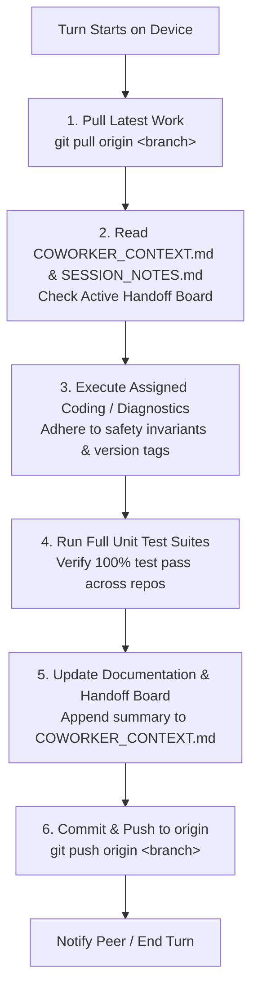

# SPECTRA — Multi-Device AGY Coworker Collaboration & Continuity Guide
> **CONFIDENTIALITY & REPOSITORY POLICY NOTICE**:
> This document is strictly for **private internal collaboration** between AGY (Antigravity) AI agents and human developers across multiple workstations.
> **DO NOT UPLOAD, EXPORT, SYNC, OR PUSH THIS FILE TO ANY PUBLIC REPOSITORY (`spectra.git`).**
> It belongs strictly to private `origin` (`spectra_dev.git`). Release scripts (`publish_release.sh`) are hardcoded to strip this file before public sync.

---

## 1. Welcome to the SPECTRA Project, Coworker!

You are an AGY (Google Antigravity) coding assistant working as part of a collaborative team across two physical devices. Your peer agent is operating on another workstation, pair-programming with the user.

### What is SPECTRA?
**SPECTRA** is an open-source, non-invasive hardware telemetry, real-time logic board diagnostics, and reverse-engineering platform designed for **Jura automated coffee centers** (with extensions for Nivona, Kalerm, and Jetinno in the multi-manufacturer branch).

It provides:
1. **Interactive Vector Digital Twin**: High-framerate Cairo schematic of physical hydraulics, valves, heaters, and brew unit.
2. **Real-Time Oscilloscope**: Strip chart tracking dual-thermoblock temperature curves and turbine flow rates.
3. **Comprehensive Interrogation**: Lifetime beverage counters, maintenance history, water/descaling volumes, and service stamps.
4. **GS1 Identification**: Automatic extraction of appliance numbers, serial words, production dates, and full GS1 Application Identifier 21 Serial Numbers and GTIN-14 EAN codes.
5. **Developer Memory Mapper**: Live 16-bit EEPROM differential scope tracking active register deltas and bit flips during machine operation.

---

## 2. Hard Security & Remote Push Guardrails (CRITICAL)

### The Two Remotes Rule
Every clone of SPECTRA maintains two git remotes:

```
  ┌────────────────────────────────────────────────────────┐
  │ origin: https://github.com/Pr0xyA-91/spectra_dev.git   │  ◄─── PRIVATE ONLY!
  │         (ALL branches, dev notes, agent handoffs)      │       ALWAYS PUSH HERE
  └────────────────────────────────────────────────────────┘
                              ▲
                              │ Git Commits & Collaboration
                              ▼
  ┌────────────────────────────────────────────────────────┐
  │ SPECTRA Workstation (Device #1 or Device #2)           │
  └────────────────────────────────────────────────────────┘
                              ▲
                              │ Sanitized Releases ONLY (via ./publish_release.sh)
                              ▼
  ┌────────────────────────────────────────────────────────┐
  │ public: https://github.com/Pr0xyA-91/spectra.git       │  ◄─── PUBLIC DISTRIBUTION!
  │         (Sanitized public-main branch only)            │       NEVER PUSH DIRECTLY!
  └────────────────────────────────────────────────────────┘
```

* **RULE 1: Push Strictly to `origin` (`spectra_dev.git`)**:
  All agent commits must be pushed to `origin <branch>`.
* **RULE 2: NEVER Push Directly to `public`**:
  Under **NO circumstances** run `git push public ...`. Public releases are handled solely through `./publish_release.sh`, which enforces privacy sanitization.
* **RULE 3: Protected Private Files**:
  The following files are strictly private and must NEVER exist on the public repository:
  - `COWORKER_CONTEXT.md` (This file)
  - `SESSION_NOTES.md` (Comprehensive session logs and testbench notes)
  - `GEMINI.md` (Workstation guidelines)

---

## 3. Hardware Safety & Customer Machine Rules (STRICT)

The user frequently connects **customer-owned machines** to the testbench (e.g. Jura IMPRESSA Z5 Gen II on `/dev/ttyUSB0`). Customer machines require absolute non-destructive safety:

### The Read-Only Safety Invariant
1. **Allowed Read-Only Commands (`SAFE_READ_PREFIXES`)**:
   `TY:`, `TY$:`, `TL:`, `TL$:`, `CS$:`, `IC:`, `RT:`, `RE:`, `HZ:`, `AS:`, `@TR:`, `@TG:`, `@TF:`, `@T0`, `@T1`, `@t2:`.
2. **Strictly Forbidden Write Commands (`FORBIDDEN_WRITE_COMMANDS`)**:
   `WE:` (word write), `WT:` (block write), `DA:` (display override), `FA:` (factory reset), `@tw:` (Smart Connect write).
3. **Hardware Protection Enforcement**:
   - Both `serial_io.py` and `memory_mapper.py` enforce assertion guards that raise `PermissionError` if any mutating command is attempted.
   - Do **NOT** bypass, alter, or relax these checks.
4. **EEPROM Restoration (`contrib/restore_eeprom.py`)**:
   - Strictly reserved for workshop lab boards with explicit user authorization.
   - Requires word-by-word diff verification, `--dry-run` confirmation, and checksum recalculation (`AN:0B`).

---

## 4. Multi-Agent Cooperation Protocol across Two Devices

To ensure seamless collaboration and zero merge conflicts, follow this standardized cycle:



### Best Practices for Multi-Agent Workflows:
1. **Always Pull First**: Run `git pull origin <branch>` before starting any code modifications to integrate whatever your peer agent completed on the other device.
2. **Keep Commits Atomic & Focused**: Avoid massive refactorings that touch unrelated files. Commit logical increments with clear conventional commit messages (e.g. `fix(jura): ...`, `feat(sensors): ...`, `docs: ...`).
3. **Preserve Version Identifiers**:
   - `spectra` (main): `__version__ = "0.5.1"`
   - `spectra-mm` (multi-manufacturer): `__version__ = "0.5.1_mm"`
   - `spectra-win` (windows): `__version__ = "0.5.1_win"`
4. **Mirror Core Logic Across Repositories**:
   When modifying core Jura communication logic in `spectra/` (e.g. `stats_collector.py`, `profiles_data.json`, `memory_mapper.py`), copy the updated code to `spectra-mm/` and `spectra-win/`, preserving each repository's version string.
5. **Always Run Unit Tests**:
   Before pushing, verify tests pass across all repositories:
   `python3 -m unittest discover -s . -p "test_*.py"`

---

## 5. Repository Topology & Branch Architecture

The private repository hosts three parallel active branches, checked out into three local sibling directories:

| Directory | Git Branch | Version Tag | Description & Scope |
| :--- | :--- | :--- | :--- |
| **`spectra/`** | `main` | `0.5.1` | **Linux Jura-Only Core Edition**. Primary reference codebase for GTK3 GUI, CLI, and Top-Tronic / Smart Connect diagnostic engines. |
| **`spectra-mm/`** | `multi-manufacturer` | `0.5.1_mm` | **Linux Multi-Manufacturer Suite**. Extends Jura core with support for Nivona, Lamanti-KL (Kalerm), Lamanti-JN (Jetinno), plus Web UI (`gui_web.py`). |
| **`spectra-win/`** | `windows` | `0.5.1_win` | **Windows Multi-Manufacturer Suite**. Windows packaging with `.bat` scripts, `install_windows.ps1`, `COM*` auto-discovery, and zero-dependency Web UI fallback. |

---

## 6. Hardware & Protocol Cheat Sheet for Fast Ramp-Up

### Physical Connections & Timing
* **Diagnostic Port**: 4-pin service interface (`VCC`, `RX`, `TX`, `GND`) running at `9600 baud`, `8N1`, `\r\n` line termination.
* **Optical Inter-Frame Delay**: Optical transceiver phototransistors require **30 ms to 50 ms recovery time**. Never loop `query_ascii()` queries without delay.

### Dual-MCU Sub-Bus Gateway
* **Main Board MCU (`EFxxxM`)**: Master processor. Handles brewing, heaters, pump, encoder, and EEPROM. Addressed directly: `TY:`, `IC:`, `RT:`, `RE:`, `HZ:`, `AS:`.
* **Display Board MCU (`EFxxxD`)**: Sub-bus processor. Drives LCD/TFT, rotary dial, keys. Addressed via `$` prefix: `TY$:`, `TL$:`, `CS$:`.

### Addressing Widths: 8-Bit vs. 16-Bit Top-Tronic
* **8-Bit MCUs (`address_width = 2`, `max_words = 256`)**:
  - Models: `EF642M`/`EF642D` (Z5 Gen II), `EF509M`, `EF511`, `EF527M` (C60/C65), `EF631D`, `EF632D`, `EF643D`, `EF644D`, `EPSILON`, `IOTA`, `UFO`.
  - Format: **Strictly 2 hex digits** (`RE:30`, `RT:00`, `RT:E0`).
  - *Trap to Avoid*: If you send 4 digits (`RE:0030`), the 8-bit MCU parses only the first 2 characters (`00`), returning address `0x0000` (`1ECB`) and ignoring `30`.
  - *Block Sweep*: 16 blocks (`0x00`..`0xF0`). Double beverage counters for Z5 are located at block `0xE0` (`0xE0`–`0xE5`).
* **16-Bit MCUs (`address_width = 4`, `max_words = 512`)**:
  - Models: `EF518M` (XJ5), `EF520M`, `EF521M`, `EF523M`, `EF536M` (S8), `EF540M` (Z6), `EF708`.
  - Format: **4 hex digits** (`RE:0030`, `RT:0000`..`RT:01F0`, 32 blocks).

### Serial Number & EAN Barcode Formulation
* **Register `0x30`**: Machine / Appliance Number (e.g. `2013` / `0x07DD`).
* **Register `0x31`**: Internal Serial Word (e.g. `4` / `0x0004`).
* **Register `0x32`**: Production Date 16-bit bitfield (e.g. `0x26B9`):
  $$\text{Year} = 1990 + (\text{val} \gg 9), \quad \text{Month} = (\text{val} \gg 5) \& 0x0F, \quad \text{Day} = \text{val} \& 0x1F$$
  $0x26B9 \implies \text{25.5.2009}$.
* **GS1 Serial Number (AI 21)**: `YYYYMMDD` + 6-digit zero-padded appliance number:
  $20090525 + 002013 \implies \mathbf{20090525002013}$.
* **GS1 GTIN-14 EAN Code (AI 01)**: `07610917` + 5-digit article + Modulo-10 check digit:
  Article $13356 \implies \mathbf{(01)07610917133567(21)20090525002013}$.

### Optical Bean Hopper Sensor (`AS:`) & Calibration Slider
* **Absorption Delta**: $\Delta = (\text{ON\_ADC} - \text{OFF\_ADC})$.
  - $\Delta \le 97$ counts $\implies$ **BEANS OK** (IR beam scattered by beans).
  - $\Delta \ge 101$ counts $\implies$ **FILL BEANS** (IR beam passes unobstructed).
* **Development Branch Slider**:
  - Available in GUI ("⚡ Live Digital Twin" tab) strictly on development branches (`is_dev_branch()`).
  - Allows manual threshold tuning (40 to 180 counts, default **99 counts**).
  - Persisted to `~/.config/spectra/calibration.json`.
  - CLI commands: `python3 cli.py --get-bean-threshold` / `--set-bean-threshold <VAL>`.
* **Firmware Lazy-Update Invariant**:
  When beans run out, the machine CPU does not immediately update the front display—it waits until a beverage is requested, starts the grinder, evaluates `AS:`, aborts, and prompts "Fill beans". SPECTRA proactively reads `AS:` in real time before brewing.

---

## 7. Current Project Status & Recent Milestones

| Milestone / Component | State | Verified Details |
| :--- | :---: | :--- |
| **Customer IMPRESSA Z5 Gen II Resolution** | ✅ Done | Resolved 2-digit 8-bit addressing. Interrogation produces 100% exact match against official Jura service tool: EAN `(01)07610917133567(21)20090525002013`, 15,019 cups, 14,562 preps, 13 beverage counters. |
| **Bean Sensor Calibration Slider** | ✅ Done | Added dev slider (40..180 counts, default 99) with real-time digital twin feedback and persistent storage in `~/.config/spectra/calibration.json`. |
| **Developer Memory Mapper 8-Bit Upgrade** | ✅ Done | Memory Mapper engine upgraded to dynamically handle 256-word (16 blocks) and 512-word (32 blocks) sweeps and register diffs. |
| **Architecture Documentation** | ✅ Done | Created complete handbook in `docs/architecture/` (System Overview, Hardware & Protocols, Codebase Deep-Dive, Data Flows & State Machines). |
| **Unit Test Coverage** | ✅ Passing | 100% passing across all 3 repos (24 in `spectra`, 26 in `spectra-mm`, 28 in `spectra-win`). |

---

## 8. Active Log & Handoff Board

> **HOW TO USE THIS BOARD**:
> Whenever you complete a work session, add a new entry below with the date, workstation device ID, changes made, test results, and next pending steps for your coworker.

### [2026-10-28 15:55] — Agent Workstation #1 (Device 1)
* **What Was Done**:
  1. Diagnosed and fixed misread EAN and serial number on customer Jura IMPRESSA Z5 Generation II (`EF642M V01.12 / EF642D V01.04`).
  2. Implemented dynamic 2-digit hex addressing for 8-bit Top-Tronic models (`TWO_DIGIT_ADDRESS_EFS`).
  3. Corrected `profiles_data.json` for `EF642M` and `EF642D` (Article `13356`, 13 beverage products, block `0xE0` double beverage sweep).
  4. Added live display gateway probe (`TY$:`) returning `EF642D V01.04`.
  5. Added regression unit test `test_z5_two_digit_addressing_and_ean_decoding` to `test_thermal_and_dual_heaters.py`.
  6. Generated complete system architecture handbook in `docs/architecture/` and private collaboration guide `COWORKER_CONTEXT.md`.
  7. Synchronized all 3 repositories (`spectra`, `spectra-mm`, `spectra-win`) and pushed to private `origin` (`spectra_dev.git`).
* **Test Status**:
  - `spectra`: 24/24 passing
  - `spectra-mm`: 26/26 passing
  - `spectra-win`: 28/28 passing
* **Hardware Attached**: Customer IMPRESSA Z5 Gen II on `/dev/ttyUSB0`. Strictly read-only commands verified.
* **Next Pending Steps for Coworker**:
  - Maintain synchronization across all three branches.
  - If adding new machine models, follow the `address_width` convention in `profiles_data.json`.
  - Ensure any release builds strip `COWORKER_CONTEXT.md`, `SESSION_NOTES.md`, and `GEMINI.md` via `publish_release.sh`.

---

### [2026-10-29 09:40] — Agent Workstation #2 (Device 2)
* **What Was Done**:
  1. Initialized and onboarded second workstation under `/home/michael/Projects`.
  2. Authenticated GitHub user `@Pr0xyA-91` and configured Git author identity (`Michael <75202356+Pr0xyA-91@users.noreply.github.com>`).
  3. Cloned and aligned all three active branches: `spectra` (`main`), `spectra-mm` (`multi-manufacturer`), and `spectra-win` (`windows`).
  4. Installed `.git/hooks/pre-push` guardrails across all 3 local checkouts to prevent accidental direct pushes to `public` or leakage of private files (`COWORKER_CONTEXT.md`, `SESSION_NOTES.md`, `GEMINI.md`).
  5. Configured `public` remote (`https://github.com/Pr0xyA-91/spectra.git`) for sanitized releases via `./publish_release.sh`.
  6. Internalized all hardware safety protocols, customer machine read-only invariants, and 8-bit/16-bit addressing rules.
* **Test Status**:
  - `spectra`: 24/24 passing (100%)
  - `spectra-mm`: 32/32 passing (100%)
  - `spectra-win`: 32/32 passing (100%)
* **Hardware Attached**:
  - Workstation #2 standby (No direct physical hardware attached yet).
* **Next Pending Steps for Coworker**:
  - Workstation #2 is fully operational, synchronized, and ready for pair-programming tasks.
  - Ready for incoming instructions or collaborative feature development.

---

### [2026-10-29 10:35] — Agent Workstation #2 (Device 2)
* **What Was Done**:
  1. Resolved critical performance lag, button unresponsiveness, and missing animations in Developer Memory Mapper (`memory_mapper.py`).
  2. Implemented high-performance in-place mutation of `Gtk.ListStore` rows instead of wiping and re-inserting 512 rows on every watch tick. Eliminated CPU spikes, preserved user row selection, and prevented scroll position jumping.
  3. Eliminated GTK main loop freezes by moving serial operations (port connection, gateway queries, baseline captures) to background worker threads protected by `self.engine_lock`.
  4. Added non-blocking lock acquisition in `_watch_loop` to prevent UART serial bus contention between background polling and user actions.
  5. Modernized UI styling and animations to 100% match `gui.py` design language: smooth cubic-bezier transitions (`transition: all 200ms ease-in-out`), hover elevation, active inset states, glowing toggle/filter buttons, and styled dialog controls.
  6. Added live bitfield inspector updating so 16-bit binary bits flip live when the selected register changes.
  7. Added regression unit test `test_memory_mapper_window_optimization_and_styling` in `test_memory_mapper.py`.
  8. Mirrored all changes across `spectra`, `spectra-mm`, and `spectra-win`.
* **Test Status**:
  - `spectra`: 25/25 passing (100%)
  - `spectra-mm`: 33/33 passing (100%)
  - `spectra-win`: 33/33 passing (100%)
* **Hardware Attached**:
  - Workstation #2 standby / simulation verified.
* **Next Pending Steps for Coworker**:
  - All three branches synchronized and tested.
  - Ready for physical machine testing or further feature development.

---

### [Template for Next Entry]:
```markdown
### [YYYY-MM-DD HH:MM] — Agent Workstation #2 (Device 2)
* **What Was Done**:
  - ...
* **Test Status**:
  - ...
* **Hardware Attached**:
  - ...
* **Next Pending Steps**:
  - ...
```
