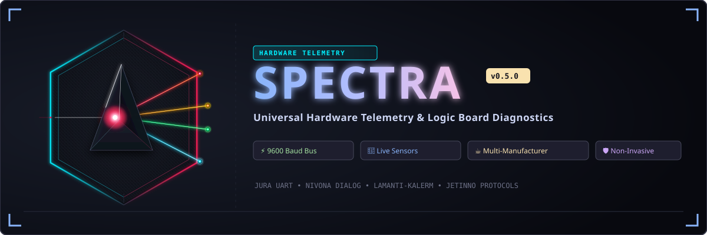
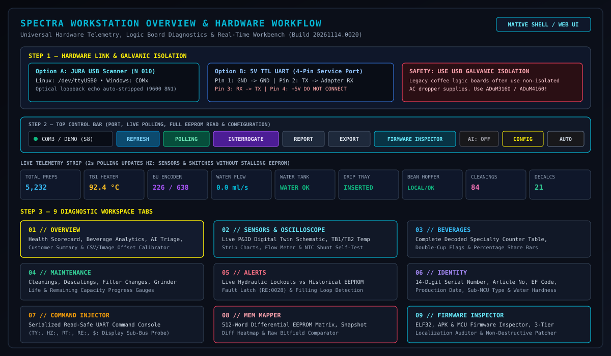
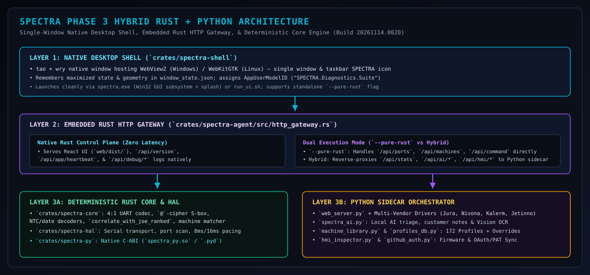

# SPECTRA — Universal Hardware Telemetry & Logic Board Diagnostics (Windows Edition)

<p align="center">
  
</p>

[](https://github.com/Pr0xyA-91/spectra)
[](https://www.python.org/downloads/)
[](https://www.rust-lang.org/)
[](https://developer.microsoft.com/en-us/microsoft-edge/webview2/)
[](LICENSE)
[](https://www.microsoft.com/windows)

> [!NOTE]
> **Project Status: Build 20261114.0020 (Windows Standalone Multi-Manufacturer & Phase 3 Rust Hybrid Suite)** — Cross-platform Telemetry Engine.
> **SPECTRA** is an extensible appliance hardware telemetry and logic board diagnostic platform supporting **Jura**, **Nivona**, **Lamanti-KL (Kalerm)**, and **Lamanti-JN (Jetinno)** across Windows 10/11 and Linux.
> Includes native Win32 offline installer (`dist/spectra_setup.exe`), fast in-place updater (`dist/spectra_update.exe`), standalone GUI launcher (`bin/spectra.exe`), single-window native WebView2 host (`bin/spectra-shell.exe` + `bin/WebView2Loader.dll`), compiled Rust Python extension (`bin/spectra_py.pyd`), and the 5-crate Rust workspace (`crates/spectra-shell`, `spectra-agent`, `spectra-core`, `spectra-hal`, `spectra-py`).

---

## 📖 Documentation & Illustrated Guides

- **[Illustrated Operator & Field Technician Guide (`docs/USER_GUIDE.md`)](docs/USER_GUIDE.md)** — Step-by-step visual guide for Windows/Linux operation, Local AI installation & model pulling, fixing EEPROM offsets from J.O.E. CSV or screenshots, managing the 172-machine library, and connecting GitHub.
- **[Jura EEPROM & Sub-Bus Memory Map (`docs/JURA_MEMORY_MAP.md`)](docs/JURA_MEMORY_MAP.md)** — Register-level hardware protocol documentation (`RT:`, `RE:`, `HZ:`, `CS:`, `AS:`, `$:` display sub-bus).
- **[Field Capture & J.O.E. Correlation Guide (`docs/FIELD_CAPTURE_GUIDE.md`)](docs/FIELD_CAPTURE_GUIDE.md)** — Capturing anonymized dumps for new models.
- **[Release Changelog (`CHANGELOG.md`)](CHANGELOG.md)** — Full build history and diff summary.

<p align="center">
  <a href="docs/USER_GUIDE.md">
    
  </a>
</p>

---

## 🌟 Overview

The legacy coffee service tools (from 2016 and earlier) were built around 32-bit Windows, lacked support for modern electronic architectures, and only recognized obsolete machines with frozen databases. Newer appliances trigger protocol rejections, encrypted handshake requirements, or locked logic boards.

**SPECTRA** runs natively on modern 64-bit Windows (Windows 10 / 11) with zero terminal windows or script dependency headaches:
1. **Jura Diagnostics Engine**: Plain-ASCII optical transceiver protocol (`RT:`, `RE:`, `CS:`, `IC:`, `HZ:`) and modern encrypted Smart Connect `@`-protocol cipher (`0xDB` wire carrier modulation & challenge-response handshake).
2. **Nivona CafeRomatica Driver**: Native support for NICR 5xx/6xx/7xx/8xx/9xx/10xx and NIVO 810x series.
3. **Lamanti-KL (Kalerm Platform) Driver**: Diagnostics and live telemetry for Kalerm K95, KLM1601/2601, and commercial platforms.
4. **Lamanti-JN (Jetinno Platform) Driver**: Commercial HORECA telemetry for Jetinno JLTT, JL08, JL10, JL15, JL28, and JL500 vending series via binary framing and CRC16 validation.
5. **Phase 3 Hybrid Rust Architecture**: Single-window WebView2 shell (`spectra-shell.exe`), embedded async Rust HTTP/1.1 gateway (`spectra-agent`), deterministic Rust protocol/math codecs (`spectra-core` / `spectra-hal`), and precompiled Windows Python extension (`bin/spectra_py.pyd`).
6. **Native Win32 Installers**: Compiled cleanly with Zig + LLVM-RC, embedding the Python 3.12 64-bit runtime, PySerial, `certifi`, WebView2 host, and Start Menu / Desktop shortcuts.

<p align="center">
  
</p>

---

## ✨ Features

- **Single-Window Native WebView2 App (`spectra.exe` -> `spectra-shell.exe`)**:
  - Eliminates multiple/stray background processes and console popups, displays the official SPECTRA icon in window titlebars and the Windows taskbar (`SetCurrentProcessExplicitAppUserModelID("SPECTRA.Diagnostics.Suite")`), opens maximized on first launch, and remembers window state in `%APPDATA%\SPECTRA\window_state.json`.
  - Supports **`spectra-shell.exe --pure-rust`** for lightweight standalone Rust operation without spawning a Python sidecar.
- **Offline Installer & Fast In-Place Updater**:
  - `dist/spectra_setup.exe`: Full standalone offline Windows installer bundle (~50 MB).
  - `dist/spectra_update.exe`: Fast in-place updater (~29 MB) upgrading existing `%LOCALAPPDATA%\Programs\SPECTRA` installations.
- **9-Tab Diagnostic Workstation**:
  - `01 // OVERVIEW`: Scorecard, beverage mix analytics, opt-in Local AI Bench Triage & Customer Summary, and inline CSV/screenshot Offset Calibrator.
  - `02 // SENSORS & OSCILLOSCOPE`: Live P&ID Digital Twin, `TB1`/`TB2` temperature oscilloscope, flow rate monitor, and `AS:` NTC shunt self-test.
  - `03 // BEVERAGES`, `04 // MAINTENANCE`, `05 // ALERTS`, `06 // IDENTITY`, `07 // COMMAND INJECTOR`, `08 // MEM MAPPER` (read-only differential EEPROM & raw sensor scope), `09 // FIRMWARE INSPECTOR` (`ELF32`/`APK`/`MCU .bin`).
- **Default-OFF Local AI Suite (`CONFIG -> Local AI & Models`)**:
  - Consumes `0 MB RAM` until enabled; automatically downloads a user-space portable engine into `%LOCALAPPDATA%\SPECTRA\ollama\` using native Windows TLS / SChannel verification (`tls_utils.py`) and pulls `qwen2.5:0.5b`, `gemma3:1b`, `gemma2:2b`, or vision-capable `gemma3:4b`.
- **CSV / Screenshot Offset Calibrator & 172-Machine Library (`machine_library.py`)**:
  - Correlates J.O.E. CSVs, legacy diagnostic CSVs, or screenshots against live EEPROM (`correlate_with_joe_ranked`), applies local overrides (`Local Override > Verified Spec > Built-in Profile`), and exports/imports portable `.spectra-offset.json` patches.
- **Opt-In GitHub Account Sync (`CONFIG -> GitHub Connection`)**:
  - Authenticates via OAuth 2.0 Device Flow, Personal Access Token (`public_repo` + `gist`), or CLI environment variables for one-click submissions to `Pr0xyA-91/spectra-captures`.
- **Focused Native Windows File Dialogs**: Native `GetSaveFileNameW` / `GetOpenFileNameW` dialogs open focused above the SPECTRA window for `.txt`, `.json`, `.csv`, and `.spectra-offset.json` exports.

---

## 🪟 Windows Quick Start (Windows 10 / 11)

### Option 1: Native Offline Installer (Recommended)
1. Run **`dist/spectra_setup.exe`**.
2. The installer automatically extracts to `%LOCALAPPDATA%\Programs\SPECTRA`, registers Start Menu shortcuts, and creates a clean uninstaller in Windows *Settings > Installed apps*.
3. Launch **SPECTRA** from the Start Menu or desktop shortcut.
4. When newer builds release, run **`dist/spectra_update.exe`** to update your existing installation in place.

### Option 2: Portable Standalone Executable & CLI Flags
Run **`bin/spectra.exe`** directly from any folder or USB drive *(keep `bin/spectra-shell.exe`, `bin/WebView2Loader.dll`, and `bin/spectra_py.pyd` alongside if running standalone)*:
```cmd
:: Launch standalone desktop GUI
bin\spectra.exe

:: Open in system web browser instead of native WebView2 shell
bin\spectra.exe --browser

:: Command-Line Interface (CLI)
bin\spectra.exe --cli --list-ports
bin\spectra.exe --cli --demo --demo-model S8
bin\spectra.exe --cli -p COM3 --sensors
```

### Option 3: Developer / Python Environment
```cmd
python -m pip install -r requirements-win.txt
python spectra_app.py
```

---

## 🏗️ Phase 3 Hybrid Rust Architecture

SPECTRA combines a 5-crate Rust workspace with Python domain orchestrators:

| Crate | Purpose | Core Responsibilities |
|---|---|---|
| [`crates/spectra-shell`](crates/spectra-shell) | Native Desktop Shell | `tao` + `wry` WebView2 desktop host, pure-Rust `.ico` RGBA icon loader, Windows AppUserModelID, persistent `window_state.json`, Python sidecar supervisor & `--pure-rust` mode. |
| [`crates/spectra-agent`](crates/spectra-agent) | Embedded HTTP Gateway & Daemon | Async Rust HTTP/1.1 control plane (`http_gateway.rs`) serving `web/dist/`, `/api/version`, `/api/app/heartbeat`, `/api/debug/*`, native `--pure-rust` routes (`/api/ports`, `/api/machines`, `/api/command`), and loopback sidecar reverse-proxy. |
| [`crates/spectra-core`](crates/spectra-core) | Protocol & Calibration Core | Zero-allocation byte-level state machine, 4:1 UART codec, `@`-cipher encoder/decoder, 0.1 °C NTC/date decoders, `correlate_with_joe_ranked`, machine matching, and differential EEPROM mapper. |
| [`crates/spectra-hal`](crates/spectra-hal) | Hardware Abstraction Layer | Win32 & POSIX serial driver, `tokio-serial` async UART transport, cross-platform COM port discovery, and Android ADB `/dev/ttyS*` bridge. |
| [`crates/spectra-py`](crates/spectra-py) | PyO3 Native Extension | Precompiled native extension (`bin/spectra_py.pyd` on Windows, `spectra_py.so` on Linux). |

---

## 🔌 Hardware Connection Guide (Windows COM Ports)

> [!CAUTION]
> **Galvanic Isolation Required on Direct UART Connections**: Legacy coffee appliance boards often run capacitive/non-isolated Mains dropper power supplies, leaving serial `GND` live relative to Earth. Always use an optical transceiver (`JURA USB Scanner N 010`) or insert an **`ADuM3160` / `ADuM4160` USB isolator** between your computer and any 5V USB-to-UART adapter.

### Option A: Official JURA USB Scanner (N 010)
Connect the USB scanner to any USB port. Windows automatically assigns a `COM*` port (e.g. `COM3`). Attach the optical head to the machine's front optical port.

### Option B: 5V USB-to-UART Adapter (FTDI FT232R, CP2102, CH340)
For machines with internal or external 4-pin service ports:
- **Baud Rate**: `9600 Baud`, 8 Data Bits, No Parity, 1 Stop Bit (`9600 8-N-1`).
- **Signal Logic**: 5V TTL UART.
- **Pinout (typical 4-pin port)**:
  - Pin 1: `GND` $\rightarrow$ Adapter `GND`
  - Pin 2: `TX` (out of machine) $\rightarrow$ Adapter `RX`
  - Pin 3: `RX` (into machine) $\rightarrow$ Adapter `TX`
  - Pin 4: `+5V VCC` $\rightarrow$ *(Leave disconnected if using USB adapter to prevent ground loops)*.

---

## 📁 Repository Structure

```
.
├── bin/                        # Precompiled PE32+ binaries (spectra.exe, spectra-shell.exe, spectra_py.pyd, WebView2Loader.dll)
├── dist/                       # Native Windows offline installer & updater (spectra_setup.exe, spectra_update.exe)
├── src_launcher/               # Native Win32 C sources, resources, and Zig build script
├── Cargo.toml                  # Rust hybrid workspace manifest
├── crates/
│   ├── spectra-shell/          # Native WebView2 desktop shell
│   ├── spectra-agent/          # Embedded HTTP/1.1 gateway & WS broadcaster
│   ├── spectra-core/           # Protocol state machine, cipher & J.O.E. correlator
│   ├── spectra-hal/            # Win32 & POSIX serial async transport
│   └── spectra-py/             # PyO3 native extension (spectra_py.pyd / .so)
├── drivers/                    # Unified multi-manufacturer driver suite
│   ├── base.py                 # Common appliance driver abstraction
│   ├── jura/                   # Jura optical & Smart Connect driver
│   ├── nivona/                 # Nivona CafeRomatica driver
│   ├── lamanti_kl/             # Lamanti Kalerm platform driver
│   └── lamanti_jn/             # Lamanti Jetinno HORECA driver
├── web/                        # 9-Tab React + Vite Workstation UI
│   ├── src/                    # Components (Workstation, ConfigModal, MemMapper, HMI)
│   └── dist/                   # Production compiled UI bundle
├── spectra_app.py              # Standalone desktop supervisor & window launcher
├── web_server.py               # Python domain backend API server (ThreadingHTTPServer)
├── cli.py                      # Command-line interface runner
├── stats_collector.py          # Telemetry orchestrator & report exporters
├── spectra_ai.py               # Default-OFF Local AI triage, summary & Vision OCR
├── machine_library.py          # Unified 172-machine catalog & offset patch resolver
├── profiles_db.py              # Machine profile database & local override store
├── profiles_data.json          # Built-in database of 172 machine profiles
├── hmi_inspector.py            # Universal ELF/APK/MCU firmware auditor & AI runtime installer
├── github_auth.py              # GitHub Device Flow, PAT & keyring/0600 credential manager
├── tls_utils.py                # Cross-platform TLS root cert & Windows SChannel resolver
├── memory_mapper.py            # Differential EEPROM memory mapper & logic scope
├── spectra_probe.py            # Field capture & J.O.E. auto-correlator
├── docs/                       # Operator manual, diagrams & protocol documentation
│   ├── USER_GUIDE.md           # Illustrated operator & technician guide
│   ├── images/                 # SVG architectural & workflow diagrams
│   ├── JURA_MEMORY_MAP.md      # Master EEPROM & telemetry register map
│   ├── FIELD_CAPTURE_GUIDE.md  # Field telemetry capture workflow
│   └── models/                 # Verified model-specific hardware specifications
├── CHANGELOG.md                # Release changelog (tracked by Build YYYYMMDD.HHMM)
├── DEPENDENCIES.md             # Runtime requirements & dependency reference
├── LICENSE                     # MIT License
└── README.md                   # Unified Windows platform documentation
```

---

## 📜 Credits & Acknowledgements

This project builds upon the shared knowledge, protocol analysis, and reverse-engineering contributions of the open-source coffee telemetry and home automation community:

- **CM-P ([jura-coffee-machine](https://github.com/CM-P/jura-coffee-machine))**: Foundational documentation and reverse-engineering of the Jura optical port, cleartext command structure (`TY:`, `RT:`, `RE:`, `AN:`, `FA:`), baud timing, and optical pinout mapping.
- **Hajo Noerenberg ([hn/jura-coffee-machine](https://github.com/hn/jura-coffee-machine)) & c't Magazin / Heise ("Kaffeemaschine gehackt")**: Pioneer research on Jura optical transceivers, `cmd2jura` bit-banging gateway routines, and embedded serial communication.
- **Jutta-Proto Project ([Jutta-Proto/protocol-cpp](https://github.com/Jutta-Proto/protocol-cpp))**: C++ reverse-engineering and protocol implementations for optical/serial and modern Bluetooth/WiFi Smart Connect communication, de-obfuscation layers, and technician test modes.
- **Ryan Alden ([ryanalden/esphome-jura-component](https://github.com/ryanalden/esphome-jura-component))**: ESPHome Jura component research for physical contact monitoring, microswitch status bit decoding, tray/tank alerts, and home automation integration.
- **AlexxIT ([AlexxIT/Jura](https://github.com/AlexxIT/Jura))**: Home Assistant custom component researching Jura Bluetooth communication, GATT protocols, and command framing.
- **makefu ([makefu/jura-connect-hass](https://github.com/makefu/jura-connect-hass)) & `jura-connect` researchers**: Reverse-engineering of Jura Wi-Fi protocol, status alert bitfields (`@TF:`), beverage parameter structures, and live maintenance indicators.
- **Otto Winter & the [ESPHome](https://esphome.io/) Project**: Research and implementation of embedded Jura UART communication and protocol timing.
- **tinaught ([Jura-Coffee-Machine-Home-Assistant](https://github.com/tinaught/Jura-Coffee-Machine-Home-Assistant)) & bpeoples**: Home Assistant integration, EEPROM word mapping, and beverage counter offsets.
- **Smart Connect Protocol Researchers**: Reverse-engineering of modern Jura bus communication, 4:1 wire carrier modulation (`0xDB` base byte), and dongle challenge-response handshake sequence.
- **Dangerous Prototypes**: Creators of the Bus Pirate hardware tool used for multi-protocol bus debugging.
- **Google Antigravity (Agy / DeepMind)**: Advanced reverse-engineering, 3-layer Rust hybrid workspace, dynamic Brew Unit position tracking, optical infrared bean hopper sensor (`AS:`) decoding, real-time multi-manufacturer telemetry architectures, and Windows cross-platform implementation.
- **Kaffee-Welt & Kaffeevollautomaten Forum communities**: Pioneer technician insights into the classic Jura filling loop (*"System füllen Endlosschleife"*), thermoblock NTC temperature registers, and hydraulic diagnostic fault codes.

---

## 📄 License

This project is licensed under the [MIT License](LICENSE).
