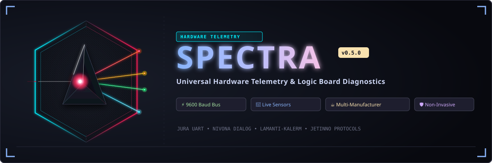

# SPECTRA — Universal Hardware Telemetry & Logic Board Diagnostics

<p align="center">
  
</p>

[](https://github.com/Pr0xyA-91/spectra)
[](https://www.python.org/downloads/)
[](https://www.rust-lang.org/)
[](https://www.gtk.org/)
[](LICENSE)
[](https://kernel.org)

> [!NOTE]
> **Project Status: Build 20261102.1605 (Windows Multi-Manufacturer & Rust Hybrid Suite)** — Cross-platform Telemetry Engine.
> **SPECTRA** is an extensible appliance hardware telemetry and logic board diagnostic engine supporting **Jura**, **Nivona**, **Lamanti-KL (Kalerm)**, and **Lamanti-JN (Jetinno)** across Windows and Linux.
> Includes native PE32+ offline installer (`dist/spectra_setup_build20261102.1605.exe`), fast in-place updater (`dist/spectra_update_build20261102.1605.exe`), standalone launcher (`bin/spectra.exe`), and the 3-layer Rust hybrid workspace (`crates/spectra-hal`, `spectra-core`, `spectra-agent`, `spectra-py`).

---

## 🌟 Overview

The legacy coffee service tools (from 2016 and earlier) were built around 32-bit Windows, lacked support for modern electronic architectures, and only recognized obsolete machines with frozen databases. Newer appliances trigger protocol rejections, encrypted handshake requirements, or locked logic boards.

**SPECTRA** runs natively on modern 64-bit Windows (Windows 10 / 11) with zero external script or dependency headaches:
1. **Jura Diagnostics Engine**: Plain-ASCII optical transceiver protocol (`RT:`, `RE:`, `CS:`, `IC:`, `HZ:`) and modern encrypted Smart Connect `@`-protocol cipher.
2. **Nivona CafeRomatica Driver**: Native support for NICR 5xx/6xx/7xx/8xx/9xx/10xx and NIVO 810x series.
3. **Lamanti-KL (Kalerm Platform) Driver**: Diagnostics and live telemetry for Kalerm K95, KLM1601/2601, and commercial platforms.
4. **Lamanti-JN (Jetinno Platform) Driver**: Commercial HORECA telemetry for Jetinno JLTT, JL08, JL10, JL15, JL28, and JL500 vending series via binary framing and CRC16 validation.
5. **3-Layer Rust Hybrid Architecture**: Ultra-low-latency HAL, deterministic protocol parsing, Tauri v2 async backend, and native PyO3 C extension (`spectra_py.so`).
6. **Native Win32 PE32+ Installers**: Compiled with Zig and LLVM-RC, embedding isolated Python 3.12 64-bit runtime, PySerial, and all diagnostic engines with automated Start Menu shortcuts and uninstallers.

---

## ✨ Features

- **Native Windows Standalone Launcher (`bin/spectra.exe`)**: Single-file executable with embedded runtime. Double-clicking automatically spins up the Web UI and opens your browser; passing CLI flags executes command-line routines.
- **Offline Installer & Fast In-Place Updater**:
  - `dist/spectra_setup_build20261102.1605.exe`: Full offline installer bundle (44 MB).
  - `dist/spectra_update_build20261102.1605.exe`: Fast in-place application updater (884 KB).
- **5 Interactive UI Paradigms & Web Workstation**:
  - **Engineering Telemetry**: High-density gauges, strip charts, and component state trees.
  - **Industrial Process**: Piping & Instrumentation (P&ID) schematics with active solenoid/heater animations.
  - **Executive KPI**: High-level maintenance readiness, beverage yields, and lifecycle summaries.
  - **Diagnostic Scopes**: Real-time temperature oscilloscope and live hydraulic flow rate monitoring.
  - **Memory Matrix**: Real-time EEPROM memory cell viewer with byte-by-byte differential heatmaps.
- **Accurate Sensor Decoding & Safety Systems**:
  - **Tenths-of-a-Degree Celsius (°C) Decoding**: Accurately translates raw NTC sensor readings into 0.1 °C precision for Coffee Thermoblock (`TB1`), Steam Thermoblock (`TB2`), and Ambient/Intake NTCs.
  - **Dual-Heater Accommodation**: Built-in architecture detection seamlessly accommodates dual-thermoblock models (e.g. Z10, GIGA) and single-thermoblock models (e.g. E8, S8).
  - **Bean Hopper Optical Sensor (`AS:`)**: Net reflection delta ($\Delta = \text{ON} - \text{OFF}$) thermal calibration ($115 \pm 5$ counts) with hysteresis band ($110 < \Delta < 120$).
  - **Physical Microswitches & Contacts**: Interrogates water tank level float, drip tray presence switch, machine readiness state, and CLARIS water filter configuration in real time (`HZ:`).
- **170+ Machine Profiles**: Unified database recognizing all generations of Jura machines (Gen 7+, E/ENA/D/S/J/Z/C/X/W/WE/GIGA series, and classic TOP-tronic).
- **Multi-Format Export**: Export clean diagnostic reports to formatted text (`.txt`), structured JSON (`.json`), or CSV (`.csv`).
- **Hardware Simulation Modes**: Built-in mock devices allow full testing across all vendors without physical hardware attached.

---

## 🪟 Windows Quick Start (Windows 10 / 11)

### Option 1: Native Offline Installer (Recommended)
1. Run **`dist/spectra_setup_build20261102.1605.exe`** (or `dist/spectra_setup.exe`).
2. The installer automatically extracts to `%LOCALAPPDATA%\Programs\Spectra`, registers Start Menu shortcuts, and creates a clean uninstaller in Windows *Settings > Installed apps*.
3. Launch **SPECTRA** from the Start Menu or desktop shortcut.

### Option 2: Portable Standalone Executable
Run **`bin/spectra.exe`** directly from any folder or USB drive.

### Option 3: Developer / Python Environment
```cmd
python -m pip install -r requirements-win.txt
python gui_web.py
```

---

## 🏗️ 3-Layer Rust Hybrid Architecture

SPECTRA features a high-performance native Rust core integrated via PyO3:

| Crate | Purpose | Core Responsibilities |
|---|---|---|
| [`crates/spectra-hal`](crates/spectra-hal) | Hardware Abstraction Layer | POSIX termios / Win32 serial driver, `tokio-serial` async UART transport, cross-platform port discovery, Android ADB `/dev/ttyS*` bridge. |
| [`crates/spectra-core`](crates/spectra-core) | Protocol & Memory Core | Zero-allocation byte-level state machine, optical loopback echo stripper, `@`-cipher encoder/decoder, differential EEPROM mapper, bean hopper thermal calibration. |
| [`crates/spectra-agent`](crates/spectra-agent) | IPC & WebSocket Daemon | High-speed telemetry broadcaster and Tauri v2 async backend. |
| [`crates/spectra-py`](crates/spectra-py) | PyO3 Native Extension | Bridges high-performance Rust parsing directly into Python (`spectra_py.so`). |

---

## 🔌 Hardware Connection Guide (Windows COM Ports)

### Option A: Official JURA USB Scanner (N 010)
Connect the USB scanner to any USB port. Windows automatically assigns a `COM*` port (e.g. `COM3`). Attach the optical head to the machine's front optical port.

### Option B: 5V USB-to-UART Adapter (FTDI FT232R, CP2102, CH340)
For machines with internal or external 4-pin service ports:
- **Baud Rate**: `9600 Baud`, 8 Data Bits, No Parity, 1 Stop Bit (`9600 8-N-1`).
- **Signal Logic**: 5V TTL UART.
- **Pinout (typical 4-pin port)**:
  - Pin 1: `GND` $\rightarrow$ Adapter `GND`
  - Pin 2: `TX` (out of machine) $\rightarrow$ Adapter `RX`
  - Pin 3: `RX` (into machine) $\rightarrow$ Adapter `TX`
  - Pin 4: `+5V VCC` $\rightarrow$ *(Leave disconnected if using USB adapter to prevent ground loops)*.

---

## 📁 Repository Structure

```
.
├── bin/                    # Standalone PE32+ launcher (spectra.exe)
├── dist/                   # Native offline installer & updater bundles
├── src_launcher/           # Native Win32 C sources, resources, and Zig build script
├── Cargo.toml              # Rust 3-layer workspace manifest
├── crates/
│   ├── spectra-hal/        # Serial POSIX & Win32 async transport
│   ├── spectra-core/       # Jura protocol state machine & cipher
│   ├── spectra-agent/      # Tauri v2 async backend & WS broadcaster
│   └── spectra-py/         # PyO3 native spectra_py.so extension
├── drivers/                # Unified multi-manufacturer driver suite
│   ├── base.py             # Common appliance driver abstraction
│   ├── jura/               # Jura optical & Smart Connect driver
│   ├── nivona/             # Nivona CafeRomatica driver
│   ├── lamanti_kl/         # Lamanti Kalerm platform driver
│   └── lamanti_jn/         # Lamanti Jetinno HORECA driver
├── web/                    # 5-Paradigm React + Vite Web UI
│   ├── src/                # Modern telemetry & P&ID components
│   └── dist/               # Production compiled UI bundle
├── gui.py                  # GTK 3 desktop application
├── gui_web.py              # Lightweight fallback web dashboard
├── web_server.py           # 5-paradigm API & static file web server
├── cli.py                  # Command-line interface runner
├── stats_collector.py      # Telemetry orchestrator & report exporters
├── memory_mapper.py        # Differential EEPROM memory mapper & logic scope
├── profiles_db.py          # Machine profile resolver & database engine
├── profiles_data.json      # Database of 170+ machine profiles & memory maps
├── docs/                   # Reverse-engineering protocol & memory documentation
├── DEPENDENCIES.md         # Runtime requirements & dependency reference
├── LICENSE                 # MIT License
└── README.md               # Unified Windows platform documentation
```

---

## 📜 Credits & Acknowledgements

This project builds upon the shared knowledge, protocol analysis, and reverse-engineering contributions of the open-source coffee telemetry and home automation community:

- **CM-P ([jura-coffee-machine](https://github.com/CM-P/jura-coffee-machine))**: Foundational documentation and reverse-engineering of the Jura optical port, cleartext command structure (`TY:`, `RT:`, `RE:`, `AN:`, `FA:`), baud timing, and optical pinout mapping.
- **Hajo Noerenberg ([hn/jura-coffee-machine](https://github.com/hn/jura-coffee-machine)) & c't Magazin / Heise ("Kaffeemaschine gehackt")**: Pioneer research on Jura optical transceivers, `cmd2jura` bit-banging gateway routines, and embedded serial communication.
- **Jutta-Proto Project ([Jutta-Proto/protocol-cpp](https://github.com/Jutta-Proto/protocol-cpp))**: C++ reverse-engineering and protocol implementations for optical/serial and modern Bluetooth/WiFi Smart Connect communication, de-obfuscation layers, and technician test modes.
- **Ryan Alden ([ryanalden/esphome-jura-component](https://github.com/ryanalden/esphome-jura-component))**: ESPHome Jura component research for physical contact monitoring, microswitch status bit decoding, tray/tank alerts, and home automation integration.
- **AlexxIT ([AlexxIT/Jura](https://github.com/AlexxIT/Jura))**: Home Assistant custom component researching Jura Bluetooth communication, GATT protocols, and command framing.
- **makefu ([makefu/jura-connect-hass](https://github.com/makefu/jura-connect-hass)) & `jura-connect` researchers**: Reverse-engineering of Jura Wi-Fi protocol, status alert bitfields (`@TF:`), beverage parameter structures, and live maintenance indicators.
- **Otto Winter & the [ESPHome](https://esphome.io/) Project**: Research and implementation of embedded Jura UART communication and protocol timing.
- **tinaught ([Jura-Coffee-Machine-Home-Assistant](https://github.com/tinaught/Jura-Coffee-Machine-Home-Assistant)) & bpeoples**: Home Assistant integration, EEPROM word mapping, and beverage counter offsets.
- **Smart Connect Protocol Researchers**: Reverse-engineering of modern Jura bus communication, 4:1 wire carrier modulation (`0xDB` base byte), and dongle challenge-response handshake sequence.
- **Dangerous Prototypes**: Creators of the Bus Pirate hardware tool used for multi-protocol bus debugging.
- **Google Antigravity (Agy / DeepMind)**: Advanced reverse-engineering, 3-layer Rust hybrid workspace, dynamic Brew Unit position tracking, optical infrared bean hopper sensor (`AS:`) decoding, real-time multi-manufacturer telemetry architectures, and Windows cross-platform implementation.
- **Kaffee-Welt & Kaffeevollautomaten Forum communities**: Pioneer technician insights into the classic Jura filling loop (*"System füllen Endlosschleife"*), thermoblock NTC temperature registers, and hydraulic diagnostic fault codes.

---

## 📄 License

This project is licensed under the [MIT License](LICENSE).
