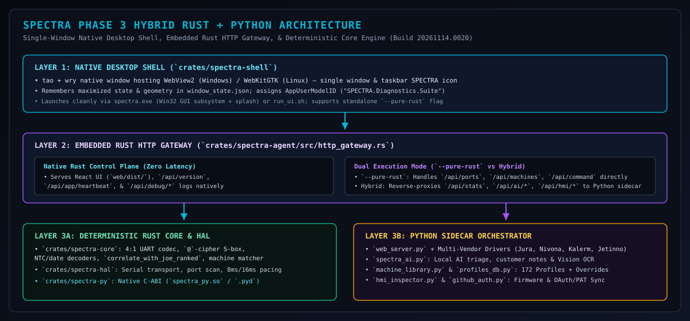
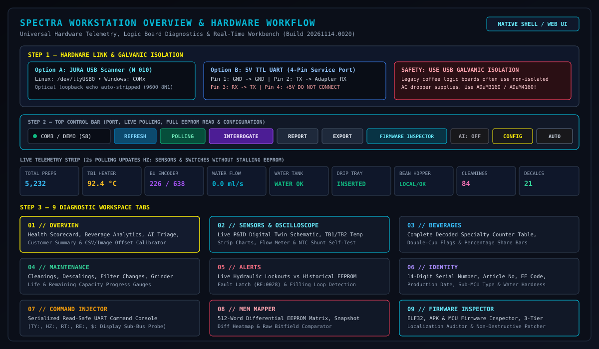
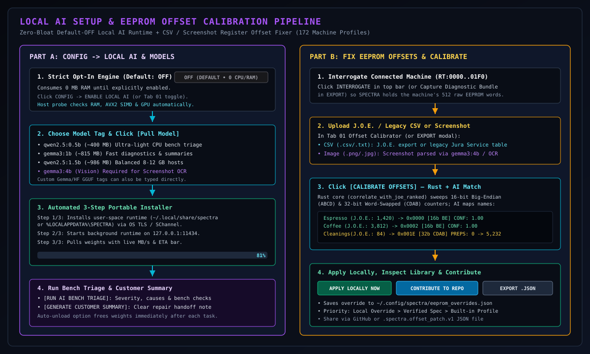
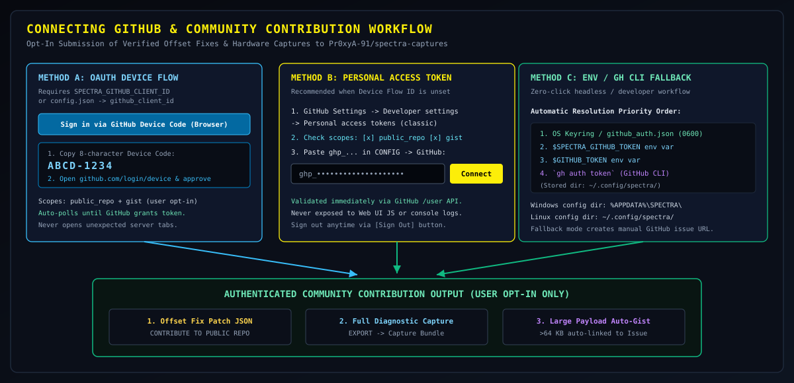

# SPECTRA Operator & Field Technician Guide

> **Applies to**: SPECTRA Build `20261114.0020` (Windows & Linux Multi-Manufacturer + Rust Hybrid Suite)
> **Supported Platforms**: Jura (Plain-ASCII Optical & Encrypted `@` Smart Connect), Nivona CafeRomatica, Lamanti-KL (Kalerm), Lamanti-JN (Jetinno)
> **Česká verze / Czech Guide**: [Jednoduchá uživatelská příručka v češtině](USER_GUIDE_CS.md)

<p align="center">
  
</p>

---

## Table of Contents

1. [Installation & Launching SPECTRA](#1-installation--launching-spectra)
2. [Hardware Connection & Galvanic Isolation Safety](#2-hardware-connection--galvanic-isolation-safety)
3. [Operating the SPECTRA Workstation](#3-operating-the-spectra-workstation)
4. [Setting Up & Using Local AI](#4-setting-up--using-local-ai)
5. [Fixing EEPROM Offsets & Calibrating the Machine Library](#5-fixing-eeprom-offsets--calibrating-the-machine-library)
6. [Connecting GitHub & Contributing Telemetry / Offset Fixes](#6-connecting-github--contributing-telemetry--offset-fixes)
7. [Firmware Inspector (`09 // FIRMWARE INSPECTOR`)](#7-firmware-inspector-09--firmware-inspector)
8. [Troubleshooting & Configuration File Locations](#8-troubleshooting--configuration-file-locations)

---

## 1. Installation & Launching SPECTRA

SPECTRA runs as a **single native desktop window** (`crates/spectra-shell`) powered by an embedded Rust HTTP gateway (`crates/spectra-agent`), deterministic Rust protocol/math codecs (`crates/spectra-core` via `spectra_py`), and a Python domain sidecar (`web_server.py`).

### Windows (`windows` branch / Installer Suite)

1. **Fresh Install**: Download and run **`spectra_setup.exe`** (offline portable bundle containing the Win32 GUI launcher `spectra.exe`, native `spectra-shell.exe`, `WebView2Loader.dll`, compiled Rust Python extension `spectra_py.pyd`, and the embedded Python 3.12 runtime) which installs into `%LOCALAPPDATA%\Programs\SPECTRA\`.
2. **Fast In-Place Upgrade**: When updating an existing installation, run **`spectra_update.exe`**. It updates the runtime, compiled React UI (`web/dist/`), `spectra-shell.exe`, and `spectra_py.pyd` in-place under `%LOCALAPPDATA%\Programs\SPECTRA\`.
3. **Launching**:
   - Double-click **`spectra.exe`** (or Start Menu / Desktop shortcut). No terminal window pops up, and only a single SPECTRA window and taskbar entry (`SPECTRA.Diagnostics.Suite`) appear.
   - SPECTRA opens **maximized by default** on first run and persists window size, position, and monitor state in `%APPDATA%\SPECTRA\window_state.json`.
   - **Browser fallback**: Run `spectra.exe --browser` to open the dashboard in your default web browser.
   - **Standalone Pure-Rust Mode**: Run `spectra-shell.exe --pure-rust` to start only the Rust WebView + `http_gateway` + `spectra-core`/`spectra-hal` stack (ideal for ultra-low-overhead port scanning, Machine Library browsing, and raw command probes without spawning Python).
   - **Command-Line Interface**: Run `spectra.exe --cli --port COM3` or `spectra.exe --cli --demo --demo-model S8` from Command Prompt / PowerShell.

### Linux (`main` branch)

1. **Grant Serial Port Permissions** *(once per system)*:
   ```bash
   # Arch Linux / Omarchy
   sudo usermod -aG uucp "$USER"

   # Debian / Ubuntu / Fedora
   sudo usermod -aG dialout "$USER"
   ```
   Log out and back in so the group change activates (the launcher scripts also auto-adopt `uucp` when configured).

2. **Launch Native Desktop App** *(recommended)*:
   ```bash
   ./run_ui.sh
   # or equivalently:
   ./run.sh
   ```
   Both scripts launch `spectra_app.py`, which prefers the native Rust `spectra-shell` binary when available (falling back cleanly to GTK3 WebKit2 or a chromeless Chromium/Edge window).

3. **Additional Launch Modes**:
   - **Web Browser Tab**: `./run_ui.sh --browser`
   - **Vite Hot-Reload Dev Mode**: `./run_ui.sh --dev` (starts `web_server.py` on `:8080` + Vite on `:5173`)
   - **Legacy GTK 3 GUI**: `./run.sh --legacy-gtk`
   - **Standalone Pure-Rust Desktop Shell**:
     ```bash
     cargo run -p spectra-shell -- --pure-rust
     ```
   - **Headless CLI & Simulated Demo Machine**:
     ```bash
     ./run.sh --cli --list-ports
     ./run.sh --cli --list-models
     ./run.sh --cli --demo --demo-model S8
     ./run.sh --cli -p /dev/ttyUSB0 --sensors
     ./run.sh --cli -p /dev/ttyUSB0 -o diagnostic_report.json --format json
     ```

---

## 2. Hardware Connection & Galvanic Isolation Safety

> [!CAUTION]
> **ELECTRICAL SAFETY — GALVANIC ISOLATION REQUIRED**
> Legacy coffee machine logic boards (Jura, Saeco, De'Longhi, Nivona) frequently derive low-voltage logic DC directly from Mains Live/Neutral using non-isolated capacitive/resistor dropper power supplies. The UART `GND` pin on the appliance service port can sit at hazardous mains potential!
> **Never touch exposed logic pins while powered, and ALWAYS place an ADuM3160 / ADuM4160 USB galvanic isolator between your USB-to-UART adapter and your computer when connecting directly to electrical service pins.** An optical transceiver (such as the official JURA USB Scanner N 010) provides natural optical isolation.

### Option A: Official JURA USB Scanner (N 010 / Optical Port)
1. Plug the scanner into USB (`COMx` on Windows Device Manager, `/dev/ttyUSB0` on Linux).
2. Snap the optical head onto the machine's front service port.
3. SPECTRA automatically strips half-duplex optical loopback echoes in Rust (`crates/spectra-core`) and calibrates `8 ms` intra-frame / `16 ms` inter-character timing.

### Option B: 5V USB-to-UART Adapter (FT232R, CP2102, CH340) + USB Isolator
- **Serial Settings**: `9600 Baud`, `8 Data Bits`, `No Parity`, `1 Stop Bit` (`9600 8-N-1`), **5V TTL logic**.
- **Typical 4-Pin Jura / Eugster Service Port Pinout**:
  | Pin | Signal | Adapter Connection |
  |---|---|---|
  | Pin 1 | `GND` | Connect to Adapter `GND` |
  | Pin 2 | `TX` *(out from machine)* | Connect to Adapter `RX` |
  | Pin 3 | `RX` *(into machine)* | Connect to Adapter `TX` |
  | Pin 4 | `+5V VCC` | **DO NOT CONNECT** *(leave disconnected to prevent back-powering or ground loops)* |

### Option C: Demo / Simulation Mode (No Machine Attached)
Select **`DEMO / SIMULATION`** in the top-left port selector to explore all tabs, test AI Triage, and verify offset workflows without physical hardware.

---

## 3. Operating the SPECTRA Workstation

<p align="center">
  
</p>

### Top Control Bar
- **Port Selector**: Automatically discovers `COM*` (Windows) or `/dev/ttyUSB*` / `/dev/ttyACM*` (Linux), plus `DEMO / SIMULATION`. Click **REFRESH** after plugging in a USB adapter.
- **`START POLL` / `POLLING`**: Toggles continuous 2-second **fast live telemetry (`HZ:`)** polling. Fast poll reads only dynamic heater temperatures, flow rate, brew unit encoder position, and microswitches so the UI never stalls EEPROM reads or overwrites static water-hardness settings.
- **`INTERROGATE`**: Performs a full deterministic interrogation sweep across identity (`TY:`, `CS:`, `RE:`), hardware configuration (`IC:`, `HZ:`), and the entire `RT:0000`–`RT:01F0` (512-word) EEPROM map using exclusive serial port locking (`fcntl.flock` / mutex lock) so background commands never collide on the UART wire.
- **`REPORT` & `EXPORT`**:
  - Generates printable service reports or structured **JSON**, **CSV**, or **Text (`.txt`)** exports.
  - Native OS "Save As..." dialogs (`GetSaveFileNameW` on Windows, GTK/zenity on Linux) open **focused above the SPECTRA window**.
  - Inside **EXPORT**, you can also sweep and save a full **Diagnostic Bundle**, run the **Local AI Offset Fixer**, or submit anonymized captures to the community repo.
- **`FIRMWARE INSPECTOR`**: Shortcut button jumping directly to Tab 09 (`09 // FIRMWARE INSPECTOR`).
- **`AI: OFF / ON`**: Master opt-in switch for the **Local AI** engine. Remains **OFF (`0 MB RAM`)** by default until clicked.
- **`CONFIG`**: Opens **SPECTRA Configuration & AI Engine**, featuring a top **Language / Jazyk (`English` / `Čeština`)** toggle, an **Interactive Guide** relaunch reminder/button in the footer (also shown automatically on first startup), and four tabs:
  1. `Local AI & Models`
  2. `Machine Library (172)` *(count grows with imported/verified profiles)*
  3. `GitHub Connection`
  4. `Overrides & Calibration`
- **Profile Badge (`AUTO`)**: Shows the automatically matched EF code / machine profile (preferring `Local Override > Verified Model Spec > Built-in Profile`), or lets you pick a profile manually.

### Live KPI Strip (9 Cards)
1. **TOTAL PREPS**: Total beverage preparations decoded from EEPROM.
2. **TB1 HEATER**: Coffee thermoblock temperature in `°C` (`0.1 °C` resolution; readiness window `80.0 °C – 115.0 °C`).
3. **BU ENCODER**: Brew Unit encoder position (`raw / max_ticks`, home vs press compression).
4. **WATER FLOW**: Instantaneous flowmeter rate in `ml/s` and cumulative shot volume.
5. **WATER TANK**: Real-time float switch status (`WATER OK` / empty alarm).
6. **DRIP TRAY**: Contact microswitch status (`INSERTED` / removed).
7. **BEAN HOPPER**: Displays physical hopper state or hardware provenance — e.g. `LOCAL (EF518D)` on commercial EF518 models where the IR sensor wires directly into the front display MCU rather than main-board UART.
8. **CLEANINGS** & **DECALCS**: Total lifetime cleaning and descaling cycles.

### The 9 Diagnostic Tabs
1. **`01 // OVERVIEW`**: Overall machine health scorecard, top beverage mix analytics, **Local AI Bench Triage & Customer Summary**, and the inline **EEPROM Offset Calibrator** (`Wrong Counters? Fix Machine Offsets`).
2. **`02 // SENSORS & OSCILLOSCOPE`**: Real-time **P&ID Digital Twin Schematic**, live `TB1`/`TB2` temperature strip-chart oscilloscope, flow pulses, brew encoder telemetry, and Coffee Heater NTC $+6\%$ resistor shunt self-test (`AS:`).
3. **`03 // BEVERAGES`**: Complete decoded drink table with single vs `[2x]` double-cup flags, preparation counts, and % share bars.
4. **`04 // MAINTENANCE`**: Cleaning, descaling, CLARIS filter replacement intervals, grinder runtime, and remaining capacity bars.
5. **`05 // ALERTS`**: Separates **active physical lockouts** (tray missing, tank empty, grounds full, active filling loop) from **historical EEPROM fault latches** (`RE:0028`, `0x01B0`–`0x01B6` trip counters). Notice: historical faults never wrongly mark a healthy warm machine as blocked!
6. **`06 // IDENTITY`**: 14-digit Jura factory barcode / serial number, production date, article number, country code, firmware version (`TY:`), and Display Sub-MCU identification (`EF518D` / `FlashDisplayZeta`).
7. **`07 // COMMAND INJECTOR`**: Safe, serialized UART console for manual commands (`TY:`, `HZ:`, `RT:0000`, `$:` sub-bus probes) with echo stripping and wire pacing enforced.
8. **`08 // MEM MAPPER`**: Read-only 256/512/1024-word EEPROM hex matrix, traffic-light register classifier (`Mapped`, `Theoretical`, `Unknown`, `Blank`), live before/after snapshot **differential scope**, raw `HZ:`/`AS:` sensor mapper, and one-click model JSON persistence (see [JURA_MEMORY_MAP.md](JURA_MEMORY_MAP.md)).
9. **`09 // FIRMWARE INSPECTOR`**: Multi-format `ELF32`, Android `APK`, and `MCU .bin` firmware analyzer, 3-tier localization defect auditor, dynamic string search, and non-destructive lab binary patcher.

---

## 4. Setting Up & Using Local AI

<p align="center">
  
</p>

SPECTRA runs **all AI locally on your computer (`127.0.0.1:11434`)** with zero cloud telemetry. By default, Local AI is **OFF (`0% CPU`, `0 MB RAM`)** so SPECTRA stays lightweight on workshop laptops.

### Step 1: Open `CONFIG -> Local AI & Models`
1. Click **`CONFIG`** in the top control bar (or click **`Models & Machine Library`** inside the Overview AI panel).
2. Inspect the automatic **Host Hardware Self-Check**: SPECTRA detects total RAM, CPU SIMD capabilities (`AVX2`), free disk space, and discrete GPU VRAM, then marks compatible models vs `INSUFFICIENT_RAM`.

### Step 2: Pull a Model (Auto-Installs Portable Engine)
You do **not** need to pre-install any third-party AI software manually:

1. Under **Download / Pull Model Tag (Auto-Installs Engine)**, click one of the quick-pick model tags (or type any compatible tag such as **`gemma3:1b`**, **`qwen2.5:0.5b`**, **`gemma2:2b`**, **`gemma3:4b`**):
   - **`qwen2.5:0.5b`** *(Recommended on 4–8 GB RAM)* — Ultra-light CPU text triage & fast summaries.
   - **`gemma3:1b`** — Google Gemma 3 compact model for clear technician diagnostics & customer notes.
   - **`qwen2.5:1.5b` / `gemma2:2b`** — Higher accuracy on 12+ GB RAM hosts.
   - **`gemma3:4b` (Vision)** — Multimodal vision model capable of reading screenshots directly (`.png`, `.jpg`, `.webp`) without separate OCR tools.
2. Click **`Pull Model`**.
3. Watch the 3-stage automated installer progress bar:
   - **`Step 1/3: Installing Portable Local AI Engine`**: Downloads a user-space portable runtime (using OS TLS root verification / Windows SChannel fallback via `tls_utils.py` so corporate/VM certificate stores work cleanly) into `%LOCALAPPDATA%\SPECTRA\ollama\` (Windows) or `~/.local/share/spectra/ollama/` (Linux) — **no admin/sudo required**.
   - **`Step 2/3: Starting Local AI Engine (127.0.0.1:11434)`**: Starts the local loopback daemon cleanly inside SPECTRA's process group (no stray console windows, terminates automatically when SPECTRA exits unless already running as a system service).
   - **`Step 3/3: Pulling Model`**: Streams the model layers with live download speed (`MB/s`), percentage, and ETA.
4. Select your preferred **Default Model** in the dropdown and keep **`Auto-unload model weights from RAM immediately after each task finishes`** checked on laptops with `<= 12 GB` RAM.

### Step 3: Turn AI ON & Run Bench Triage / Customer Summary
1. Click **`ENABLE LOCAL AI`** (inside `CONFIG` or in Tab 01 `LOCAL AI BENCH TRIAGE, SUMMARY & OFFSET CALIBRATOR` or top bar `AI: OFF`).
2. Interrogate your machine (`INTERROGATE`), then in **`01 // OVERVIEW`**:
   - Click **`🧠 RUN AI BENCH TRIAGE`**: Produces severity (`LOW`/`MEDIUM`/`HIGH`), a diagnostic summary correlating fault latches, temperatures, and maintenance overdue percentages, probable root causes, and concrete bench checks.
   - Click **`📝 GENERATE CUSTOMER SUMMARY`**: Drafts a plain-language handover summary and recommended next service interval ready to copy onto an invoice or service ticket.
3. Click **`TURN AI OFF`** (or **`Unload RAM`** / **`Stop Engine`** in `CONFIG`) whenever you finish to immediately reclaim all RAM.

---

## 5. Fixing EEPROM Offsets & Calibrating the Machine Library

If you connect an uncommon firmware variant or newer Jura generation where drink or maintenance counters display incorrect numbers (for example, Espresso shows `0` or swapped counts), SPECTRA lets you **fix the register offsets yourself in minutes** — and optionally share the verified map so everyone gets automatic support in future SPECTRA builds.

### Step 1: Collect Ground Truth from J.O.E. or Legacy Software
Prepare either:
- **A CSV export** (`.csv` or `.txt`) from **J.O.E. (Jura Operating Experience)** or legacy Jura Service Software showing accurate drink / cleaning / descaling counters, **OR**
- **A Screenshot** (`.png`, `.jpg`, `.jpeg`, `.webp`) of the J.O.E. app screen or legacy diagnostic counter screen. *(For image extraction, pull `gemma3:4b` in `CONFIG -> Local AI & Models`, or ensure Tesseract OCR is installed).*

### Step 2: Interrogate the Connected Machine
Connect the appliance (or Demo machine) and click **`INTERROGATE`** so SPECTRA captures the machine's full raw EEPROM dump (`RT:0000`–`RT:01F0`).

### Step 3: Upload & Run Calibration
You can calibrate directly from **`01 // OVERVIEW`** (fastest) or from **`EXPORT`**:

1. In **`01 // OVERVIEW`**, under **`Wrong Counters? Fix Machine Offsets (J.O.E. / Legacy CSV or Screenshot)`**:
   - Click **`Upload CSV / Screenshot (.csv, .png, .jpg)`** and select your reference file.
   - Click **`CALIBRATE OFFSETS`** (no Local AI is strictly needed for clean English/numeric CSVs because the deterministic Rust correlator runs automatically; Local AI helps translate cross-language CSV labels or extract numbers from screenshots).
2. SPECTRA executes **`correlate_with_joe_ranked`** in `crates/spectra-core`:
   - Scans every address in the EEPROM dump as **16-bit Big-Endian (`ABCD`)** and **32-bit Word-Swapped (`CDAB`)** words against every non-zero counter in your reference file.
   - Displays each matched beverage and maintenance counter with its hex word offset (e.g. `0x0000`, `0x001E`), matched reference value, and **Total Preps Before vs. After** preview.

> [!TIP]
> Alternatively, inside the **`EXPORT`** modal, upload a J.O.E. CSV under `Attach J.O.E. App CSV Export`, click **`Capture Diagnostic Bundle`** (or **`🧠 Sweep & AI Auto-Fix EEPROM Offsets`**), then use the **`Local AI Offset Fixer (Instant Repair)`** panel to preview and apply fixes.

### Step 4: Apply Locally Now
Click **`APPLY LOCALLY NOW`** (or **`🔧 FIX LOCALLY NOW`** in Export):
- Writes the verified offset map into `~/.config/spectra/eeprom_overrides.json` *(or `%USERPROFILE%\.config\spectra\eeprom_overrides.json` / XDG config path resolved via `profiles_db.EEPROM_OVERRIDES_FILE`)*.
- Re-decodes telemetry immediately so your dashboard KPIs, `03 // BEVERAGES`, and `04 // MAINTENANCE` show the exact corrected counters right away.

### Step 5: Manage Models in `Machine Library` & `Overrides & Calibration`
Open **`CONFIG`**:
- **`Machine Library (172)`**:
  - Search all **172+ indexed machines** by EF code (e.g. `EF518`, `EF634`), model family (`IMPRESSA XJ5`, `ENA 7`, `WE8`, `Z10`), or Jura article number.
  - Connected machines automatically highlight at the top (`CONNECTED MACHINE MATCH` / `ACTIVE` badge).
  - Shows active precedence source (`Local Override` &gt; `Verified Model Spec` &gt; `Built-in Profile`).
  - Expand any verified or overridden machine to inspect hex register addresses, click **`Export JSON`** to save a portable `.spectra-offset.json` (`spectra.offset_patch.v1` schema) patch file, or click **`Import Patch (.json)`** to load a patch shared by another technician.
- **`Overrides & Calibration`**:
  - Lists every saved local override with **`Revert`** buttons to restore built-in factory profiles anytime.
  - Adjusts Optical Bean Hopper (`AS:`) calibration threshold (`30`–`250` counts) and lets you clear Firmware Inspector AI glossaries.

### Step 6: Contribute Your Fix Back to SPECTRA
Once your calibration preview matches your machine:
- Click **`CONTRIBUTE TO PUBLIC REPO`** to open an automated GitHub submission in `Pr0xyA-91/spectra-captures` (attaching the anonymized `.spectra-offset.json` fix and model metadata — requires opt-in GitHub authentication), **OR**
- Click **`EXPORT FILE (.JSON)`** to save the `.spectra-offset.json` patch locally via native Save As dialog for manual upload or sharing with fellow technicians.

### Step 7: Live EEPROM & Sensor Discovery with `08 // MEM MAPPER`
To inspect raw machine memory directly or map brand-new firmware registers interactively:
1. Open Tab **`08 // MEM MAPPER`** (`memory_mapper.py` + `spectra_py` Rust parser `parse_rt_block`).
2. Click **`Sweep EEPROM`** in the **`01 // EEPROM REGISTER MATRIX`** sub-tab to read every word across `256` / `512` / `1024`-word architectures, automatically classified as **`Mapped`** (green), **`Theoretical`** (amber), **`Unknown`** (red, non-zero), or **`Blank`** (grey `0x0000`).
3. Toggle **`Live Differential Scope`** before triggering a brew, rinse, or grinder pulse on the machine to highlight exact word & 16-bit binary bit-flip deltas in real time (filtering thermoblock NTC / heartbeat noise automatically).
4. Click any unknown word to name and persist it directly into `docs/models/<EF>_*.json`, or switch to **`02 // RAW SENSOR TELEMETRY`** to annotate live `HZ:` / `AS:` frame fields. All write commands (`WE:`, `WT:`, `DA:`) are strictly blocked for physical safety.

---

## 6. Connecting GitHub & Contributing Telemetry / Offset Fixes

<p align="center">
  
</p>

SPECTRA **never** uploads anything silently or in the background. You only authenticate with GitHub if you want 1-click submission of diagnostic bundles or verified EEPROM offset patches to the community repository (**`Pr0xyA-91/spectra-captures`**).

Open **`CONFIG -> GitHub Connection`** (or use the auth controls inside **`EXPORT`**). Three authentication methods are supported:

### Method A: OAuth 2.0 Device Flow (`Browser`)
*(Shown when an OAuth Client ID is configured via `SPECTRA_GITHUB_CLIENT_ID` or `github_client_id` in `config.json`)*:
1. Click **`Sign in via GitHub Device Code (Browser)`**.
2. SPECTRA requests an 8-character Device Code from GitHub (`public_repo` + `gist` scopes).
3. Click **`Copy Code`** and open **`https://github.com/login/device`** in your browser, paste the code, and authorize SPECTRA.
4. SPECTRA detects authorization automatically and shows **`CONNECTED: @your-username`**.

### Method B: Personal Access Token (`PAT` — Recommended Ready-to-Use Method)
1. On GitHub, go to **Settings -> Developer settings -> Personal access tokens -> Tokens (classic)** *(or fine-grained token for `Pr0xyA-91/spectra-captures`)*.
2. Select scopes: **`public_repo`** and **`gist`** *(needed when telemetry captures exceed 64 KB so SPECTRA can attach an unlisted Gist link safely)*.
3. Copy the token (`ghp_...` or `github_pat_...`), paste it into **`Or Connect with Personal Access Token (public_repo & gist)`** inside **`CONFIG -> GitHub Connection`**, and click **`Connect`**.
4. SPECTRA validates your token via GitHub's `/user` API and stores it securely using the OS Keyring (falling back to a `chmod 0600` `github_auth.json` file in `~/.config/spectra/` on Linux or `%APPDATA%\SPECTRA\` on Windows). Tokens are **never** logged or sent to the frontend JavaScript bundle.

### Method C: Environment Variable or GitHub CLI (`gh auth`)
For CLI or developer workstations, SPECTRA resolves credentials automatically in strict priority order:
1. Stored token (OS Keyring / `github_auth.json`)
2. `SPECTRA_GITHUB_TOKEN` environment variable
3. `GITHUB_TOKEN` environment variable
4. GitHub CLI active login (`gh auth token`)

> [!NOTE]
> **Unauthenticated / Offline Workflow**: You can always use **`Save Locally`** (in `EXPORT`) or **`EXPORT FILE (.JSON)`** (in the Offset Calibrator) without any GitHub account. You can also submit captures manually via browser fallback without storing any token.

---

## 7. Firmware Inspector (`09 // FIRMWARE INSPECTOR`)

For technicians auditing coffee machine display/UI firmware:
1. Open **`09 // FIRMWARE INSPECTOR`** (or click **`FIRMWARE INSPECTOR`** in the top bar).
2. Click **`Browse Firmware`** (auto-discovers `.elf`, `.axf`, `.bin`, `.apk` binaries in `~/Downloads` or opens native OS file chooser).
3. Audit localization tables across **ELF32** (`lv_i18n` LVGL binaries), **Android APKs** (`resources.arsc`), or **MCU binary images** using zero-hardcoding dynamic ELF segment & symbol resolution:
   - Detects cross-key swaps, pointer leakage, orthography typos, polarity inversions, and placeholder mismatches (`%d`, `%s`).
   - Optionally runs a Tier-3 review using your opt-in Local AI model.
   - Exports Markdown/HTML/PDF bug reports or produces a non-destructive patched copy (`--hmi-patch`).

---

## 8. Troubleshooting & Configuration File Locations

| Item | Windows Location | Linux Location |
|---|---|---|
| Install Directory *(Packaged)* | `%LOCALAPPDATA%\Programs\SPECTRA\` | Repository checkout directory |
| Window Geometry State | `%APPDATA%\SPECTRA\window_state.json` | `~/.config/spectra/window_state.json` *(or `$XDG_CONFIG_HOME/spectra/`)* |
| GitHub Auth Token / Config | `%APPDATA%\SPECTRA\github_auth.json` (+ OS Keyring) | `~/.config/spectra/github_auth.json` (+ OS Keyring) |
| Local EEPROM Offset Overrides | `~/.config/spectra/eeprom_overrides.json` *(user profile `.config`)* | `~/.config/spectra/eeprom_overrides.json` |
| Portable Local AI Engine | `%LOCALAPPDATA%\SPECTRA\ollama\` | `~/.local/share/spectra/ollama/` |
| Windows Runtime Log *(if needed)* | `%TEMP%\spectra_app.log` | Terminal stdout / Debug Console (`Bug` icon in top bar) |

### Common Quick Fixes
- **Top-right Bug Icon (`Debug Console`)**: Opens an in-app live log viewer backed by the Rust HTTP gateway (`/api/debug/logs`), helpful for diagnosing serial port timeouts or Local AI pull steps.
- **Port shows `Busy` or refuses to open**: Ensure no other serial monitor (PuTTY, minicom, legacy Jura software, or second SPECTRA instance) holds the port. SPECTRA enforces single-instance desktop locking and exclusive port locks so commands never interleave.
- **Wrong Beverage Counts**: Follow [Section 5](#5-fixing-eeprom-offsets--calibrating-the-machine-library) to correlate a J.O.E. CSV or screenshot and save a persistent local offset override.
- **Screenshot Calibration says Vision Model Required**: Open `CONFIG -> Local AI & Models`, pull **`gemma3:4b`**, wait for Step 1–3 to finish, and re-run **`CALIBRATE OFFSETS`**.
