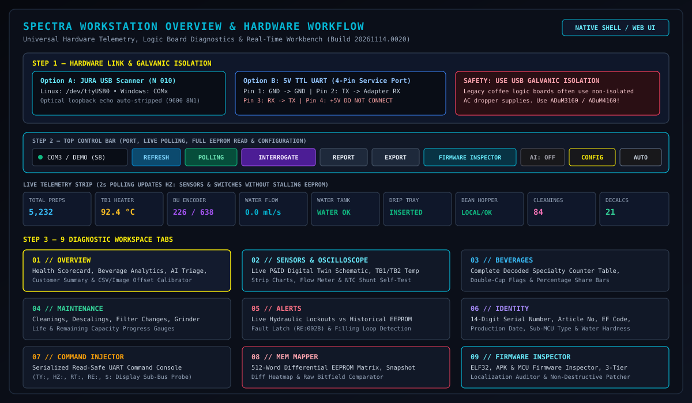
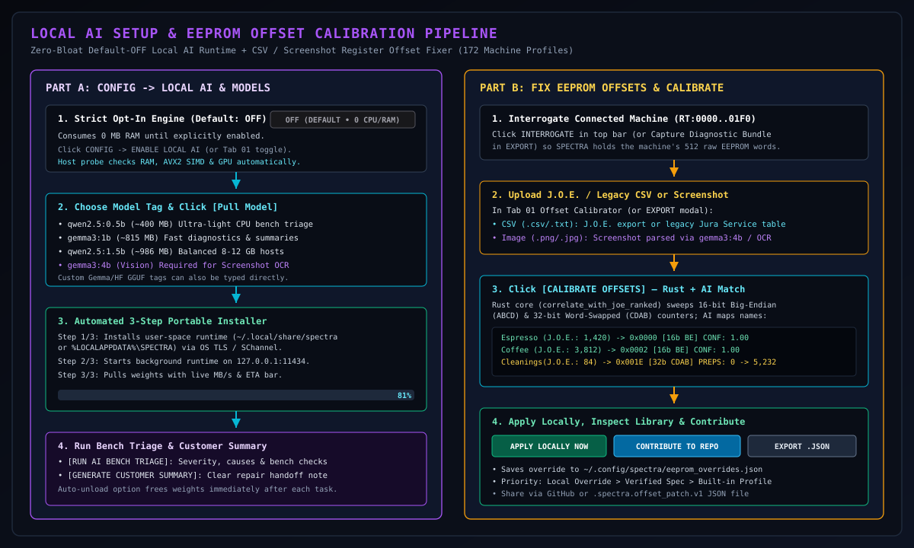
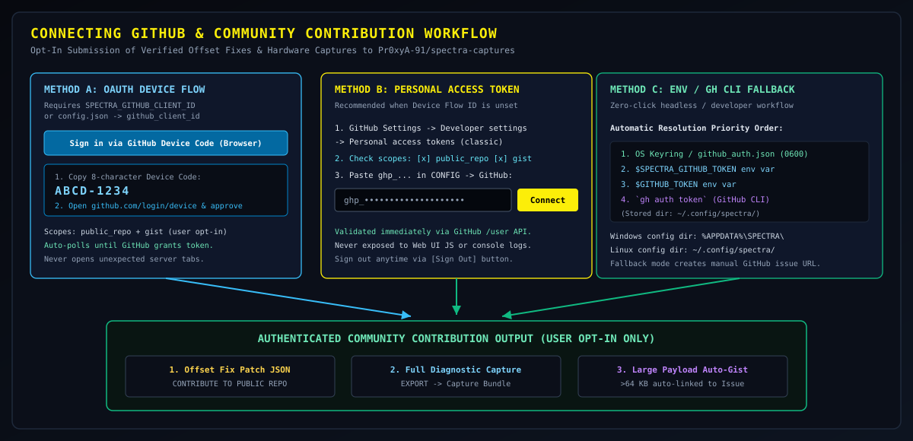

# SPECTRA — Jednoduchá uživatelská příručka (Čeština)

> **Pro koho je tento návod:** Pro servisní techniky i běžné uživatele kávovarů, kteří nechtějí řešit složité programátorské detaily. Návod vás krok za krokem provede základním používáním programu, zapnutím místní AI a opravou špatných počitadel nápojů.
> **Podporované kávovary:** Jura, Nivona CafeRomatica, Kalerm (Lamanti-KL) a Jetinno (Lamanti-JN).

<p align="center">
  
</p>

---

## Obsah příručky

1. [Spuštění programu a přepnutí do češtiny](#1-spuštění-programu-a-přepnutí-do-češtiny)
2. [Připojení kávovaru (a bezpečnost)](#2-připojení-kávovaru-a-bezpečnost)
3. [Základní používání programu](#3-základní-používání-programu)
4. [Připojení a zapnutí lokální AI](#4-připojení-a-zapnutí-lokální-ai)
5. [Oprava špatných počitadel pomocí AI (Kalibrace offsetů)](#5-oprava-špatných-počitadel-pomocí-ai-kalibrace-offsetů)
6. [Sdílení opravy přes GitHub (nepovinné)](#6-sdílení-opravy-přes-github-nepovinné)
7. [Časté potíže a rychlá pomoc](#7-časté-potíže-a-rychlá-pomoc)

---

## 1. Spuštění programu a přepnutí do češtiny

### Na Windows
1. Pro první instalaci spusťte **`spectra_setup.exe`** (program se nainstaluje do vašeho uživatelského účtu, bez potřeby složitého nastavování).
2. Při aktualizaci na novější verzi stačí spustit **`spectra_update.exe`**.
3. Program pak kdykoli zapnete ikonou **SPECTRA** (nebo souborem **`spectra.exe`**). Otevře se přímo hlavní okno programu na celou obrazovku.

### Na Linuxu
1. Otevřete terminál ve složce s programem a spusťte:
   ```bash
   ./run_ui.sh
   ```
   *(Pokud používáte kabel poprvé a program port nevidí, přidejte se do skupiny pro sériové porty příkazem `sudo usermod -aG uucp "$USER"` na Arch/Omarchy nebo `sudo usermod -aG dialout "$USER"` na Ubuntu/Debianu a poté se odhlaste a znovu přihlaste.)*

### Jak přepnout program do češtiny a spustit průvodce
Ve výchozím nastavení je program v angličtině. Při prvním spuštění se automaticky otevře **Interaktivní průvodce**, kde si jazyk vyberete hned na první obrazovce.
Kdykoli později můžete jazyk přepnout nebo průvodce znovu spustit takto:
1. Klikněte v horní liště na tlačítko **`CONFIG`** / **`NASTAVENÍ`** (ikona ozubeného kolečka ⚙️).
2. Hned nahoře pod nadpisem okna uvidíte přepínač **`Language / Jazyk`** — klikněte na **`Čeština (CS)`**. Celý program se okamžitě přepne do češtiny.
3. V dolní části okna nastavení najdete také tlačítko **`🎓 Spustit interaktivního průvodce`** (a volbu, zda se má zobrazovat při startu).

---

## 2. Připojení kávovaru (a bezpečnost)

> [!CAUTION]
> **POZOR NA ELEKTRICKOU BEZPEČNOST**
> U řady kávovarů není servisní konektor uvnitř stroje oddělený od elektrické sítě 230 V!
> - Používáte-li **originální optický skener JURA (N 010)**, připojení je světelné (optické) a bezpečné.
> - Používáte-li **USB-UART kabel přímo do 4pinového konektoru na desce**, **VŽDY** mezi počítač a převodník zapojte **galvanický USB izolátor (např. ADuM3160 / ADuM4160)** a nikdy se nedotýkejte odkrytých pinů, když je kávovar v zásuvce! Červený napájecí drát `+5V` (pin 4) vůbec nepřipojujte.

### Postup připojení
1. Připojte USB skener nebo izolovaný kabel do počítače a druhý konec ke kávovaru.
2. Zapněte kávovar (nemusí být nutně úplně nahřátý, ale musí být pod napětím / zapnutý).
3. V levé části horní lišty vyberte v rozbalovacím seznamu port kávovaru (na Windows např. `COM3`, na Linuxu `/dev/ttyUSB0`). Pokud se port neukázal hned, klikněte na malou šipku obnovení vedle seznamu.

### Nemáte teď kávovar u sebe? Vyzkoušejte DEMO
V seznamu portů vyberte **`DEMO / SIMULATION`**. Program bude fungovat s ukázkovým virtuálním kávovarem — můžete si bezpečně vyzkoušet všechna tlačítka, AI diagnostiku i opravu počitadel.

---

## 3. Základní používání programu

Po připojení portu se v horní části okna ihned začnou automaticky aktualizovat živé údaje:
- **Horizontální pruh 9 kartiček** ukazuje aktuální teplotu ohřívače, stav nádržky na vodu, odkapní misky, zásobníku zrn, průtok vody a celkový počet káv.

### Nejdůležitější tlačítka v horní liště
- **`OBNOVIT`** — okamžitě jednou načte aktuální stav senzorů.
- **`SLEDUJI` / `SPUSTIT SLEDOVÁNÍ`** — zapíná nebo pozastavuje průběžné živé sledování teplot a spínačů (každou vteřinu).
- **`⚡ NAČÍST STROJ`** — **nejdůležitější tlačítko!** Přečte z paměti kávovaru kompletní historii nápojů, počty čištění/odvápnění, sériové číslo a případné závady. *(Bez kliknutí na toto tlačítko zůstanou záložky Nápoje, Údržba a Přehled prázdné.)*
- **`PROTOKOL`** — vytvoří přehledný servisní protokol připravený k tisku nebo uložení do PDF pro zákazníka.
- **`EXPORTOVAT`** — uloží naměřená data do souboru (`.json`, `.csv`, `.txt`) nebo vytvoří diagnostický balíček.
- **`AI: VYP` / `AI: ZAP`** — hlavní vypínač místní umělé inteligence (ve výchozím stavu vypnuto, aby šetřila paměť počítače).
- **`NASTAVENÍ`** — otevírá okno nastavení (jazyk, stahování AI modelů, knihovna kávovarů, opravy počitadel, GitHub).

### Přehled hlavních záložek
- **`01 // PŘEHLED`** — hlavní stránka: celkové hodnocení zdraví kávovaru (0–100), automatická doporučení (např. kdy odvápnit), kontrolní seznam pro technika, **AI diagnostika** a **oprava špatných počitadel**.
- **`02 // SENZORY A OSCILOSKOP`** — přehledné schéma kávovaru (kliknutím na jakoukoli část zobrazíte detail), živý graf teploty v čase a seznam všech spínačů a bezpečnostních testů.
- **`03 // NÁPOJE`** — tabulka všech druhů nápojů (Espresso, Káva, Cappuccino…) s přesnými počty a procentuálním podílem.
- **`04 // ÚDRŽBA`** — přehled cyklů čištění, odvápnění a stavu vodního filtru CLARIS.
- **`05 // VÝSTRAHY`** — aktuální blokace (chybějící miska, prázdná nádržka) a případné poruchy.
- **`06 // IDENTITA`** — přesný název modelu, verze firmwaru a sériové číslo kávovaru.
- *Záložky `07 // PŘÍKAZOVÁ KONZOLE`, `08 // MEM MAPPER` a `09 // INSPEKTOR FIRMWARU` jsou pokročilé nástroje pro vývojáře a servisní specialisty — při běžné práci je vůbec nemusíte otevírat.*

---

## 4. Připojení a zapnutí lokální AI

<p align="center">
  
</p>

SPECTRA umí používat **lokální umělou inteligenci (AI)**, která běží **přímo ve vašem počítači**.
- **Nic se nikam neodesílá** — vaše data zůstávají u vás a AI funguje i bez internetu (jakmile jednou stáhnete model).
- **Nepotřebujete nic instalovat ručně** — SPECTRA si vše stáhne a nastaví sama do své vlastní složky.
- **Ve výchozím stavu je AI vypnutá** (`0 MB RAM`), aby nezpomalovala slabší notebooky.

### Krok 1: Stažení AI modelu (stačí udělat jen jednou)
1. Klikněte v horní liště na **`NASTAVENÍ`** (zůstáváte v první záložce **`Lokální AI a modely`**).
2. V dolní části vyberte jeden z přednastavených modelů podle toho, kolik má váš počítač operační paměti (RAM):
   - **`qwen2.5:0.5b`** *(nejlehčí, stačí 4–8 GB RAM)* — velmi rychlý model pro textovou diagnostiku a souhrny pro zákazníka.
   - **`gemma3:1b`** *(doporučený základ)* — výborný poměr rychlosti a kvality v češtině.
   - **`gemma3:4b (Vision)`** *(pro počítače s 8–16+ GB RAM)* — **umí číst obrázky a snímky obrazovky** (skvělé, pokud chcete opravovat počitadla jen z fotky aplikace J.O.E.!).
3. Klikněte na **`Stáhnout model`**.
4. Program sám projde 3 kroky (stažení přenosného AI enginu, jeho spuštění a stažení vybraného modelu) a ukáže přehledný ukazatel průběhu v procentech.
5. V rozbalovacím seznamu **`Výchozí AI model`** zkontrolujte, že je vybraný váš stažený model.
6. Doporučujeme nechat zaškrtnutou volbu **`Automaticky uvolnit model z paměti RAM ihned po dokončení každé úlohy`** — počítač tak zůstane svižný.

### Krok 2: Zapnutí AI a použití v praxi
1. Zapněte AI tlačítkem **`ZAPNOUT LOKÁLNÍ AI`** v nastavení (nebo v horní liště klikněte na **`AI: VYP`** → změní se na **`AI: ZAP`**).
2. Připojte kávovar a klikněte na **`⚡ NAČÍST STROJ`**.
3. Přejděte na záložku **`01 // PŘEHLED`** a v bloku **`LOKÁLNÍ AI DIAGNOSTIKA, SOUHRN A OPRAVA OFFSETŮ`** můžete kliknout na:
   - **`🧠 SPUSTIT AI DIAGNOSTIKU`** — AI zhodnotí teploty, závady a opotřebení a navrhne konkrétní postup kontroly.
   - **`📝 VYGENEROVAT SOUHRN PRO ZÁKAZNÍKA`** — AI napíše lidskou, srozumitelnou zprávu bez technických kódů, kterou můžete kliknutím na **`📄 PROTOKOL + AI SOUHRN`** vložit přímo do tiskového servisního listu.
4. Až práci dokončíte, můžete AI zase jedním kliknutím na **`AI: ZAP`** vypnout a uvolnit tak veškerou paměť počítače.

---

## 5. Oprava špatných počitadel pomocí AI (Kalibrace offsetů)

Některé novější nebo méně obvyklé verze firmwaru kávovarů mají čísla nápojů uložená na jiných místech v paměti. Poznáte to tak, že SPECTRA po načtení stroje ukazuje u některého nápoje nulu (přitom víte, že se připravil), nebo jsou počty prohozené.

SPECTRA vám umožní **tato počitadla během pár minut opravit**, aniž byste museli umět programovat:

### Krok 1: Získejte správná čísla (CSV nebo obrázek)
Připravte si vzor se správnými počty nápojů z vašeho kávovaru:
- **Možnost A (CSV soubor):** Exportujte statistiky z mobilní aplikace **J.O.E.** (Jura Operating Experience) nebo ze staršího servisního programu ve formátu `.csv` / `.txt`.
- **Možnost B (Obrázek / Screenshot):** Udělejte snímek obrazovky nebo fotku displeje/aplikace J.O.E., kde jsou vidět správné počty nápojů. *(Pro čtení z obrázku mějte stažený model **`gemma3:4b (Vision)`** z kapitoly 4.)*

### Krok 2: Načtěte paměť kávovaru
1. Připojte kávovar (nebo zvolte `DEMO`) a klikněte v horní liště na **`⚡ NAČÍST STROJ`**.
2. Ujistěte se, že máte zapnutou **AI** (tlačítko nahoře svítí **`AI: ZAP`**).

### Krok 3: Nahrajte soubor a spusťte kalibraci
1. Otevřete záložku **`01 // PŘEHLED`**.
2. Najděte sekci **`Špatná počitadla? Opravit offsety stroje (J.O.E. / CSV nebo screenshot)`**.
3. Klikněte na **`Nahrát CSV / Screenshot (.csv, .png, .jpg)`** a vyberte váš připravený soubor nebo obrázek.
4. Klikněte na oranžové tlačítko **`KALIBROVAT OFFSETY`**.
5. SPECTRA prohledá celou paměť kávovaru, najde, kde jsou jednotlivé nápoje a údržba skutečně uložené, a ukáže vám náhled:
   - kolik nápojů a položek údržby se podařilo přesně spárovat,
   - porovnání **`Celkem příprav: Původní → Opraveno`**.

### Krok 4: Použijte opravu hned u sebe
1. Zkontrolujte náhled výsledků. Pokud čísla sedí s vaší předlohou, klikněte na zelené tlačítko **`POUŽÍT LOKÁLNĚ HNED`**.
2. Počitadla v celém programu (horní kartičky, záložka `03 // NÁPOJE` i `04 // ÚDRŽBA`) se **okamžitě opraví** a nastavení se trvale uloží do vašeho počítače.

### Jak opravu kdykoli vrátit nebo přenést na jiný počítač
1. Otevřete **`NASTAVENÍ`**.
2. V záložce **`Vlastní úpravy a kalibrace`** vidíte všechny své uložené opravy a tlačítkem **`Vrátit původní`** je můžete kdykoli smazat.
3. V záložce **`Knihovna kávovarů`** můžete opravený profil uložit do souboru přes **`Export JSON`** nebo nahrát opravu od kolegy přes **`Importovat záplatu (.json)`**.
4. Pokud chcete pomoct i ostatním uživatelům SPECTRA, klikněte po kalibraci na **`ODESLAT OPRAVU KOMUNITĚ`** (vyžaduje připojení GitHubu v další kapitole) nebo jim pošlete uložený `.json` soubor.

---

## 6. Sdílení opravy přes GitHub (nepovinné)

<p align="center">
  
</p>

> [!NOTE]
> **GitHub vůbec nepotřebujete**, pokud chcete program jen používat u sebe, tisknout protokoly a opravovat si počitadla lokálně. SPECTRA nikdy nic nikam neposílá automaticky na pozadí.

Pokud chcete jedním kliknutím posílat ověřené opravy počitadel nebo diagnostické balíčky do komunitního repozitáře **`Pr0xyA-91/spectra-captures`**:
1. Otevřete **`NASTAVENÍ` → `Připojení GitHubu`**.
2. Pokud je dostupné tlačítko **`Přihlásit se přes kód zařízení GitHub (prohlížeč)`**, klikněte na něj, zkopírujte 8znakový kód a potvrďte ho v prohlížeči.
3. Nebo použijte **Personal Access Token (PAT)**:
   - Na GitHubu v *Settings → Developer settings → Personal access tokens → Tokens (classic)* vytvořte token s právy **`public_repo`** a **`gist`**.
   - Vložte ho do políčka v `NASTAVENÍ` a klikněte na **`Připojit`**.
4. Váš token je uložen bezpečně přímo v systémové klíčence počítače.

---

## 7. Časté potíže a rychlá pomoc

| Situace / Problém | Jednoduché řešení |
|---|---|
| **Program nevidí připojený kabel / port** | Zkontrolujte, že nemáte otevřený jiný servisní program (Jura SW, PuTTY apod.), který by port blokoval. Klikněte na ikonu obnovení vedle seznamu portů. |
| **Záložky Nápoje / Údržba jsou prázdné** | Je potřeba nejprve kliknout na **`⚡ NAČÍST STROJ`** v horní liště — živé sledování čte jen teploty a spínače, historii čte až toto tlačítko. |
| **Kalibrace ze screenshotu hlásí chybu Vision modelu** | Otevřete **`NASTAVENÍ → Lokální AI a modely`**, stáhněte model **`gemma3:4b`**, vyberte ho jako výchozí a zkuste kalibraci znovu. |
| **Počítač je při spuštěné AI pomalý** | Zkontrolujte v `NASTAVENÍ`, že máte vybraný lehký model (`qwen2.5:0.5b` nebo `gemma3:1b`) a zaškrtnuté automatické uvolnění z RAM po dokončení úlohy. Když AI nepotřebujete, klikněte na **`AI: ZAP`** pro její vypnutí. |
| **Chci vrátit původní (tovární) počitadla před opravou** | Otevřete **`NASTAVENÍ → Vlastní úpravy a kalibrace`** a u příslušného stroje klikněte na **`Vrátit původní`**. |
| **Potřebuji zjistit, proč něco hlásí chybu** | Klikněte na malou ikonu broučka **`🐞`** v pravém horním rohu — otevře se okno s podrobným záznamem událostí, který můžete jedním kliknutím zkopírovat. |
