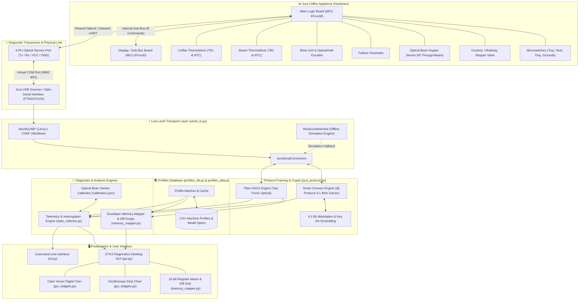
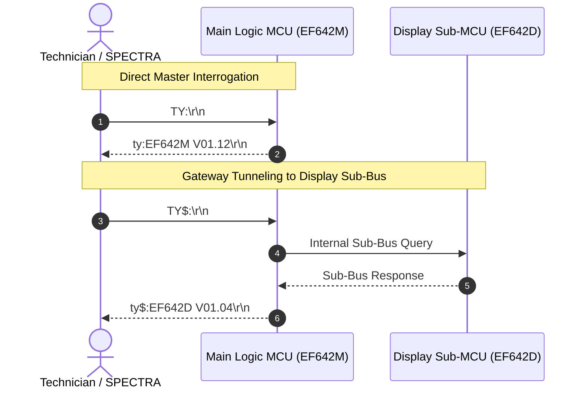

# SPECTRA — System Architecture & Connection Overview
**Universal Hardware Telemetry, Real-Time Logic Board Diagnostics & Reverse-Engineering Suite for Jura Automatic Coffee Appliances**

---

## 1. High-Level System Architecture

SPECTRA is engineered as a modular, hardware-centric telemetry and diagnostic platform. It interfaces with both legacy and contemporary Jura automated coffee machines via non-invasive, read-only diagnostic links.

The following diagram illustrates how all software layers connect to the physical appliance:



---

## 2. Hardware Connectivity & Pinout Topology

### Physical Diagnostic Port
Jura coffee machines feature a proprietary service port located behind the water tank, under the bean hopper lid, or behind the front fascia:

```
          Jura 4-Pin Service Interface (Top View)
          ┌─────────────────────────────────────┐
          │   [Pin 1]   [Pin 2]   [Pin 3]   [Pin 4]  │
          │     VCC       RX        TX       GND     │
          │   (+5V DC)  (Serial)  (Serial)  (Ground) │
          └─────────────────────────────────────┘
```

* **Signal Characteristics**:
  - **Baud Rate**: `9600 baud`
  - **Data Bits**: `8`
  - **Parity**: `None`
  - **Stop Bits**: `1` (`9600 8N1`)
  - **Voltage Levels**: 5V TTL (in galvanic mode) or modulated infrared optical pulses (in optocoupler scanner mode).
  - **Line Termination**: Commands are terminated by `\r\n` (CRLF).

### Dual-MCU Architecture: Main MCU vs. Display Sub-Bus
High-end machines (e.g., IMPRESSA Z5, Z6, Z7, XJ5, GIGA) utilize a distributed dual-microcontroller architecture:
1. **Main Logic Board MCU (`EFxxxM`)**:
   - Master controller for low-level machine hydraulics, high-voltage triacs, heating elements, thermistors, motor encoders, and the persistent EEPROM.
   - Responds to root queries: `TY:`, `IC:`, `RT:`, `RE:`, `HZ:`, `AS:`.
2. **Display & Interface Sub-Bus MCU (`EFxxxD`)**:
   - Dedicated processor governing rotary switch encoders, TFT/OLED graphic displays, illumination LEDs, and user button matrix.
   - Connected internally to the Main MCU via a synchronous sub-bus.
   - Addressed transparently through the primary diagnostic port using dollar-sign prefixed commands: `TY$:`, `TL$:`, `CS$:`.



---

## 3. Communication Modes

SPECTRA automatically probes and adapts to two distinct protocol standards:

| Communication Mode | Applicable Appliances | Operating Characteristics |
| :--- | :--- | :--- |
| **Mode A: Plain-ASCII Optical (Jura USB Scanner / Direct Serial)** | IMPRESSA (C, F, J, S, X, Z series), ENA, E-line, Sub-2015 machines. | Human-readable ASCII commands (`TY:`, `RT:`, `RE:`, `HZ:`). Split into 8-bit addressing (2 hex digits, 256 words) and 16-bit addressing (4 hex digits, 512 words). |
| **Mode B: Encrypted Smart Connect (@-Protocol)** | Modern machines equipped with Bluetooth Smart Connect dongles or modern BLE/UART logic boards (Z6, Z10, E8, S8, GIGA 6). | Proprietary scrambled 4:1 wire carrier modulation. Requires strict 4-step handshake (`@T0` $\to$ `@T1` $\to$ `@t2:` $\to$ `@T3`). |

---

## 4. Safety Invariants & Diagnostic Protection

To prevent accidental damage or non-volatile memory corruption on production and customer appliances, SPECTRA enforces a hardware safety invariant at the lowest serial driver layer:

1. **Strictly Read-Only Whitelist (`SAFE_READ_PREFIXES`)**:
   - Only non-intrusive interrogation prefixes are permitted: `TY:`, `TY$:`, `TL:`, `TL$:`, `CS$:`, `IC:`, `RT:`, `RE:`, `HZ:`, `AS:`, `@TR:`, `@TG:`, `@TF:`, `@T0`, `@T1`, `@t2:`.
2. **Hard Rejection of Mutating Commands (`FORBIDDEN_WRITE_COMMANDS`)**:
   - Any packet beginning with or containing `WE:` (Word Write), `WT:` (Block Write), `DA:` (Display Overwrite), `FA:` (Factory Action), or `@tw:` (Smart Connect Write) triggers an immediate `PermissionError` and is dropped before transmission to the serial bus.
