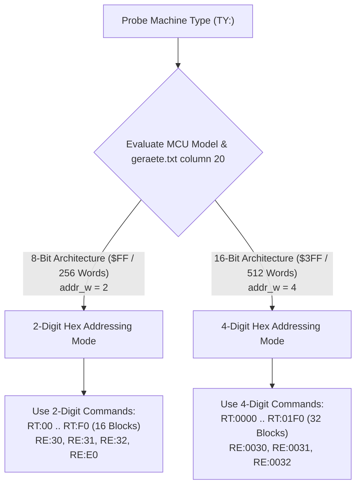
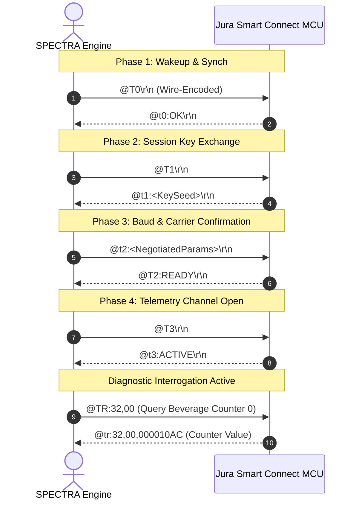

# SPECTRA — Hardware Interfacing & Wire Protocols

---

## 1. Physical Hardware Interface & Optical Transceiver

Jura automatic coffee centers use an optical or galvanic asynchronous serial interface to communicate with factory service equipment.

### The Optical Transceiver Link
Rather than exposing exposed copper traces directly to high humidity, boiling water, and high-voltage brew groups, many Jura appliances use infrared optical couplers located behind the service port door:
* **Emitter**: Infrared LED pulsed by the microcontroller UART Tx pin.
* **Receiver**: Infrared phototransistor monitored by the microcontroller UART Rx pin.
* **Optical Timing Constraints**:
  - Because phototransistor optical saturation requires recovery time, SPECTRA inserts a **30 ms to 50 ms inter-frame pacing delay** between successive queries.
  - Without this inter-frame guard, optical echo and buffer overflow can occur on older MCUs, causing missed packets (`None` response) or corrupted hex digits.

```
SPECTRA (PC)                     Jura USB Scanner                   Jura Coffee Appliance
┌──────────────────┐            ┌──────────────────┐               ┌───────────────────────┐
│                  │            │                  │  IR Light     │                       │
│  stats_collector │◄──USB Cable──► FTDI / CP2102  │══════════════►│ Phototransistor (RX)  │
│  serial_io.py    │ (Virtual   │ Opto-Transceiver │◄══════════════│ IR LED (TX)           │
│                  │  COM Port) │                  │  IR Light     │ Main MCU (Top-Tronic) │
└──────────────────┘            └──────────────────┘               └───────────────────────┘
```

---

## 2. Protocol Mode A: Top-Tronic Plain-ASCII Protocol

Top-Tronic Plain-ASCII is the primary diagnostic protocol for Jura appliances spanning from ~2000 to ~2018 (IMPRESSA C, E, F, J, S, X, Z lines and early ENA series).

### Microcontroller Addressing Architectures: 8-Bit vs. 16-Bit EEPROM
A critical distinction exists across Jura Top-Tronic generations regarding how EEPROM memory addresses are formatted:



#### 1. Top-Tronic 8-Bit EEPROM Architecture (`address_width = 2`)
* **EEPROM Size**: 256 words (0x00 to 0xFF, 512 bytes).
* **Number of Blocks**: 16 blocks (0x00, 0x10, 0x20, ..., 0xF0) of 16 words each.
* **Command Address Format**: **Strictly 2 hex characters** (`RE:xx`, `RT:xx`).
* **Applicable Models**:
  - `EF509M`, `EF511`, `EF511M`, `EF527M` (ENA Micro 1, 3, 5, 101, IMPRESSA C60, C65).
  - `EF631D`, `EF632D` (IMPRESSA J7, J9.2 Display).
  - `EF642M`, `EF642D` (IMPRESSA Z5 Generation II Main & Display).
  - `EF643D`, `EF644D` (IMPRESSA Z7 Display).
  - Legacy masks: `EPSILON`, `IOTA`, `UFO`, `E90`, `ALPHAM`, `C1300`, `E1300`, `E100`.
* **MCU Parsing Quirk**:
  - The 8-bit MCU UART interpreter reads only the first 2 characters after `RE:`.
  - If SPECTRA sends `RE:0030`, the MCU parses only `00`, returning register `0x00` and ignoring `30`.

#### 2. Top-Tronic 16-Bit EEPROM Architecture (`address_width = 4`)
* **EEPROM Size**: 512 to 1024 words (0x0000 to 0x01FF / 0x03FF).
* **Number of Blocks**: 32 blocks (0x0000 to 0x01F0) of 16 words each.
* **Command Address Format**: **4 hex characters** (`RE:xxxx`, `RT:xxxx`).
* **Applicable Models**: `EF518M` (XJ5), `EF520M`, `EF521M`, `EF523M`, `EF536M` (S8), `EF540M` (Z6), `EF708`.

---

### Master ASCII Command Reference

| Command | Direction | Description | Example Query | Example Response |
| :--- | :---: | :--- | :--- | :--- |
| **`TY:`** | Request | Query Main Logic Board firmware & MCU code | `TY:\r\n` | `ty:EF642M V01.12\r\n` |
| **`TY$:`** | Request | Query Display Sub-Bus MCU firmware | `TY$:\r\n` | `ty$:EF642D V01.04\r\n` |
| **`TL:`** | Request | Query Main Board bootloader version | `TL:\r\n` | `tl:Loader V3.0\r\n` |
| **`TL$:`** | Request | Query Display Sub-Bus bootloader version | `TL$:\r\n` | `tl$:Loader V3.0\r\n` |
| **`CS$:`** | Request | Query Display Sub-Bus checksum / status | `CS$:\r\n` | `cs$:0000\r\n` |
| **`IC:`** | Request | Query appliance electrical power rating | `IC:\r\n` | `ic:230V 50Hz\r\n` |
| **`RT:<BLK>`** | Request | Read 16-word EEPROM block (64 hex characters) | `RT:30\r\n` | `rt:07DD000426B9...\r\n` |
| **`RE:<ADDR>`** | Request | Read single 16-bit EEPROM word (4 hex characters) | `RE:30\r\n` | `re:07DD\r\n` |
| **`HZ:`** | Request | Read live digital & analog hardware telemetry | `HZ:\r\n` | `hz:010001100000,027E,00E2...\r\n` |
| **`AS:`** | Request | Interrogate optical bean hopper sensor ADC | `AS:\r\n` | `as:077206400000,077206A90001\r\n` |

---

### Detailed Telemetry Packet: `HZ:` Format
The `HZ:` query returns 10 comma-separated fields representing the instantaneous physical state of the coffee center:

```
hz: [0]TriacsState, [1]FlowRate, [2]CoffeeNTC, [3]Pulses, [4]EncoderPos, [5]SteamNTC, [6]ValveState, [7]AuxBits, [8]Keypad, [9]ErrorCode
```

| Field Index | Format / Units | Physical Component | Interpretation & Decoding Rules |
| :---: | :--- | :--- | :--- |
| **0** | 12-char Hex Bitfield | Power Triacs & State | Bit 0: Pump active; Bit 1: Grinder active; Bit 2: Multiway valve busy; Bit 6: Multiway valve initialized; Bit 8: Coffee heating; Bit 9: Steam heating. |
| **1** | Decimal / Hex | Turbine Flowmeter | Live water flow rate in pulses per unit time (ml/s calculated via pulse ratio). |
| **2** | 4-char Hex ADC | Coffee Thermoblock | NTC thermistor reading: Decoded via `val / 10.0` (°C). E.g., `0x00E2` = $226 \implies 22.6^\circ\text{C}$. |
| **3** | Decimal / Hex | Water Counter | Total volume of water passed in current active brewing or rinsing cycle. |
| **4** | 4-char Hex Ticks | Brew Unit Encoder | Current stroke position of brew unit piston. Evaluated against calibrated mill and home targets. |
| **5** | 4-char Hex ADC | Steam Thermoblock | Secondary thermoblock NTC reading. If reading $\ge 1900$ (e.g. `0x0802` = 2050), secondary thermoblock is absent (single-heater machine). |
| **6** | Hex / Bitfield | Valve Position Switch | Microswitch contacts indicating current physical port of the ceramic valve. |
| **7** | Hex Bitfield | Auxiliary Inputs | Microswitch presence: Water tank float, Drip tray presence, Waste coffee grounds container full. |
| **8** | Hex Bitfield | User Interface Matrix | Rotary dial pulse encoder position and momentary button actuation state. |
| **9** | Hex Integer | Diagnostic Error Code | Last latched hardware alarm or error trip code (0 = Nominal). |

---

### Detailed Telemetry Packet: `AS:` (Optical Bean Hopper Sensor)
Jura machines equipped with optical hopper monitoring use an infrared through-beam sensor situated in the neck above the grinder burrs:

```
                  Optical Bean Hopper Sensor Geometry
           
                    [ Infrared LED Emitter ]
                               │
                       IR Beam │  (Through Hopper Neck)
                               ▼
                   [ Phototransistor Receiver ]
```

* **Query Syntax**: `AS:\r\n`
* **Response Format**: `as:<Ambient_ADC_Frame>,<Emitter_Active_ADC_Frame>\r\n`
  - Example: `as:077206400000,077206A90001`
* **Absorption Physics & Delta Formula**:
  $$\text{OFF\_ADC} = \text{HexToInt}(\text{frame1}[4:8]) \quad (\text{Ambient light baseline})$$
  $$\text{ON\_ADC} = \text{HexToInt}(\text{frame2}[4:8]) \quad (\text{Active pulse light level})$$
  $$\Delta = \text{ON\_ADC} - \text{OFF\_ADC}$$
* **Threshold & Detection Logic**:
  - **Full Hopper (Beans Present)**: Beans physically occlude and scatter the infrared beam. Very little light reaches the receiver.
    $$\Delta \le (\text{Threshold} - \text{Hysteresis}) \implies \mathbf{BEANS\ OK\ (GREEN)}$$
  - **Empty Hopper (Fill Beans)**: Beam travels unobstructed through the empty plastic throat. High light reaches the receiver.
    $$\Delta \ge (\text{Threshold} + \text{Hysteresis}) \implies \mathbf{FILL\ BEANS\ (RED)}$$
  - **Nominal Calibrated Baseline**: Default threshold is **99 counts** with **2 counts hysteresis** (Decision boundary: $\le 97$ OK, $\ge 101$ Empty).

---

## 3. Protocol Mode B: Encrypted Smart Connect (@-Protocol)

Modern Jura machines equipped with the Smart Connect Bluetooth interface (or direct logic board UART on newer machines like the Z10, E8, S8) use the `@-Protocol`.

### 4:1 Wire Carrier Modulation
On the wire, plain data is transformed using 4:1 wire carrier modulation:
* Each 8-bit plain data byte is expanded into **four wire bytes**.
* Each wire byte carries 2 bits of actual payload plus timing, parity, and clock framing bits.
* Implemented in [jura_protocol.py](file:///home/a91/Projects/spectra/jura_protocol.py) via `encode_wire()` and `decode_wire()`.

### Cryptographic Scrambling & Framing
Frames are encapsulated with start markers, XOR bit manipulation with dynamic session keys (e.g. `0x20` or `0x5F`), and byte rotation:
* Plain commands are formatted as: `@TR:<REG>,<NUM>` or `@TG:<CMD>`.
* Decoded using `decode_encrypted_frame()`.

### The 4-Step Handshake Sequence
Before a Smart Connect machine will accept telemetry requests, SPECTRA executes the 4-phase link negotiation:


