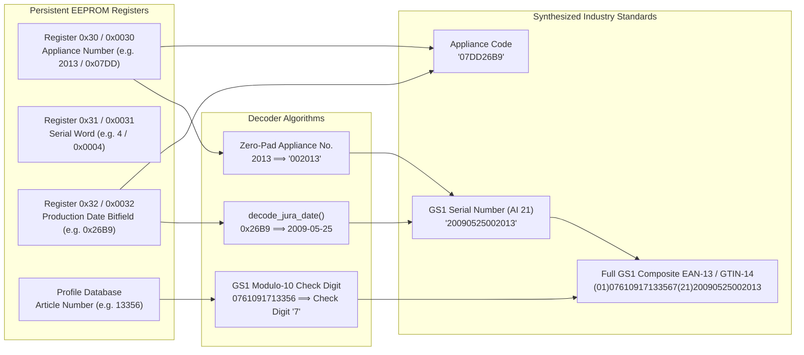
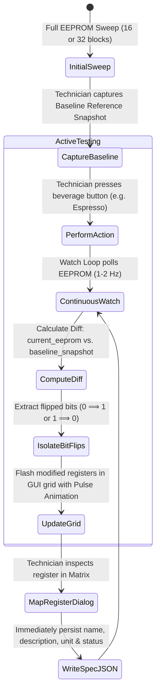

# SPECTRA — Data Flows, State Machines & Telemetry Pipelines

---

## 1. The Interrogation State Machine

The interrogation process in [stats_collector.py](../../stats_collector.py) automatically identifies the machine, determines its addressing width, queries its memory, and extracts its operational metrics:

```mermaid
stateDiagram-v2
    [*] --> PortOpen: Open /dev/ttyUSB0 (9600 8N1)
    
    PortOpen --> ProbeASCII: Send TY:\r\n
    
    state ProbeASCII {
        [*] --> CheckReply
        CheckReply --> ModeA_Detected: Response starts with 'ty:'
        CheckReply --> ModeB_Probe: Timeout / Empty Response
    }
    
    state ModeA_TopTronic {
        ModeA_Detected --> ResolveProfile: Match EF Code in profiles_db
        ResolveProfile --> QueryPower: Send IC:\r\n (Power Rating)
        QueryPower --> CheckAddrWidth: Evaluate address_width (2 vs 4)
        
        CheckAddrWidth --> Sweep8Bit: address_width == 2 (e.g. Z5, ENA, C60)<br/>RT:00..RT:30 + RT:E0
        CheckAddrWidth --> Sweep16Bit: address_width == 4 (e.g. XJ5, S8, Z6)<br/>RT:0000..RT:0030
        
        Sweep8Bit --> QueryDisplay: Send TY$:\r\n (Display Firmware)
        Sweep16Bit --> QueryDisplay: Send TY$:\r\n (Display Firmware)
        
        QueryDisplay --> ReadIdentWords: Read RE:30/0030 (Appliance No),<br/>RE:31/0031 (Serial Word),<br/>RE:32/0032 (Production Date)
        ReadIdentWords --> MapBeverages: Map Single & Double Drinks
    }
    
    state ModeB_SmartConnect {
        ModeB_Probe --> HandshakeT0: Send @T0 (4:1 Wire Encoded)
        HandshakeT0 --> HandshakeT1: Received @t0 -> Send @T1
        HandshakeT1 --> HandshakeT2: Received @t1 -> Send @t2:
        HandshakeT2 --> HandshakeT3: Received @T2 -> Send @T3
        HandshakeT3 --> ReadSmartTelemetry: Query @TR:32,xx (Beverage Counters),<br/>@TG:43 (Maintenance), @TF: (Alerts)
    }
    
    MapBeverages --> ReadSensors: Query Live Sensors (HZ:, AS:)
    ReadSmartTelemetry --> ReadSensors
    
    ReadSensors --> SynthesizeIdentifiers: Compute GS1 Serial & GTIN-14 EAN
    SynthesizeIdentifiers --> GenerateSummary: Build Structured Diagnostics Report
    GenerateSummary --> [*]: Interrogation Complete
```

---

## 2. Telemetry Parsing & Digital Twin Event Pipeline

During live operation, SPECTRA polls the coffee machine at high frequency to update the Digital Twin schematic and strip charts:

```mermaid
sequenceDiagram
    autonumber
    participant UI as GTK3 Main GUI Loop
    participant Worker as Background Telemetry Thread
    participant Link as JuraSerialConnection
    participant MCU as Machine Logic Board

    UI->>Worker: Start Live Polling Loop (10 Hz)
    loop Every 100ms - 250ms
        Worker->>Link: query_ascii("HZ:")
        Link->>MCU: HZ:\r\n (Optical)
        MCU-->>Link: hz:<Bitfields>\r\n
        Link-->>Worker: Raw HZ Telemetry String
        
        opt When Optical Hopper Sensor Present
            Worker->>Link: query_ascii("AS:")
            Link->>MCU: AS:\r\n
            MCU-->>Link: as:<ADC_Frames>\r\n
            Link-->>Worker: Raw AS Telemetry String
        end
        
        Worker->>Worker: Parse HZ (NTC °C, Encoder Ticks, Flowrate, Switches)
        Worker->>Worker: Calculate AS Delta: (ON_ADC - OFF_ADC)
        Worker->>Worker: Compare AS Delta against Calibrated Threshold & Hysteresis
        
        Worker->>UI: GLib.idle_add(update_ui_state, parsed_data)
        UI->>UI: Redraw Cairo Vector Digital Twin Canvas
        UI->>UI: Append New Sample to Strip Chart Oscilloscope
    end
```

---

## 3. Serial Number, Appliance Code & EAN Synthesis

Jura machines store serial number components in non-volatile registers. SPECTRA reassembles these into standard GS1 barcodes:



### GS1 Check Digit Calculation (Modulo 10)
To construct the official 14-digit GTIN, the base string `07610917` + 5-digit zero-padded article number (13 digits total) is passed to `calculate_gs1_check_digit()`:
1. Starting from the rightmost digit, alternate multiplying each digit by 3 and 1.
2. Sum the products.
3. The check digit is the amount needed to round the sum up to the nearest multiple of 10:
   $$\text{CheckDigit} = (10 - (\text{Sum} \pmod{10})) \pmod{10}$$

---

## 4. Developer Memory Mapper: Differential Inspection Engine

The Memory Mapper enables non-invasive discovery of unknown registers during brewing or testing:


