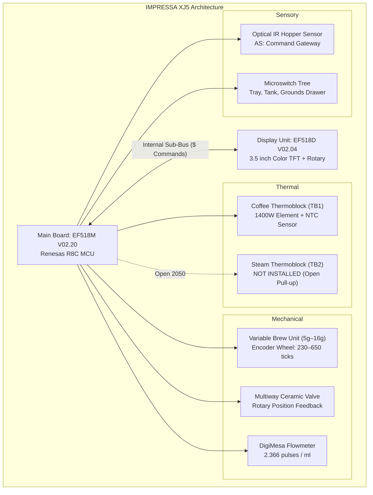

# Jura Model Specification: IMPRESSA XJ5 Professional GII

**Model Family**: Jura IMPRESSA XJ5 Professional GII (Commercial X-Line)  
**Main Logic Board**: `EF518M V02.20` | **Main Bootloader**: `R8Cx Loader V2.0`  
**Display Sub-MCU**: `EF518D V02.04` | **Display Bootloader**: `R8C Loader V2.0`  
**Jura Article Numbers**: `13705` (Smart Connect Brillantsilber), `13583` (Platinum), `13636` (Dark Inox)  
**Hardware Revision Code (`IC:`)**: `0x0F0B` / `0x230A` | **Display ROM Checksum (`CS$:`)**: `0x0105`  
**Tested Unit Electronic Serial**: `0051` | **Production Date**: May 30, 2013 (`0x42BC`)

---

## 1. Hardware Architecture & Subsystems

### Key Hardware Characteristics:
1. **Single Thermoblock Architecture**:
   * The XJ5 features one high-performance 1400W Coffee Thermoblock (`TB1`).
   * Volatile telemetry field `HZ[5]` reads `0802` (`2050` decimal), representing an open pull-up resistor.
   * Safety fault register `RE:0028` bits 6 and 7 map to `HB_Relay_Main` and `HB_Overheat` (rather than Steam NTC).

2. **Espresso & Black Coffee Commercial Specialist**:
   * Pure black coffee hydraulic system without an automatic cappuccinatore or motorized air intake valve.
   * Lifetime milk preparations (`RE:0013`) and milk volume (`RE:00BB` low byte) are always `0`.
   * Features high-clearance dual dispensing spouts and dedicated bypass hot water spout.

3. **Commercial 500g Bean Hopper with Optical Sensor**:
   * Equipped with a commercial-capacity bean hopper and clear optical prism in the funnel throat.
   * Uses active infrared reflection (`AS:` command) rather than motor current estimation to track bean depletion.

4. **Commercial External Plumbing Support**:
   * Fully supported connections for external commercial filtration and plumbing lines.
   * Tracks lifetime external filter volume throughput and rinse thresholds (`Filter_Ext_*`).

---

## 2. Model-Specific Hardware Commands & Protocols

### A. Optical Bean Hopper Sensor (`AS:`)
The optical hopper sensor is read exclusively via the Jura analog diagnostic command:
* **Query**: `AS:\r\n`
* **Response Format**: `as:VREF, OFF_ADC, 0000, VREF, ON_ADC, 0001`
  * `Group 0` (`0000`): Ambient light reading when IR LED is off (`~1360–1614` ADC counts).
  * `Group 1` (`0001`): Reflected infrared light reading when IR LED is pulsed on (`~1445–1792` ADC counts).

#### Calibration & State Thresholds
* **Empty Hopper (Reflective)**:
  * Infrared pulse reflects cleanly off the bare optical prism back into the photodiode.
  * `ON_ADC` rises to **`1726`–`1792` counts** ($> 1710$ ADC threshold).
  * Net delta $\Delta = (\text{ON\_ADC} - \text{OFF\_ADC})$ is **$+97$ to $+104$ counts**.
  * Appliance indicates: *"Doplňte kávová zrna"* / *"Fill beans"*.
* **Hopper Charged (Absorption)**:
  * Dark coffee beans scatter and absorb the infrared pulse away from the photodiode.
  * `ON_ADC` drops down to **`1445`–`1665` counts** ($\le 1680$ ADC threshold).
  * Net delta $\Delta$ drops to **$+65$ to $+81$ counts**.
  * Appliance indicates: *"Ready to brew"*.

### B. Front Panel Sub-Bus (`$` Commands)
The 3.5" color TFT display and front-panel rotary encoder run on a separate microcontroller:
* `TY$:\r\n` $\rightarrow$ `ty$:EF518D V02.04` (Display firmware version)
* `TL$:\r\n` $\rightarrow$ `tl$:R8C Loader V2.0` (Display bootloader version)
* `CS$:\r\n` $\rightarrow$ `cs$:0105` (Display ROM checksum)
* `TS$:4,02\r\n` $\rightarrow$ Display language country code selection (`IT`, `CZ`, etc.)
* `DI$:\r\n` $\rightarrow$ Built-in Display Pixel Test (*Warning*: forces full BU re-homing; do not poll in read-only mode).

---

## 3. Brew Unit Mechanical Calibration (Encoder Ticks)

The IMPRESSA XJ5 uses the standard Variable Brewing Unit (5g to 16g dose capacity) driven by a 24V DC motor with a dual-channel optical slotted encoder disc:

| Position State | Nominal Range | Calibrated Live Value on XJ5 | Register / Source | Description |
| :--- | :---: | :---: | :---: | :--- |
| **Upper Stop Limit** | `1250–1350` ticks | **`1,292` ticks** (`0x050C`) | `RE:0040` | Absolute mechanical physical upper stop |
| **Upper Reference** | `645–655` ticks | **`650` ticks** (`0x028A`) | `HZ[1]` & `RE:00CC` | Upper travel reference and cake ejection / rinse zone |
| **Compression Chamber** | `500–560` ticks | **`520` ticks** (`0x0208`) | `RE:0043` | Piston entrance to compression cylinder |
| **Pre-Brew Travel** | `260–280` ticks | **`266` ticks** (`0x010A`) | `RE:0042` | Intermediate tamping stroke |
| **Lower Mill Target** | `225–235` ticks | **`230` ticks** (`0x00E6`) | `RE:0041` & `RE:00D1` | **Calibrated Home Position (Grinder Drop)** |
| **Cake Thickness** | `10–40` ticks | **`14` / `29` ticks** | `HZ[8]` | Compressed puck: `14` ticks = dry/empty grind, `29` ticks = strong espresso |

---

## 4. Model-Specific EEPROM Register Map

These registers are specific to the commercial hardware profile and recipe layout of the IMPRESSA XJ5:

### A. Commercial Plumbing & External Filtration Registers

| Address | Live Hex | Decimal | Parameter Name | Description |
| :---: | :---: | :---: | :--- | :--- |
| **`0x0000`** | `0000` | `0` dl | `Filter_Ext_Watervolume` | Cumulative volume through external filtration |
| **`0x0003`** | `0000` | `0` dl | `Filter_Ext_Watervolumeafter` | Water drawn after external filter expiry limit |
| **`0x0070`** | `0000` | `0` dl | `Filter_Ext_Rinsing` | Rinse water volume delivered through external filter |
| **`0x0071`** | `0000` | `0` dl | `Filter_Ext_Limit_Rinsing` | External filter maximum rinse limit threshold |
| **`0x0076`** | `0000` | `0` dl | `Filter_Ext_Watervolume2` | Secondary external filter volume accumulator |
| **`0x008B`** | `0000` | `0` dl | `Filter_Ext_Limit_Water` | Warning threshold for external filter replacement |

### B. Front-Panel 4-Button Beverage Recipe Matrix

The XJ5 features 4 direct front-panel selection buttons assigned to classic espresso and coffee drinks:

| Address | Live Hex | High Byte Setting | Low Byte Setting | Assigned Front-Panel Product |
| :---: | :---: | :--- | :--- | :--- |
| **`0x00B4`** | `0000` | `Espresso_2_Settings` | `Espresso_1_Settings` | **Button 1 / 2**: Single Espresso & Double Espresso (strength & pre-brew) |
| **`0x00B5`** | `0000` | `Coffee_2_Settings` | `Coffee_1_Settings` | **Button 3 / 4**: Single Coffee & Double Coffee (strength & pre-brew) |
| **`0x00B9`** | `0000` | `Espresso_2_Volume` | `Espresso_1_Volume` | Dispensed water portion for Single / Double Espresso |
| **`0x00BA`** | `0000` | `Coffee_2_Volume` | `Coffee_1_Volume` | Dispensed water portion for Single / Double Coffee |
| **`0x00BB`** | `0000` | `Hotwater_Volume` | `Milk_Volume` (`0` on XJ5) | Hot water portion (milk volume inactive on XJ5) |
| **`0x00A9`** | `0000` | `Hotwater_Settings` | Unused | Water temperature and bypass valve timing for tea water |

---

## 5. Live Production & Diagnostic Snapshot

Live memory dump taken from physical unit `/dev/ttyUSB0` on October 26, 2026:
* **Lifetime Coffee Cups**: `4,265` Single Espresso + `18,245` Single Coffee + `1,214` Double Espresso cups + `11,242` Double Coffee cups = **`34,966` total cups**.
* **Tablet Cleanings**: `166` programs completed (`RE:0008` = `0x00A6`).
* **Descalings**: `38` programs completed (`RE:0009` = `0x0026`).
* **Grinder Run Time**: `28,163` seconds = **`7.82` hours** of active grinding (`RE:000A` = `0x6E03`).
* **Configured Water Hardness**: **`30 °dH`** (`RE:00C3` = `0x1E32`).
* **Active Language**: Czech Republic (`Country_Code` = `"CZ"` / `0x435A`).
