# Uživatelská příručka SPECTRA (Čeština)

> **Přehledná příručka pro servisní dílnu a tým** · Platí pro **SPECTRA Build `20261123.2040`** a novější.
>
> Tato příručka je napsaná lidsky a bez zbytečného technického žargonu. Provede vás od prvního spuštění programu přes čtení kávovaru, tisk protokolu pro zákazníka a export dat až po připojení ke GitHubu a nahlášení chyby.

---

## Obsah

1. [Co je SPECTRA a jak začít](#1-co-je-spectra-a-jak-začít)
2. [Bezpečnost práce, připojení kávovaru a režim DEMO](#2-bezpečnost-práce-připojení-kávovaru-a-režim-demo)
3. [Orientace v hlavním okně](#3-orientace-v-hlavním-okně)
4. [Podrobný přehled všech 9 záložek](#4-podrobný-přehled-všech-9-záložek)
5. [Servisní protokol pro zákazníka (tisk a PDF)](#5-servisní-protokol-pro-zákazníka-tisk-a-pdf)
6. [Export dat, číslo zakázky a diagnostický balíček](#6-export-dat-číslo-zakázky-a-diagnostický-balíček)
7. [Lokální AI a oprava špatných počitadel (offsetů)](#7-lokální-ai-a-oprava-špatných-počitadel-offsetů)
8. [Jak se připojit ke GitHubu (krok za krokem)](#8-jak-se-připojit-ke-githubu-krok-za-krokem)
9. [Jak nahlásit chybu nebo poslat návrh na vylepšení](#9-jak-nahlásit-chybu-nebo-poslat-návrh-na-vylepšení)
10. [Nastavení, knihovna kávovarů a aktualizace](#10-nastavení-knihovna-kávovarů-a-aktualizace)
11. [Ladící konzole (`🐞`) a rychlá pomoc při problémech (FAQ)](#11-ladící-konzole-a-rychlá-pomoc-při-problémech-faq)

---

## 1. Co je SPECTRA a jak začít

**SPECTRA** je dílenský diagnostický program pro automatické kávovary (primárně **Jura**, dále podporuje také vybrané modely **Nivona**, **Kalerm / Lamanti-KL** a **Jetinno / Lamanti-JN**).

V praxi vám pomůže hlavně s těmito úkoly:
- **Rychlé vyčtení počitadel** — přesně uvidíte, kolik káv, mléčných specialit, čištění a odvápnění má stroj za sebou.
- **Živá kontrola součástek** — teploty topných bloků, poloha spařovací jednotky, průtok vody, spínače misky, nádržky a bezpečnostní čidla.
- **Servisní protokol pro zákazníka** — na jedno kliknutí vytvoříte přehlednou kartu stroje k vytištění nebo uložení do PDF.
- **Záloha paměti a export dat** — uložení dat pod číslem zakázky do Excelu (`.csv`), textu (`.txt`) nebo zálohy paměti (`.json`).
- **Oprava špatně mapovaných počitadel** — když nový model kávovaru ukazuje špatná čísla, program umí najít správné pozice v paměti.
- **Jednoduché hlášení chyb a aktualizace** — přímo z aplikace můžete poslat zpětnou vazbu nebo stáhnout novou verzi.

### Jak program spustit

| Systém | První instalace | Každodenní spuštění |
| :--- | :--- | :--- |
| **Windows** | Spusťte instalátor `spectra_setup_build....exe` a potvrďte instalaci. | Otevřete zástupce **SPECTRA** na ploše nebo v nabídce Start (soubor `spectra.exe`). |
| **Linux** | Naklonujte složku aplikace (případně rozbalte balíček). | Ve složce programu spusťte `./run_ui.sh`. Program se automaticky otevře v prohlížeči. |

### První spuštění, vestavěná Nápověda a Interaktivní průvodce

Při prvním spuštění se automaticky zobrazí **Interaktivní průvodce** (7 krátkých obrazovek), který vám ukáže základy ovládání.
- Kdykoliv později můžete kliknout na tlačítko **`NÁPOVĚDA`** v horní liště — otevře se tato kompletní ilustrovaná příručka (s vyhledáváním, listováním kapitolami, přepínačem CZ/EN i tlačítkem pro spuštění **Interaktivního průvodce**).
- Průvodce spustíte také přes **`NASTAVENÍ` → `Spustit interaktivního průvodce`**.

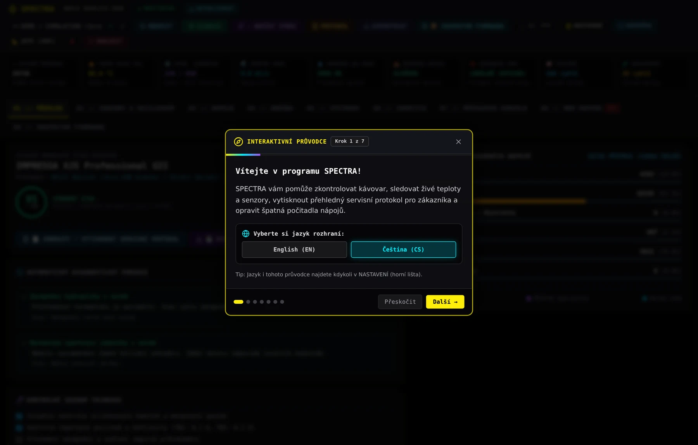

> [!TIP]
> **Přepnutí jazyka a zvětšení písma:**
> - Jazyk přepnete v okně **`NASTAVENÍ`** hned nahoře tlačítkem **`Čeština (CS)`** nebo **`English (EN)`**.
> - Pokud jsou prvky na malém notebooku příliš malé (nebo na velkém monitoru moc velké), klikněte v pravé horní liště na tlačítko **`📐 AUTO (100%)`** a vyberte pohodlné měřítko zobrazení.

---

## 2. Bezpečnost práce, připojení kávovaru a režim DEMO

> [!CAUTION]
> **Důležité elektrické upozornění (230 V):**
> Servisní konektor u kávovarů Jura **nemusí být galvanicky oddělený od síťového napětí 230 V**.
> K počítači připojujte kávovar **VŽDY pouze přes originální optický skener Jura (N 010)** nebo přes **galvanicky izolovaný USB–UART kabel** (s optočlenem nebo izolačním čipem). Nikdy nepoužívejte obyčejný neizolovaný převodník přímo ze sítě!

> [!WARNING]
> **Nikdy nespouštějte dva diagnostické programy najednou:**
> Pokud k jednomu kabelu (např. `COM3` / `/dev/ttyUSB0`) přistupují současně dva programy, jejich příkazy se na kabelu promíchají. Kávovar se pak může nečekaně vypnout nebo přestat odpovídat.

### Jak připojit skutečný kávovar (4 kroky)

1. **Připojte servisní kabel** (optický skener Jura nebo izolovaný USB kabel) do USB portu počítače a do servisního konektoru kávovaru.
2. **Zapněte kávovar** hlavním vypínačem (u většiny modelů Jura komunikuje servisní port jak v zapnutém stavu, tak v pohotovostním režimu).
3. V horní liště programu SPECTRA rozklikněte **výběr portu** (vlevo vedle tlačítka **`OBNOVIT`**) a vyberte svůj kabel:
   - na Windows má název typu **`COM3`**, **`COM4`** apod.,
   - na Linuxu má název typu **`/dev/ttyUSB0`** nebo **`/dev/ttyACM0`**.
   - *(Pokud jste kabel zapojili až po spuštění programu, klikněte na malou šipku obnovení `↻` hned vedle roletky portů.)*
4. Klikněte na fialové tlačítko **`⚡ NAČÍST STROJ`**. Během několika sekund SPECTRA vyčte model, počitadla, historii údržby i stav všech čidel.

### Jak si vše bezpečně vyzkoušet bez kávovaru (Režim DEMO)

Pokud nemáte zrovna na stole připojený kávovar (nebo zaučujete nového kolegu), vyberte v roletce portů:

> **`DEMO / SIMULATION (Jura Impressa XJ5)`**

a klikněte na **`⚡ NAČÍST STROJ`**. Program nasimuluje skutečný profesionální kávovar **IMPRESSA XJ5 Professional GII** — můžete si v klidu vyzkoušet všechny záložky, živé grafy, tisk protokolu i export souborů.

---

## 3. Orientace v hlavním okně

Po načtení kávovaru uvidíte hlavní pracovní plochu, která se skládá ze čtyř částí:
1. **Horní ovládací lišta** — výběr portu, hlavní akce, nápověda, nastavení a nahlášení chyby.
2. **9 rychlých stavových kartiček** — okamžitý přehled nejdůležitějších hodnot na první pohled.
3. **Lišta 9 záložek (`01` až `09`)** — přepínání mezi jednotlivými sekcemi programu.
4. **Spodní informační řádek** — stav připojení, rychlé teploty, poloha spařovací jednotky a čas posledního čtení.

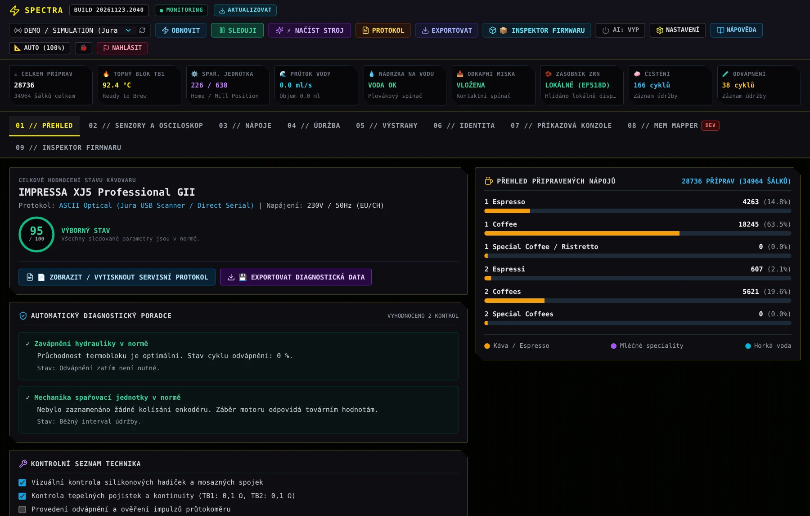

### Co dělá každé tlačítko v horní liště

| Prvek / Tlačítko | K čemu slouží |
| :--- | :--- |
| **`BUILD 20261123.2040`** | Číslo aktuální verze programu. Při řešení technické podpory podle něj hned poznáme, jakou verzi máte. |
| **Stavový štítek aktivity** *(kapsle vedle buildu)* | Živý indikátor, co program právě dělá (viz tabulka významů níže). |
| **`AKTUALIZOVAT`** *(příp. zelený štítek nové verze)* | Otevře kontrolu a instalaci nové verze SPECTRA. Pokud je dostupná nová verze, upozorní vás přímo na liště. |
| **Výběr portu + `↻`** | Zvolíte připojený kabel (`COM*` / `/dev/ttyUSB*`) nebo `DEMO`. Ikonka `↻` znovu vyhledá připojené kabely. |
| **`OBNOVIT`** | Jednorázově znovu načte aktuální hodnoty čidel (teploty, spínače, polohu spařovací jednotky). |
| **`SLEDUJI` / `SPUSTIT SLEDOVÁNÍ`** | Zapíná a vypíná automatické živé čtení čidel každou ~1 sekundu. Zelené **`SLEDUJI`** znamená, že data běží živě. |
| **`⚡ NAČÍST STROJ`** | **Hlavní tlačítko pro každodenní práci.** Kompletně vyčte paměť kávovaru (model, počty nápojů, údržbu, výstrahy a čidla). |
| **`PROTOKOL`** | Otevře hotový **Servisní protokol** připravený k vytištění nebo uložení do PDF pro zákazníka. |
| **`EXPORTOVAT`** | Otevře okno pro uložení dat do souborů (`.json`, `.csv`, `.txt`), zadání čísla zakázky a zálohu celé paměti EEPROM. |
| **`📦 INSPEKTOR FIRMWARU`** | Rychlý skok na záložku `09` pro kontrolu firmwaru a překladů dotykových panelů *(pokročilý nástroj)*. |
| **`AI: VYP` / `AI: ZAP`** | Rychlý vypínač lokální umělé inteligence. Ve výchozím stavu je **VYP** (nezabírá žádnou paměť RAM). |
| **`NASTAVENÍ`** | Otevře kompletní nastavení: jazyk, AI modely, knihovnu 174 kávovarů, připojení ke GitHubu, kalibrace a aktualizace. |
| **`NÁPOVĚDA`** | Otevře tuto **vestavěnou uživatelskou příručku** s obrázky, vyhledáváním, přepínačem CZ/EN a spuštěním interaktivního průvodce. |
| **`📐 AUTO (100%)`** | Změna zvětšení celé obrazovky (vhodné pro menší notebooky nebo monitory s vysokým rozlišením). |
| **`🐞`** *(červený brouček)* | Otevře **Monitor procesů a ladění** (živý technický log pro případ potíží). |
| **`NAHLÁSIT`** | Otevře formulář pro rychlé nahlášení chyby nebo návrhu na vylepšení přímo na GitHub. |

### Význam barevného stavového štítku (nahoře vedle čísla buildu)

| Štítek | Barva | Co se právě děje |
| :--- | :--- | :--- |
| **`MONITORING`** | Zelená | Program živě čte teploty a čidla kávovaru každou sekundu. |
| **`ČTENÍ 45 %`** | Fialová | Probíhá čtení paměti kávovaru (EEPROM) — počkejte pár sekund, neodpojujte kabel. |
| **`AI PRACUJE`** | Modrá / fialová | Lokální AI zrovna zpracovává shrnutí nebo hledá správné počitadlo. |
| **`ODESÍLÁNÍ GITHUB`** | Modrá | Probíhá odesílání diagnostického balíčku nebo nahlášení chyby na GitHub. |
| **`AKTUALIZACE 60 %`** | Tyrkysová | Stahuje se nebo instaluje nová verze programu. |
| **`CHYBA KOMUNIKACE`** | Červená | Kávovar neodpovídá (zkontrolujte kabel, napájení a vybraný port). |
| **`PŘIPRAVEN` / `NEČINNÝ`** | Šedá / zelená | Program čeká na další akci, kabel zrovna nekomunikuje. |

### Co ukazuje 9 horních stavových kartiček

| Kartička | Co přesně znamená | Na co si dát pozor v praxi |
| :--- | :--- | :--- |
| **1. ☕ CELKEM PŘÍPRAV** | Celkový počet všech výdejů stroje (pod ním menším písmem celkový počet šálků). | U dvojitých káv se jedna příprava počítá jako 2 šálky. Horká voda / pára se počítá do příprav, ale ne do šálků kávy. |
| **2. 🔥 TOPNÝ BLOK TB1** | Aktuální teplota hlavního kávového bojleru ve °C. | Připravený kávovar drží běžně **80 až 115 °C** (např. `92.4 °C` = `Ready to Brew`). Studený stroj ukazuje pokojovou teplotu. |
| **3. ⚙️ SPAŘ. JEDNOTKA** | Aktuální poloha spařovací jednotky (počet kroků snímače + popis polohy). | V klidu bývá `Home / Mill Position` (např. `226 / 638`). Při přípravě kávy se číslo mění podle zdvihu pístu. |
| **4. 🌊 PRŮTOK VODY** | Okamžitý průtok přes průtokoměr (`ml/s`) a objem dávky. | V klidu je `0.0 ml/s`. Při výdeji kávy nebo proplachu musí hodnota plynule naskakovat — pokud zůstává na nule, je ucpaný okruh nebo vadný průtokoměr. |
| **5. 💧 NÁDRŽKA NA VODU** | Stav plovákového snímače hladiny vody. | **`VODA OK`** = vody je dostatek. Při vytažení nebo vyprázdnění nádržky zčervená. |
| **6. 📥 ODKAPNÍ MISKA** | Stav kontaktního mikrospínače odkapní misky a zásobníku sedliny. | **`VLOŽENA`** = vše je správně zasunuto. Pokud svítí chyba i při vložené misce, bývají zoxidované kontakty na zadní straně misky. |
| **7. 🫘 ZÁSOBNÍK ZRN** | Stav snímače zrnkové kávy. | U modelů řady **XJ5 / XJ9 (`EF518`)** zde svítí zelené **`LOKÁLNĚ (EF518D)`** — to není chyba! U těchto strojů je čidlo zrn zapojené přímo do přední desky displeje a po servisním kabelu se nepřenáší. Hlídejte zrna přímo podle displeje kávovaru. |
| **8. 🧼 ČIŠTĚNÍ** | Celkový počet provedených čisticích cyklů tabletou. | Dobrý ukazatel, jak se zákazník o kávovar staral (v poměru k celkovému počtu káv). |
| **9. 🧪 ODVÁPNĚNÍ** | Celkový počet provedených odvápňovacích cyklů. | Pokud má stroj tisíce káv a 0 odvápnění (a nepoužívá filtr), bývá zavápněný topný blok nebo ventil. |

---

## 4. Podrobný přehled všech 9 záložek

Záložky jsou seřazené od nejjednodušších pro běžnou dílenskou práci (`01` až `06`) až po specializované technické nástroje (`07` až `09`).

---

### `01 // PŘEHLED` *(Každodenní práce)*

Hlavní souhrnná obrazovka, na které strávíte nejvíce času. Nahoře (viz obrázek v kapitole 3) vidíte:
- **Celkové hodnocení stavu kávovaru (`0–100`)** — rychlá známka kondice stroje (např. `95 / 100 VÝBORNÝ STAV`), název modelu, komunikační protokol a napájení.
- Rychlá tlačítka **`ZOBRAZIT / VYTISKNOUT SERVISNÍ PROTOKOL`** a **`EXPORTOVAT DIAGNOSTICKÁ DATA`**.
- **Přehled připravených nápojů** (pravý sloupec) — přehledný sloupcový graf, jaké nápoje se na kávovaru připravovaly nejčastěji (barevně rozlišená káva, mléčné speciality a horká voda).

Když na záložce `01 // PŘEHLED` sjedete níže, najdete další tři užitečné panely:

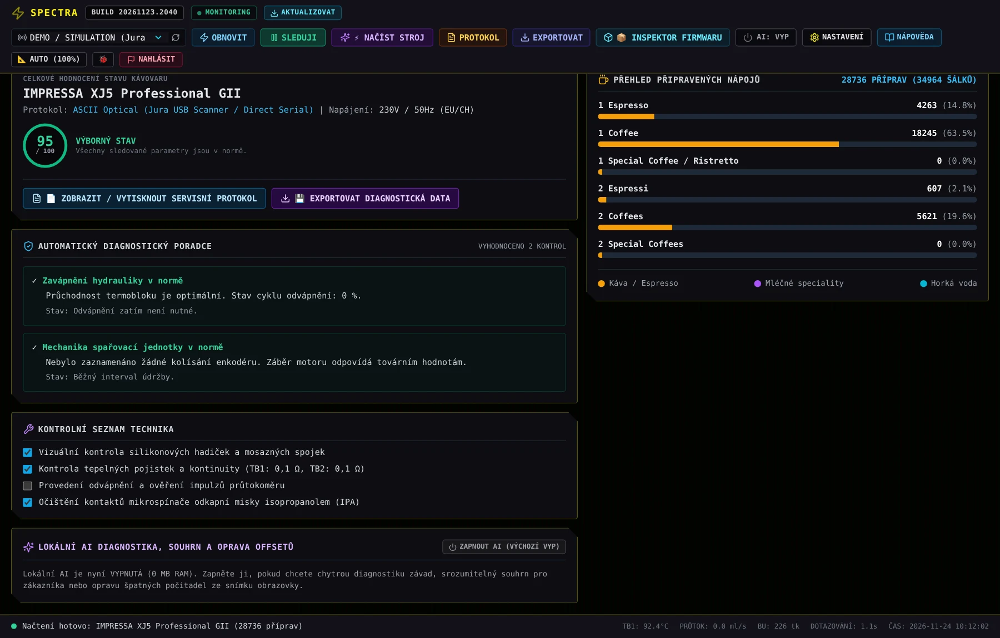

- **Automatický diagnostický poradce** — sám zkontroluje zavápnění hydrauliky, stav mechaniky spařovací jednotky a další ukazatele a napíše vám srozumitelný verdikt.
- **Kontrolní seznam technika** — dílenský checklist (kontrola hadiček, tepelných pojistek, odvápnění, vyčištění kontaktů misky isopropanolem). Položky si můžete při servisu postupně odškrtávat.
- **Lokální AI diagnostika, souhrn a oprava offsetů** — zde můžete jedním tlačítkem **`ZAPNOUT AI`** aktivovat chytrý souhrn pro zákazníka nebo automatickou opravu špatných počitadel (podrobněji v [kapitole 7](#7-lokální-ai-a-oprava-špatných-počitadel-offsetů)).

---

### `02 // SENZORY A OSCILOSKOP` *(Každodenní práce / Diagnostika)*

Tato záložka slouží k živé kontrole všech fyzických součástek kávovaru.

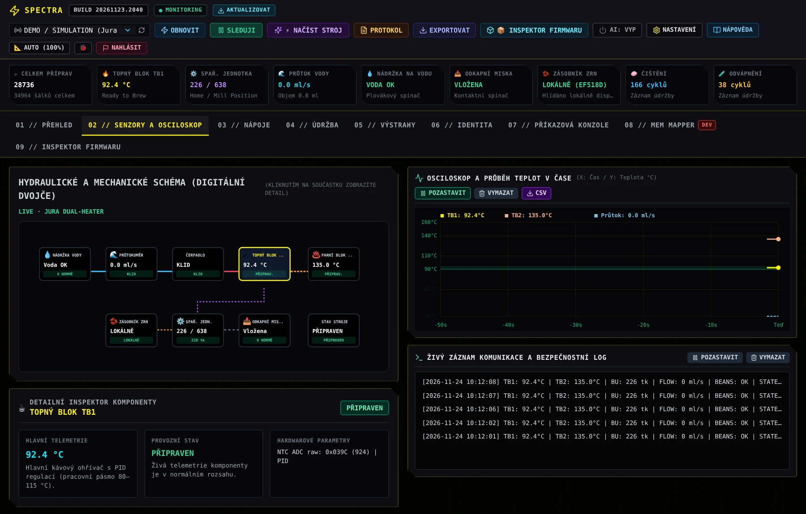

- **Digitální dvojče (schéma stroje vlevo)** — zjednodušený plánek kávovaru s živými hodnotami. **Na jakoukoliv součástku ve schématu můžete kliknout** (např. `Topný blok TB1`, `Parní blok TB2`, `Spařovací jednotka`, `Průtokoměr`, `Nádržka`, `Miska`, `Zásobník zrn`) a hned pod schématem se zobrazí její detailní stav a technické parametry.
- **Živý osciloskop (vpravo)** — vykresluje průběh teplot (TB1, TB2) a průtoku v čase. Skvělé na odhalení kolísajících čidel nebo výpadků ohřevu při testovací kávě. Tlačítky nahoře graf kdykoliv **Pozastavíte** nebo **Vymažete**.
- **Živý datový proud sběrnice** — řádek po řádku ukazuje čerstvě vyčtené hodnoty se značkou času.

Když sjedete na záložce `02 // SENZORY A OSCILOSKOP` níže, uvidíte detailní kontrolu všech čidel a mikrospínačů:

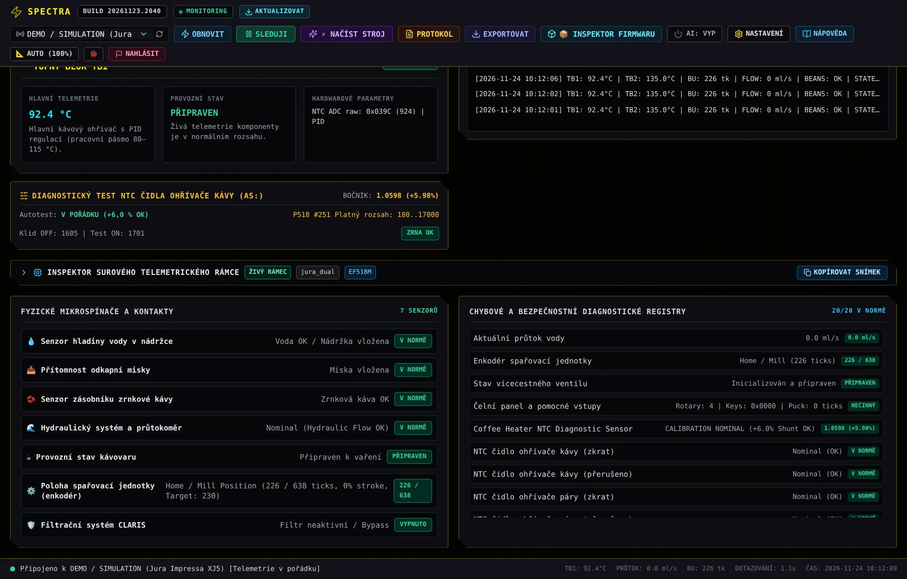

- **Diagnostický test NTC čidla ohřívače kávy (`AS:`)** — ověřuje přesnost teplotního čidla na kávovém bojleru pomocí vnitřního testovacího bočníku (`+6,0 % OK`). Zelený stav znamená, že čidlo měří správně.
- **Inspektor surového telemetrického rámce** — po rozkliknutí ukáže surová data ze stroje. Tlačítkem **`KOPÍROVAT SNÍMEK`** je jedním kliknutím zkopírujete, pokud si je vyžádá vývojář.
- **Fyzické mikrospínače a kontakty** — jasný seznam všech spínačů (voda, miska, zrna, průtokoměr, stav kávovaru, enkodér, filtr CLARIS) s barevným štítkem **`V NORMĚ`** / **`PŘIPRAVEN`** / **`VYPNUTO`**.
- **Chybové a bezpečnostní diagnostické registry** — souhrnná kontrola 20 bezpečnostních parametrů (zkraty a přerušení NTC čidel, stav vícecestného ventilu, tlačítka čelního panelu atd.).

---

### `03 // NÁPOJE` *(Každodenní práce)*

Kompletní tabulka všech naprogramovaných nápojů z paměti kávovaru s přesným počtem kusů a procentuálním podílem.

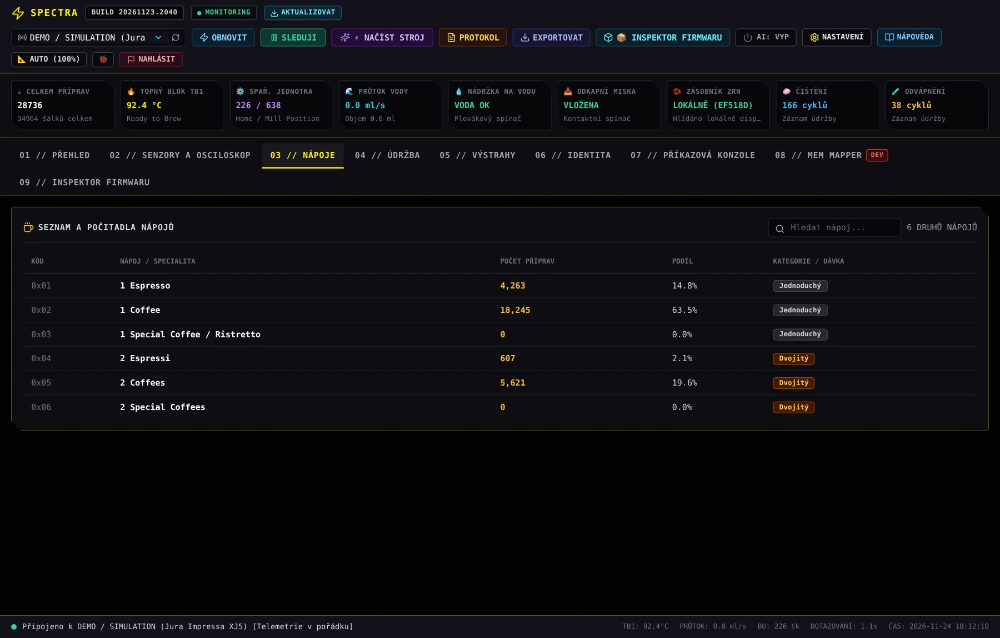

> [!NOTE]
> **Proč se může lišit „Celkem příprav“ a „Celkem šálků kávy“?**
> - **Celkem příprav** zahrnuje úplně všechno, co kávovar vydal — tedy i samostatnou horkou vodu na čaj, páru nebo čisté mléko / mléčnou pěnu.
> - **Šálků kávy** počítá pouze nápoje obsahující kávu (espresso, káva, ristretto, cappuccino, latte macchiato apod.). Dvojité nápoje (`2 Espressi`, `2 Coffees`) přičítají 1 přípravu, ale 2 šálky.

---

### `04 // ÚDRŽBA` *(Každodenní práce)*

Přehled všech servisních a čisticích cyklů, které na kávovaru proběhly za celou dobu jeho provozu.

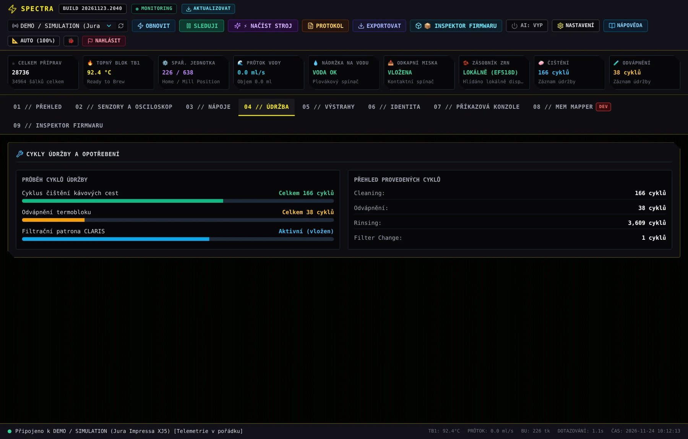

Najdete zde počty **čištění kávových cest**, **odvápnění**, případně **výměn filtru** nebo **čištění mléčného systému** (podle výbavy konkrétního modelu). Je to nejlepší podklad při jednání se zákazníkem o tom, jak byla prováděna pravidelná údržba.

---

### `05 // VÝSTRAHY` *(Každodenní práce)*

Zobrazuje aktuální blokace, které brání kávovaru v přípravě nápoje (např. vytažená miska, prázdná voda, plná sedlina), a také shrnutí historických chybových registrů desky.

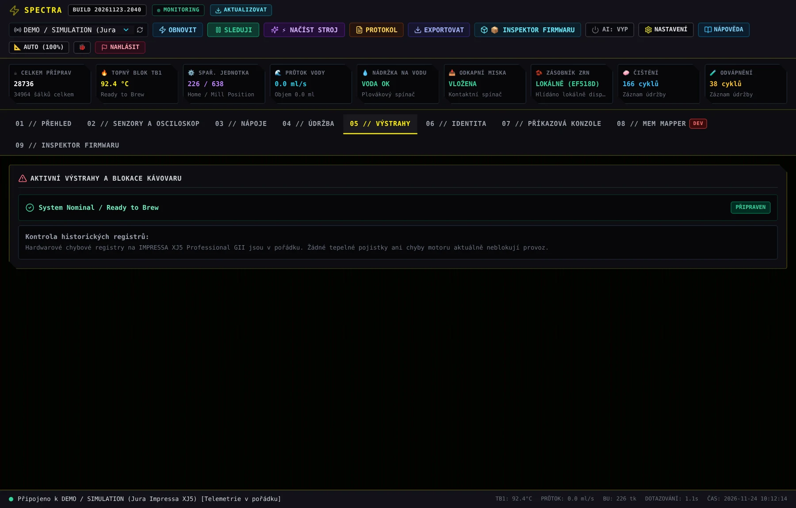

- Pokud je vše v pořádku, svítí nahoře zelené **`PŘIPRAVEN`** (`System Nominal / Ready to Brew`).
- Pokud něco blokuje provoz, objeví se výrazná červená karta s popisem blokace a štítkem **`ALARM`**.

---

### `06 // IDENTITA` *(Každodenní práce)*

Elektronický „rodný list“ připojeného kávovaru — všechny identifikační údaje pěkně pohromadě na jedné obrazovce.

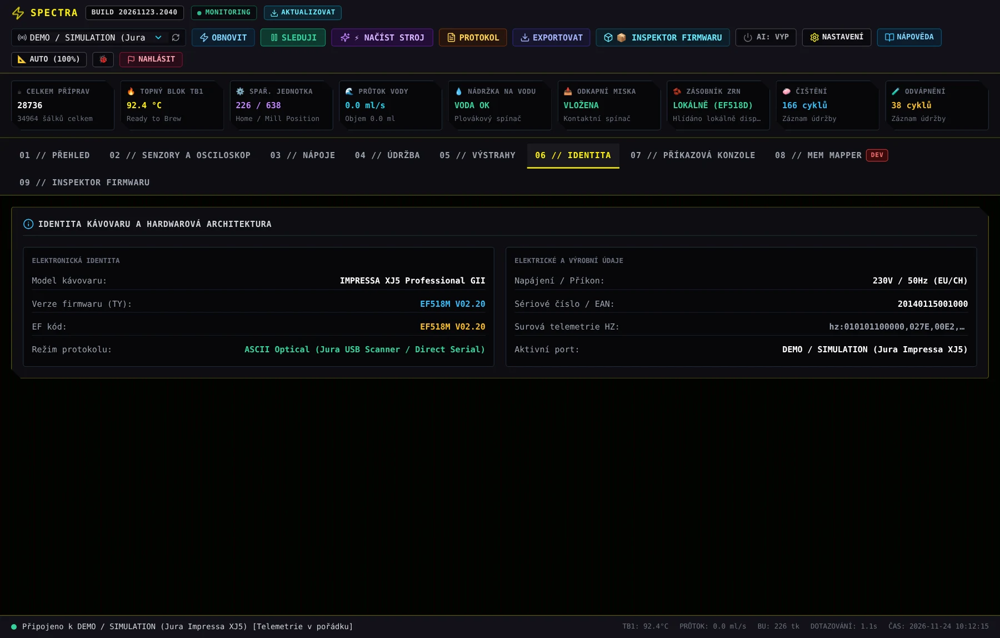

Obsahuje **Model kávovaru**, **Verzi firmwaru (`TY:`)** a **EF kód řídicí desky** *(velmi důležité při objednávání náhradní elektroniky!)*, **Režim protokolu**, **Napájení / Příkon**, **Sériové číslo / EAN** a **Aktivní port**.

---

### `07 // PŘÍKAZOVÁ KONZOLE` *(Pokročilý nástroj)*

*Pro běžnou práci v dílně tuto záložku nepotřebujete.* Slouží pokročilým technikům pro přímou ruční komunikaci s řídicí deskou kávovaru.

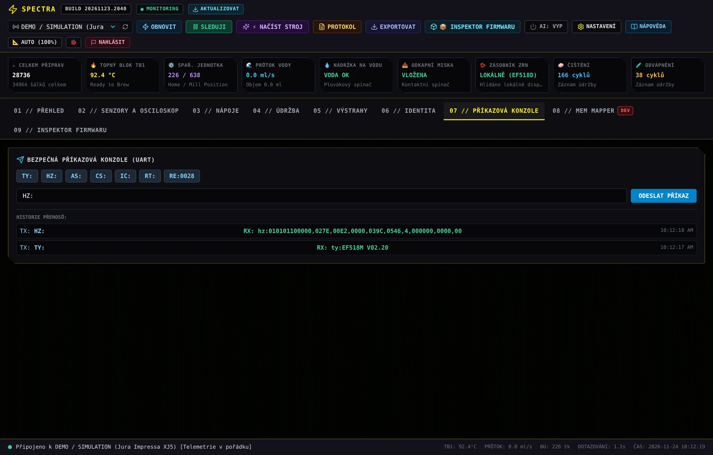

> [!WARNING]
> **Používejte s rozvahou:** Některé ruční servisní příkazy mohou kávovar vypnout (`AN:`), vymazat chyby (`FA:01`) nebo přepsat paměť. Pokud přesně nevíte, co daný příkaz dělá, používejte pouze čtecí tlačítka (`TY:`, `HZ:`, `CS:`, `RT:`).

---

### `08 // MEM MAPPER [DEV]` *(Pokročilý nástroj)*

*Nástroj pro vývojáře a specialisty, kteří přidávají podporu pro nové modely kávovarů.*

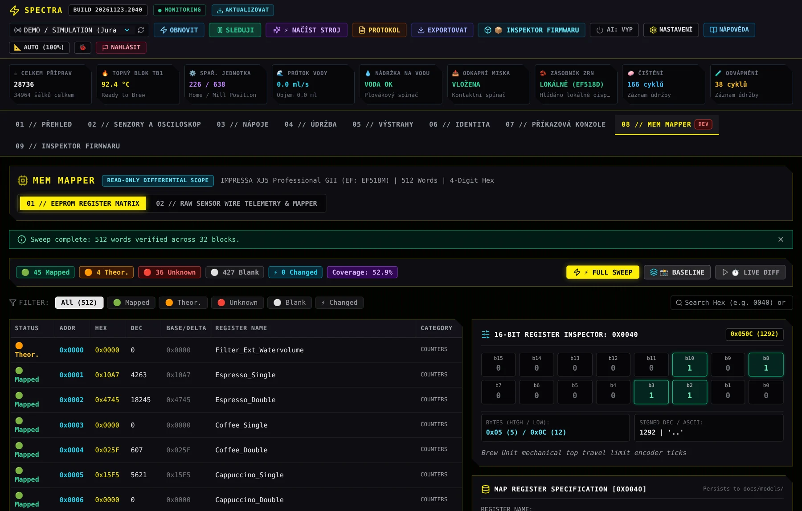

Vyčte všech 512 buněk vnitřní paměti (EEPROM) do barevné mřížky, umožňuje kontrolovat hodnoty v 16-bit / dekadickém / binárním tvaru a v rozdílovém režimu (**Diff**) porovnávat paměť před a po přípravě kávy.

---

### `09 // INSPEKTOR FIRMWARU` *(Pokročilý nástroj)*

*Nástroj pro kontrolu textů a překladů u moderních kávovarů s dotykovým displejem (HMI / Android panel).*

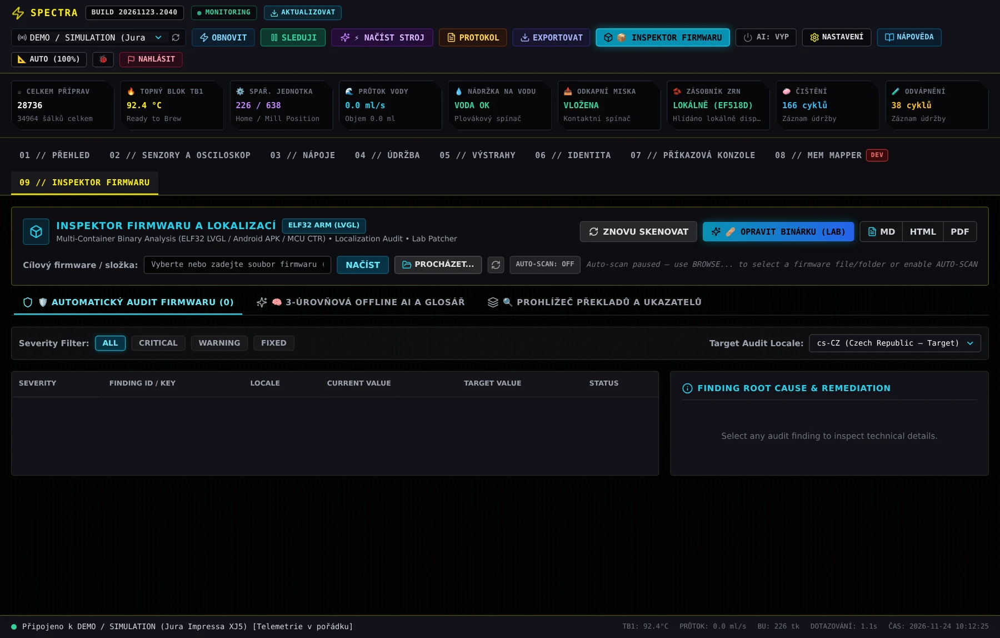

Automaticky odhalí překlepy, prohozené popisky a chyby v překladech dotykových panelů (přes USB/ADB nebo z lokálního souboru firmwaru). Pro běžné čtení kávovarů Jura tuto záložku nepotřebujete.

---

## 5. Servisní protokol pro zákazníka (tisk a PDF)

Kdykoliv chcete zákazníkovi k opravenému kávovaru přiložit přehledný výpis stavu stroje, klikněte v horní liště na oranžové tlačítko **`PROTOKOL`** (nebo na tlačítko **`ZOBRAZIT / VYTISKNOUT SERVISNÍ PROTOKOL`** v Přehledu).

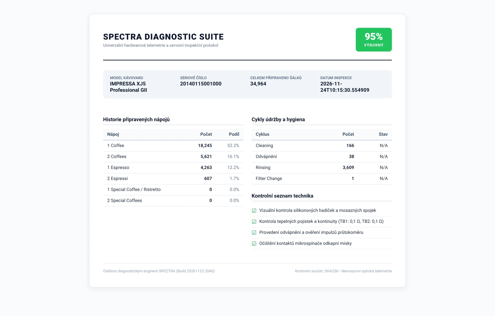

### Jak protokol vytisknout nebo uložit jako PDF

1. Nejprve načtěte kávovar tlačítkem **`⚡ NAČÍST STROJ`**.
2. Klikněte na **`PROTOKOL`** — otevře se čistý bílý dokument v češtině optimalizovaný pro tisk na papír A4.
3. Stiskněte **`Ctrl + P`** (nebo klikněte na tlačítko tisku v horní části protokolu):
   - Pro papírovou kopii vyberte svou tiskárnu a potvrďte **Tisk**.
   - Pro elektronickou verzi (např. do e-mailu) zvolte jako tiskárnu **Uložit jako PDF**.

> [!TIP]
> Pokud před otevřením protokolu zapnete Lokální AI a necháte vygenerovat **Souhrn pro zákazníka**, automaticky se propíše i do tiskového protokolu.

---

## 6. Export dat, číslo zakázky a diagnostický balíček

Kliknutím na tlačítko **`EXPORTOVAT`** v horní liště se otevře okno pro ukládání všech diagnostických údajů.

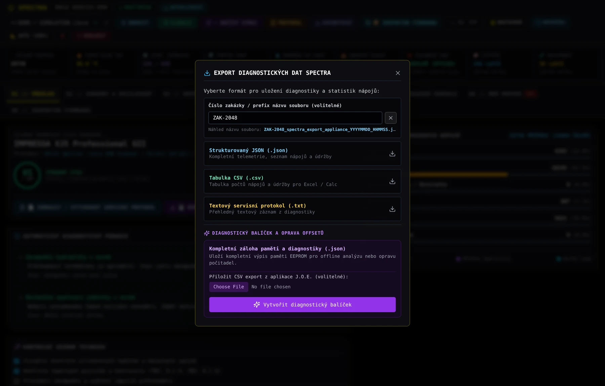

### 1. Číslo zakázky (Vlastní prefix názvu souboru)

Hned nahoře v okně exportu je políčko **Číslo zakázky / prefix názvu souboru (volitelné)** — napište do něj například **`ZAK-2048`** nebo jméno zákazníka.
- Pod políčkem okamžitě uvidíte živý náhled výsledného názvu souboru, např.:
  `ZAK-2048_IMPRESSA_XJ5_Professional_GII_20261124_075049.json`
- Prefix se automaticky použije pro všechny exportované soubory níže.

### 2. Rychlý export do běžných formátů

| Tlačítko | Formát souboru | Kdy ho použít |
| :--- | :--- | :--- |
| **Strukturovaný JSON (`.json`)** | `.json` | Úplná záloha vyčtených dat pro archivaci nebo technickou podporu. |
| **Tabulka CSV (`.csv`)** | `.csv` | Otevřete přímo v **Microsoft Excel** nebo **LibreOffice Calc** (přehledná tabulka počtů nápojů a údržby). |
| **Textový servisní protokol (`.txt`)** | `.txt` | Jednoduchý textový soubor — snadno ho zkopírujete do zakázkového systému nebo e-mailu. |

### 3. Kompletní diagnostický balíček (záloha paměti EEPROM)

Ve spodní fialové sekci **DIAGNOSTICKÝ BALÍČEK A OPRAVA OFFSETŮ** vytvoříte úplný snímek paměti kávovaru (všech 512 slov EEPROM):

1. *(Volitelné)* Pokud máte z aplikace **Jura J.O.E.** vyexportovaný `.csv` soubor se skutečnými počty nápojů, přiložte ho kliknutím na **Vybrat J.O.E. CSV soubor**.
2. Klikněte na fialové tlačítko **`Vytvořit diagnostický balíček`**.
3. Po pár sekundách vyberete ze dvou přehledných možností:

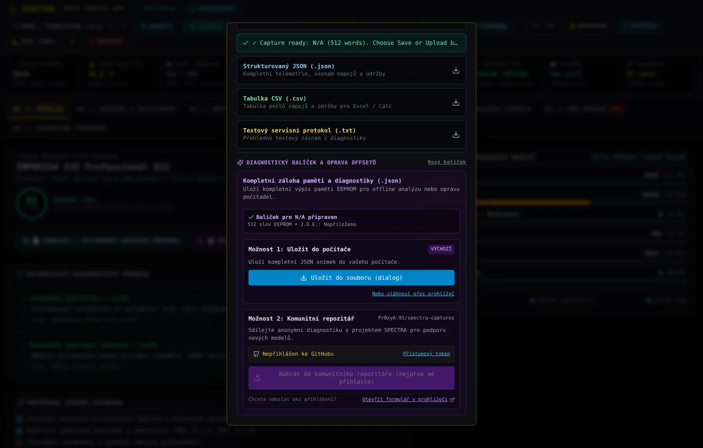

- **Možnost 1: Uložit do počítače (`VÝCHOZÍ`)** — uloží kompletní `.json` balíček na disk (**`Uložit do souboru (dialog)`** nebo **`Nebo stáhnout přes prohlížeč`**).
- **Možnost 2: Komunitní repozitář (`Pr0xyA-91/spectra-captures`)** — volitelné sdílení anonymizovaného snímku pro doplnění podpory nového modelu kávovaru (jedním kliknutím po přihlášení ke GitHubu, nebo ručně přes **`Otevřít formulář v prohlížeči`**).

> [!IMPORTANT]
> SPECTRA **nikdy** neodesílá žádná data na internet sama na pozadí. Odeslání proběhne jen tehdy, když na tlačítko sami výslovně kliknete.

---

## 7. Lokální AI a oprava špatných počitadel (offsetů)

SPECTRA má vestavěného chytrého asistenta, který běží **100 % lokálně na vašem počítači** (přes Ollama) — **žádná data vašich zákazníků se neposílají do cloudu**.

### Jak AI zapnout a vybrat správný model

Ve výchozím nastavení je AI **VYPNUTÁ (`AI: VYP`)**, aby zbytečně nezabírala operační paměť (0 MB RAM).

1. Otevřete **`NASTAVENÍ` → `Lokální AI a modely`**.
2. Vyberte vhodný model podle paměti RAM vašeho počítače:

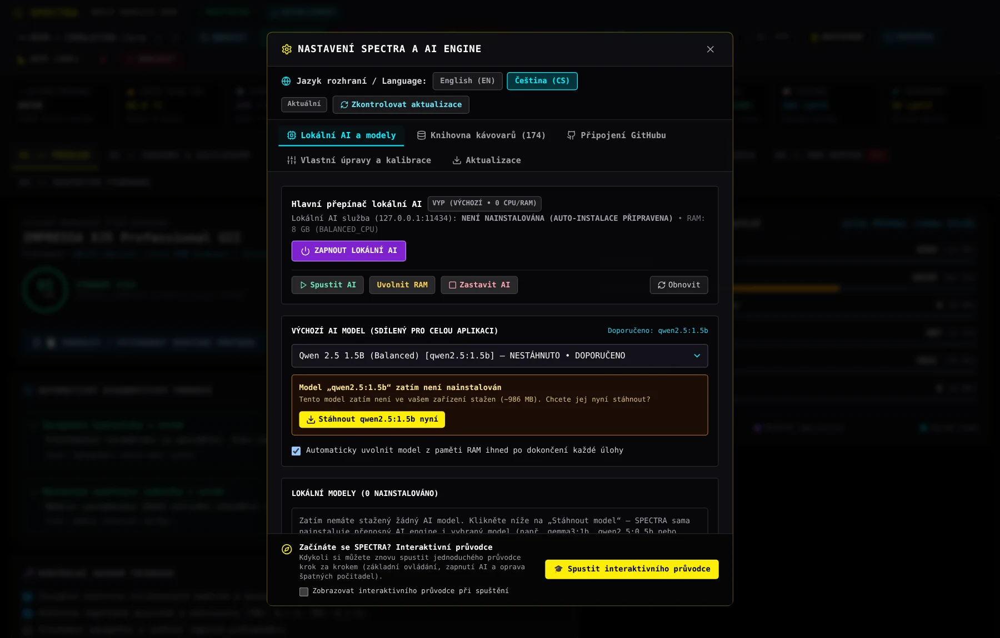

| Typ počítače (RAM) | Doporučený model | Co umí |
| :--- | :--- | :--- |
| **Běžný kancelářský notebook (8 GB RAM)** | `qwen2.5:0.5b` nebo `gemma3:1b` | Rychlé textové shrnutí pro zákazníka a základní diagnostika. |
| **Silnější PC / notebook (16 GB RAM)** | `gemma3:4b` *(Vision)* | **Doporučeno!** Umí navíc „číst z obrázků“ — nahrajete fotku displeje nebo screenshot z J.O.E. a AI sama vyčte reálné počty káv. |
| **Výkonná pracovní stanice (16–32 GB RAM)** | `qwen2.5:7b` / `llama3.1:8b` | Nejpřesnější analýza složitých závad a technických detailů. |

3. Pro aktivaci klikněte na **`AI: VYP`** v horní liště (přepne se na **`AI: ZAP`**) nebo na **`ZAPNOUT AI`** v Přehledu. Stejným kliknutím ji kdykoliv zase vypnete.

### Jak opravit špatná počitadla (kalibrace offsetů)

1. Načtěte kávovar tlačítkem **`⚡ NAČÍST STROJ`**.
2. Zapněte Lokální AI (**`AI: ZAP`**).
3. Na záložce **`01 // PŘEHLED`** sjeďte dolů do bloku **Lokální AI diagnostika, souhrn a oprava offsetů**.
4. Přiložte **CSV soubor z J.O.E.** nebo **fotku / snímek obrazovky** se skutečnými počty nápojů *(vyžaduje Vision model, např. `gemma3:4b`)*.
5. Spusťte kalibraci — SPECTRA najde správné adresy v EEPROM a uloží opravu pro tento model.

### Správa uložených oprav a kalibrací

Všechny lokálně uložené opravy najdete v **`NASTAVENÍ` → `Vlastní úpravy a kalibrace`**:

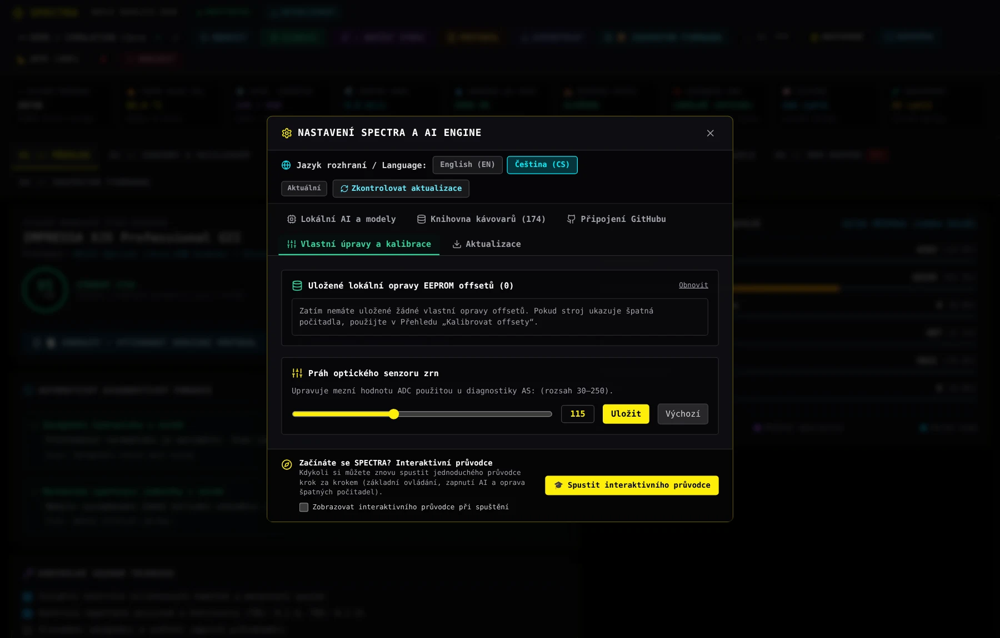

- Kdykoliv zde vidíte seznam uložených oprav a můžete jakoukoliv opravu vrátit zpět na výchozí profil.
- Ve spodní části lze doladit **Práh optického senzoru zrn** (tlačítko **`Výchozí`** vrátí hodnotu `115`).

---

## 8. Jak se připojit ke GitHubu (krok za krokem)

### Potřebuji vůbec GitHub?

- **NE**, pokud jen čtete kávovary, tisknete servisní protokoly a ukládáte si exporty na svůj počítač.
- **ANO**, pokud chcete přímo z aplikace jedním kliknutím **nahlásit chybu** (tlačítko **`NAHLÁSIT`**) nebo **poslat diagnostický balíček** nového modelu do sdílené databáze.

Připojení nastavíte **jen jednou** — pak už vás SPECTRA přihlásí automaticky sama při každém spuštění.

---

### Krok 1: Získejte osobní přístupový klíč na GitHubu

*(Pokud ještě nemáte účet na GitHubu, nejprve si ho zdarma vytvořte na [github.com/signup](https://github.com/signup).)*

1. Přihlaste se na [github.com](https://github.com) ve svém prohlížeči.
2. Klikněte na svou **profilovou ikonu vpravo nahoře** → **Settings** *(Nastavení)*.
3. V levém menu sjeďte úplně dolů a klikněte na **Developer settings**.
4. Rozklikněte **Personal access tokens** → zvolte **Tokens (classic)**.
   > [!IMPORTANT]
   > Vyberte opravdu **Tokens (classic)** — **ne** *Fine-grained tokens*! U klasického tokenu snadno nastavíte přesná oprávnění, která SPECTRA potřebuje.
5. Klikněte na **Generate new token** → **Generate new token (classic)**.
6. Vyplňte formulář:
   - **Note**: napište např. `SPECTRA dilna`.
   - **Expiration**: vyberte např. `90 days` nebo `No expiration`.
   - **Select scopes** — **zaškrtněte přesně tyto dvě položky**:
     - ✅ **`public_repo`** *(najdete po rozkliknutí `repo` — případně zaškrtněte celé `repo` pro interní repozitáře)*
     - ✅ **`gist`** *(umožňuje bezpečně přiložit delší technický log)*
7. Sjeďte dolů a klikněte na zelené tlačítko **Generate token**.
8. Ihned zkopírujte klíč začínající na **`ghp_...`** *(po zavření stránky už ho GitHub znovu neukáže!)*.

---

### Krok 2: Vložte klíč do aplikace SPECTRA

1. V horní liště klikněte na **`NASTAVENÍ`** → záložka **`Připojení GitHubu`** (uvidíte oranžové **`NEPŘIPOJENO`**):

2. Vložte zkopírovaný token **`ghp_...`** do pole **`ghp_... or github_pat_...`** (`Ctrl + V`).
3. Klikněte na žluté tlačítko **`Připojit`**.
4. Stav se během vteřiny změní na zelené **`PŘIPOJENO: @vaše_uživatelské_jméno`**:

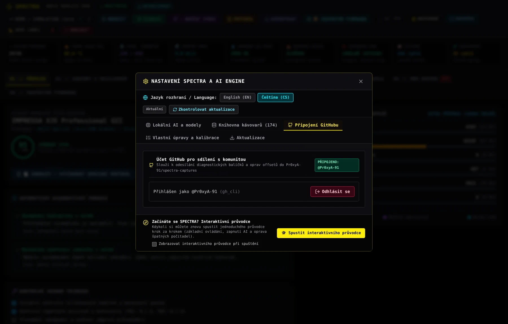

### Hotovo! Co je dobré vědět dál

- **Automatické přihlášení:** SPECTRA se přihlásí k vašemu účtu **automaticky při každém spuštění programu**.
- **Bezpečnost klíče:** Token je uložen v systémové klíčence počítače (Windows Credential Manager / Linux Keyring) nebo soukromém souboru jen pro vašeho uživatele a nikdy se neukládá do logů.
- **Odhlášení:** Kdykoliv můžete účet odpojit tlačítkem **`Odpojit`** v `NASTAVENÍ → Připojení GitHubu`.

---

## 9. Jak nahlásit chybu nebo poslat návrh na vylepšení

Kdykoliv narazíte na problém nebo máte nápad na vylepšení, dejte nám vědět přímo z programu:

1. Klikněte v horní liště na červené tlačítko **`NAHLÁSIT`**.
2. Otevře se formulář **`NAHLÁSIT PROBLÉM NA GITHUB`**:

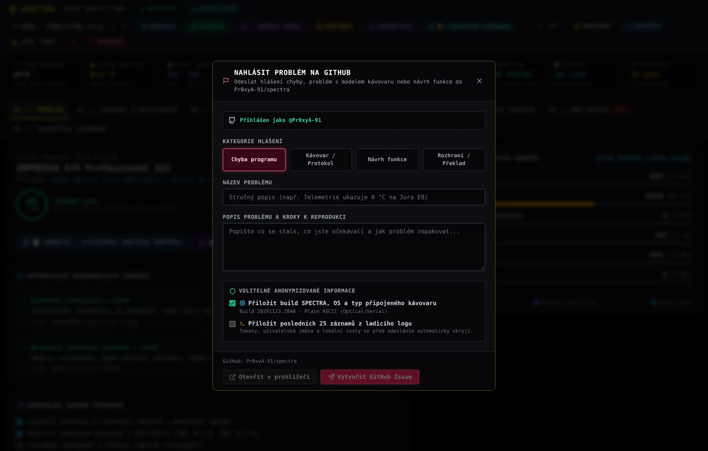

3. Vyberte kategorii, napište stručný název a vlastními slovy popište, jaký kávovar byl připojený a co se stalo.
4. Nechte zaškrtnutou volbu **Přiložit anonymizovaný kontext aplikace** — program přiloží číslo buildu, typ systému, model kávovaru a posledních pár řádků z logu.
   > [!TIP]
   > **Ochrana soukromí:** Před odesláním SPECTRA **automaticky skryje** všechny GitHub tokeny, hesla i jméno uživatele z cest ke složkám.
5. Klikněte na **`Vytvořit GitHub Issue`** (pokud jste přihlášeni), nebo na **`Otevřít v prohlížeči`** (otevře se předvyplněný formulář na webu).

---

## 10. Nastavení, knihovna kávovarů a aktualizace

### Knihovna kávovarů (174+ modelů)

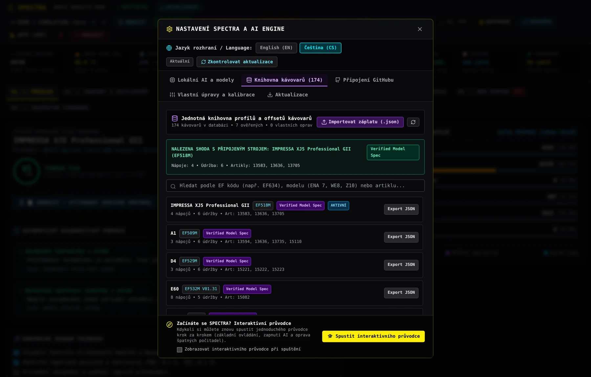

- Vyhledávání podle názvu modelu, EF kódu nebo čísla artiklu.
- Tlačítky **`Import JSON`** a **`Export JSON`** snadno předáte profil nového kávovaru mezi kolegy.

### Aktualizace programu jedním kliknutím

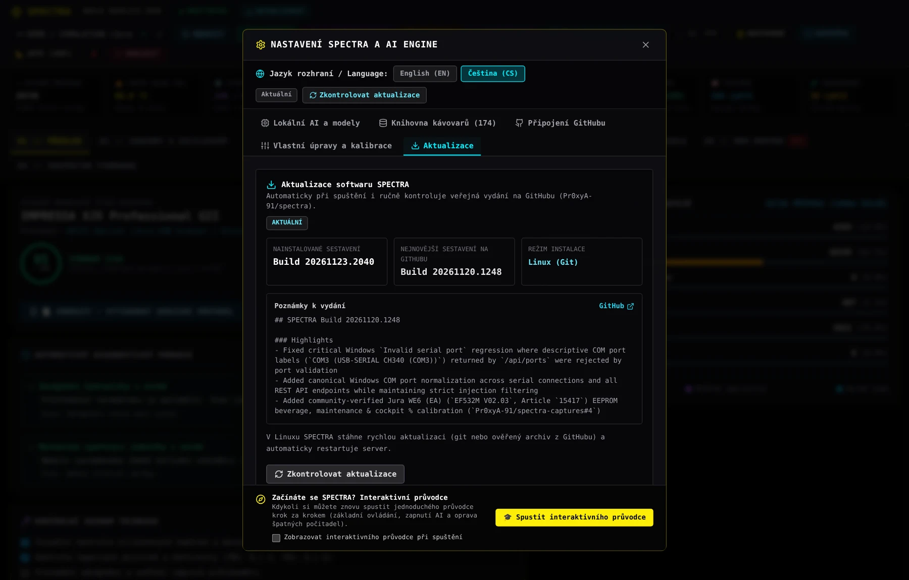

1. Klikněte na **`Zkontrolovat aktualizace`** (nebo tlačítko **`AKTUALIZOVAT`** v horní liště).
2. Pokud je dostupná nová verze, klikněte na **`Stáhnout a nainstalovat aktualizaci`**.
3. Program se bezpečně aktualizuje, **sám uklidí staré nepoužívané soubory** a znovu se spustí.

> [!NOTE]
> **Vaše nastavení zůstane zachováno:** Aktualizace nikdy nesmaže jazykové předvolby, přihlášení ke GitHubu ani vaše lokální kalibrace offsetů.

---

## 11. Ladící konzole (`🐞`) a rychlá pomoc při problémech (FAQ)

### K čemu je ikonka broučka (`🐞`) vpravo nahoře?

Kliknutím na **`🐞`** (nebo zkratkou **`Ctrl + Shift + D`** / **`F12`**) otevřete **Monitor procesů a ladění**:

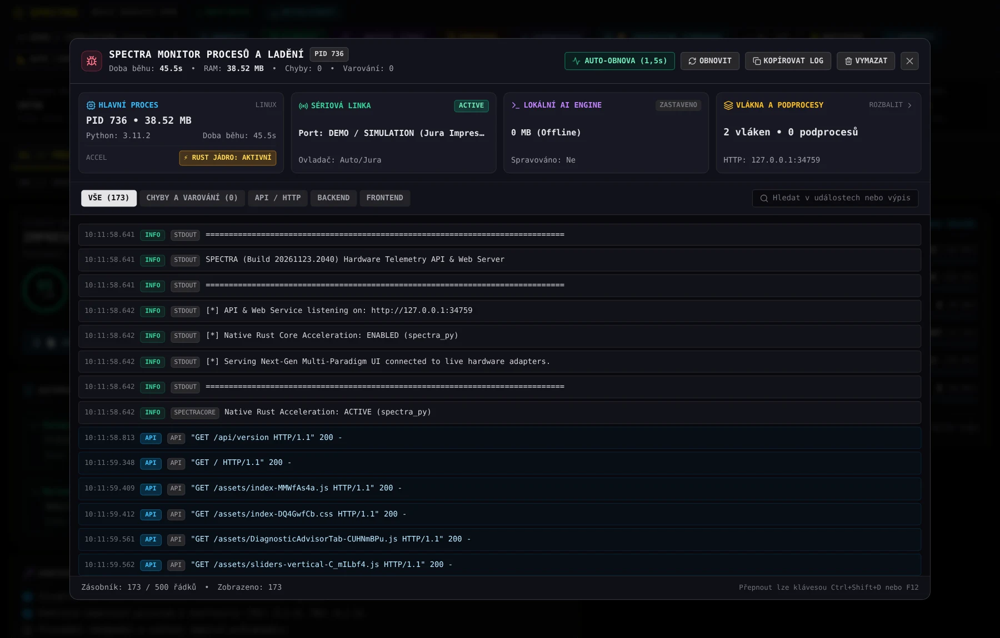

Pomocí tlačítka **`Kopírovat log`** snadno zkopírujete poslední zprávy pro technickou podporu.

---

### Rychlá pomoc — nejčastější otázky a řešení (FAQ)

| Problém / Otázka | Nejčastější příčina a jednoduché řešení |
| :--- | :--- |
| **Kabel jsem zapojil(a), ale nevidím ho v seznamu portů.** | 1. Klikněte na ikonku obnovení **`↻`** hned vedle výběru portu. 2. Zkuste jiný USB port počítače. 3. Na Windows zkontrolujte ve *Správci zařízení* (Porty COM a LPT) ovladač převodníku (FTDI / CH340 / CP210x). |
| **Klikl(a) jsem na `NAČÍST STROJ`, ale objeví se `CHYBA KOMUNIKACE` nebo nulové hodnoty.** | 1. Zkontrolujte, že je kávovar zapnutý do zásuvky a hlavní vypínač je v poloze **I (zapnuto)**. 2. Zkontrolujte správné zasunutí servisního konektoru (u optického skeneru N 010 musí přesně sedět proti okénku). 3. Zavřete případný jiný servisní program, který port blokuje. |
| **U kávovaru Jura XJ5 / XJ9 svítí u zrn `LOKÁLNĚ (EF518D)` — je čidlo rozbité?** | **Ne, je to naprosto v pořádku!** U těchto modelů je čidlo zrn připojené pouze k přední desce displeje (`EF518D`) a po servisním kabelu se nepřenáší. Stav zrn sledujte přímo na displeji kávovaru. |
| **Čísla nápojů nesedí s displejem stroje nebo s aplikací J.O.E.** | Použijte postup z [kapitoly 7 (Oprava offsetů)](#jak-opravit-špatná-počitadla-kalibrace-offsetů), případně vytvořte **Diagnostický balíček** ([kapitola 6](#3-kompletní-diagnostický-balíček-záloha-paměti-eeprom)) a pošlete hlášení přes **`NAHLÁSIT`**. |
| **GitHub hlásí chybu `403 Forbidden` nebo neplatný token.** | Vygenerujte nový **Tokens (classic)** přesně podle [kapitoly 8](#krok-1-získejte-osobní-přístupový-klíč-na-githubu) a ujistěte se, že jsou zaškrtnuté oba boxy **`public_repo`** a **`gist`**. |
| **Program ukazuje, že nejsem přihlášen(a) ke GitHubu.** | Otevřete **`NASTAVENÍ` → `Připojení GitHubu`**, vložte token `ghp_...` a klikněte na **`Připojit`**. Od buildu `20261123.2040` se přihlášení obnovuje automaticky ihned při startu. |
| **Po zapnutí AI je počítač pomalejší.** | V **`NASTAVENÍ` → `Lokální AI a modely`** přepněte na lehčí model (`qwen2.5:0.5b` nebo `gemma3:1b`) a po dokončení shrnutí AI v horní liště vypněte (`AI: ZAP → AI: VYP`). |
| **Písmo je na notebooku moc malé / nevejde se mi lišta.** | Klikněte v pravé horní liště na **`📐 AUTO (100%)`** a vyberte vhodné měřítko (`85 %`, `100 %`, `115 %`, `AUTO`). |
| **Potřebuji si program jen vyzkoušet bez kávovaru.** | Vyberte **`DEMO / SIMULATION (Jura Impressa XJ5)`** v roletce portů a klikněte na **`⚡ NAČÍST STROJ`**. |

---

*Máte nápad, co v této příručce doplnit nebo vysvětlit ještě jednodušeji? Klikněte v horní liště na **`NAHLÁSIT`** a vyberte kategorii **Návrh na vylepšení**.*
