# SPECTRA User Guide (English)

> **Friendly Workshop & Service Manual** · Applies to **SPECTRA Build `20261123.2040`** and newer.
>
> This guide is written in plain, everyday English — no engineering background required. It walks you step by step through starting SPECTRA, reading a coffee machine safely, printing customer service certificates, exporting files, connecting to GitHub, and reporting issues.

---

## Table of Contents

1. [What Is SPECTRA & Quick Start](#1-what-is-spectra-quick-start)
2. [Safety Rules, Connecting a Machine & DEMO Mode](#2-safety-rules-connecting-a-machine-demo-mode)
3. [Finding Your Way Around the Main Screen](#3-finding-your-way-around-the-main-screen)
4. [Complete Tour of All 9 Tabs](#4-complete-tour-of-all-9-tabs)
5. [Printing a Customer Service Certificate (Print & PDF)](#5-printing-a-customer-service-certificate-print-pdf)
6. [Exporting Data, Ticket Numbers & Diagnostic Bundles](#6-exporting-data-ticket-numbers-diagnostic-bundles)
7. [Local AI & Fixing Wrong Drink Counters (Offsets)](#7-local-ai-fixing-wrong-drink-counters-offsets)
8. [How to Connect to GitHub (Step-by-Step)](#8-how-to-connect-to-github-step-by-step)
9. [How to Report a Bug or Request a Feature](#9-how-to-report-a-bug-or-request-a-feature)
10. [Settings, Machine Library & One-Click Updates](#10-settings-machine-library-one-click-updates)
11. [Debug Console (`🐞`) & Quick Troubleshooting (FAQ)](#11-debug-console-quick-troubleshooting-faq)

---

## 1. What Is SPECTRA & Quick Start

**SPECTRA** is a service diagnostic tool for automatic coffee machines (primarily **Jura**, plus selected **Nivona**, **Kalerm / Lamanti-KL**, and **Jetinno / Lamanti-JN** models).

In everyday workshop work, SPECTRA helps you:
- **Read drink & maintenance counters** — instantly see how many coffees, milk drinks, cleanings, and descalings a machine has completed.
- **Check live sensors & temperatures** — inspect heater temperatures, brew unit position, water flow, drip tray, water tank, and safety switches in real time.
- **Print a customer service certificate** — generate a clean, print-ready A4 or PDF summary sheet in one click.
- **Save & archive job data** — export files tagged with your workshop ticket number to Excel (`.csv`), plain text (`.txt`), or a full memory backup (`.json`).
- **Fix misread drink counters** — if a newer board revision stores counters at different memory addresses, SPECTRA can calibrate them automatically.
- **Stay updated & report issues** — download updates or submit bug reports right inside the app.

### How to Launch SPECTRA

| System | First-Time Installation | Daily Startup |
| :--- | :--- | :--- |
| **Windows** | Run the installer `spectra_setup_build....exe` and follow the prompt. | Click the **SPECTRA** shortcut on your Desktop or Start Menu (`spectra.exe`). |
| **Linux** | Open the SPECTRA folder (cloned or extracted archive). | Run `./run_ui.sh` inside the SPECTRA folder. Your browser opens automatically. |

### First Launch, Built-In Help & Interactive Tour

The very first time you open SPECTRA, a short **7-Step Interactive Guide** pops up to walk you through the basics.
- Anytime later, click **`HELP`** in the top bar to open this full illustrated manual — you can browse chapters, search by keyword, switch between English and Czech, or launch the **Interactive Tour** again.
- You can also reopen the tour from **`CONFIG` → `Launch Interactive Guide`**.

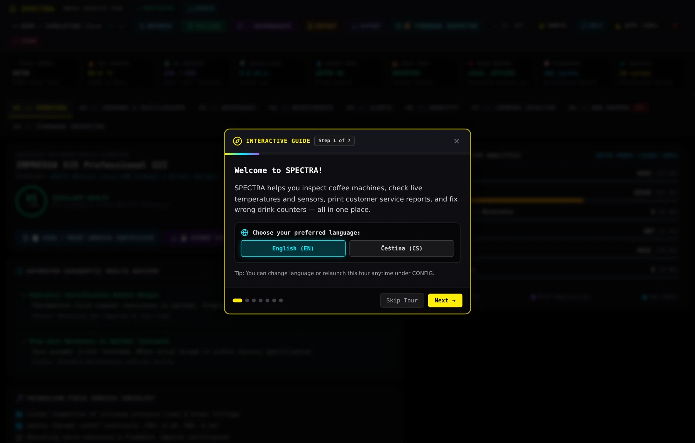

> [!TIP]
> **Switching Language & Screen Zoom:**
> - Switch the entire interface between **English (EN)** and **Čeština (CS)** at the top of **`CONFIG`**.
> - If buttons look too small on a laptop (or too large on a big monitor), click **`📐 AUTO (100%)`** in the top-right bar to cycle comfortable zoom levels (`85%`, `100%`, `115%`, or `AUTO`).

---

## 2. Safety Rules, Connecting a Machine & DEMO Mode

> [!CAUTION]
> **Critical Electrical Safety Warning (230 V / Mains Power):**
> The service port on Jura coffee machines is **not always electrically isolated from mains voltage**.
> **ALWAYS** connect your computer using either an **official Jura optical service scanner (N 010)** or a **galvanically isolated USB-to-UART adapter**. Never plug an unisolated wire adapter directly into a live machine!

> [!WARNING]
> **Never open the same serial cable in two programs at once:**
> If two diagnostic apps access the same port (e.g. `COM3` or `/dev/ttyUSB0`) simultaneously, their messages collide on the cable and can accidentally put the coffee machine into standby or interrupt readings.

### Connecting a Real Coffee Machine (4 Simple Steps)

1. **Plug in your service cable** (optical scanner or isolated USB adapter) into your PC and into the coffee machine's service port.
2. **Power on the machine** using the main power switch (most Jura machines respond over the service port both when powered on and in standby).
3. In the SPECTRA top bar, click the **port dropdown** (on the left next to **`REFRESH`**) and select your cable:
   - On Windows it looks like **`COM3`**, **`COM4`**, etc.
   - On Linux it looks like **`/dev/ttyUSB0`** or **`/dev/ttyACM0`**.
   - *(Plugged the cable in after opening SPECTRA? Click the small circular refresh icon `↻` next to the port box.)*
4. Click the purple **`⚡ INTERROGATE`** button. Within a few seconds, SPECTRA reads the machine model, drink counters, maintenance history, alerts, and live sensors.

### Practice Safely Without a Machine (`DEMO` Mode)

No coffee machine on your desk right now, or training a new coworker? Select:

> **`DEMO / SIMULATION (Jura Impressa XJ5)`**

from the port dropdown and click **`⚡ INTERROGATE`**. SPECTRA simulates a full **IMPRESSA XJ5 Professional GII** machine — every tab, live chart, service certificate, and export works identically to real hardware with zero risk.

---

## 3. Finding Your Way Around the Main Screen

Once a machine is read, the workspace is organized into four clean zones:
1. **Top Control Bar** — port selector, main actions, Help, Settings, and Issue reporting.
2. **9 Live Status Tiles (KPI Cards)** — instant glance at the most important machine vitals.
3. **9 Workspace Tabs (`01` to `09`)** — switch between everyday workshop screens and specialist tools.
4. **Bottom Status Bar** — connection status, quick heater/flow/brew-unit readings, and last update timestamp.

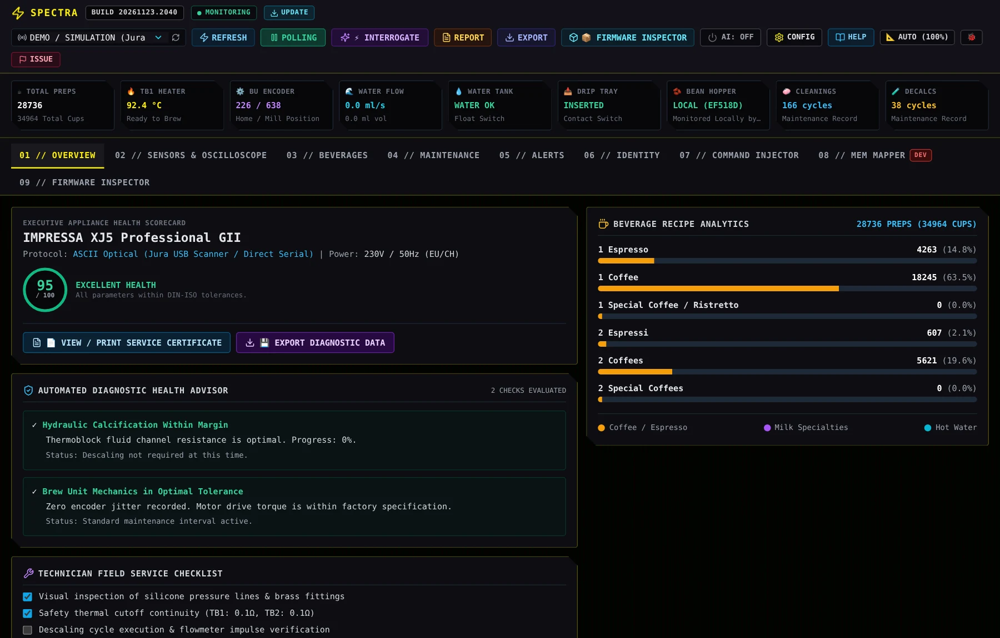

### Top Control Bar — Every Button Explained

| Button / Indicator | What It Does |
| :--- | :--- |
| **`BUILD 20261123.2040`** | Your currently installed SPECTRA build number. Clicking it opens the Update checker. |
| **Live Activity Pill** *(colored badge next to build)* | Shows in real time what SPECTRA is currently doing (see color table below). |
| **`UPDATE`** *(or pulsing green `UPDATE (build)`)* | Checks for a newer SPECTRA build and lets you install it cleanly in one click. |
| **Port Dropdown + `↻`** | Pick your USB service cable (`COM*` / `/dev/ttyUSB*`) or `DEMO` mode. Click `↻` to rescan plugged-in cables. |
| **`REFRESH`** | Reads live sensors once right now (temperatures, flow, microswitches, brew unit position). |
| **`POLLING` / `START POLL`** | Toggles continuous live monitoring every ~1 second. Green **`POLLING`** means live readings are streaming. |
| **`⚡ INTERROGATE`** | **Your main daily button.** Performs a complete memory (EEPROM) read: model, drinks, maintenance, alerts, and sensors. |
| **`REPORT`** | Opens a clean, print-ready **Service Certificate** you can print on A4 paper or save as a PDF for the customer. |
| **`EXPORT`** | Opens the export window to save `.json`, `.csv`, or `.txt` files (with optional ticket prefix) or capture a full EEPROM backup. |
| **`📦 FIRMWARE INSPECTOR`** | Quick jump to tab `09` for checking touchscreen firmware & translation quality *(advanced tool)*. |
| **`AI: OFF` / `AI: ON`** | Quick power switch for Local AI. Stays **OFF by default** so it uses zero extra RAM until you need it. |
| **`CONFIG`** | Opens Settings: UI language, Local AI models, 174-machine library, GitHub login, offset calibrations, and Updates. |
| **`HELP`** | Opens this **built-in illustrated User Guide** (searchable, English & Czech) plus a shortcut to the 7-step Interactive Tour. |
| **`📐 AUTO (100%)`** | Cycles screen zoom (`AUTO`, `85%`, `100%`, `115%`) so everything fits comfortably on any screen size. |
| **`🐞`** *(red bug icon)* | Opens the **Process & Diagnostics Monitor** (live log useful when troubleshooting). |
| **`ISSUE`** | Opens the quick form to report a bug, wrong counter, unsupported model, or feature idea directly to GitHub. |

### Live Activity Pill Colors (Next to the Build Number)

| Badge | Color | What SPECTRA Is Doing |
| :--- | :--- | :--- |
| **`MONITORING`** | Green | Live sensor telemetry is refreshing automatically every second. |
| **`READING 45%`** | Purple | Reading machine memory (EEPROM) — wait a few seconds and do not unplug the cable. |
| **`AI WORKING`** | Blue / Purple | Local AI is generating a summary or matching counter offsets. |
| **`GITHUB SYNC`** | Blue | Submitting a diagnostic bundle or issue report to GitHub. |
| **`UPDATING 60%`** | Cyan | Downloading or installing a SPECTRA software update. |
| **`COMM ERROR`** | Red | The machine is not replying — check cable seating, power switch, and selected port. |
| **`READY` / `IDLE`** | Gray / Green | Standing by for your next action. |

### The 9 Top Status Tiles Explained

| Status Tile | What It Measures | Practical Workshop Tip |
| :--- | :--- | :--- |
| **1. ☕ TOTAL PREPS** | Total preparations dispensed (smaller text underneath shows total cups). | Double drinks (`2 Coffees`) count as 1 preparation but 2 cups. Standalone hot water/steam counts in preps, not coffee cups. |
| **2. 🔥 TB1 HEATER** | Live temperature of the main coffee thermoblock (°C). | A heated, ready machine sits between **80 °C and 115 °C** (`Ready to Brew`). A cold machine shows room temperature. |
| **3. ⚙️ BU ENCODER** | Brew unit position in encoder ticks plus current mechanical zone. | At rest, look for `Home / Mill Position` (e.g. `226 / 638`). During a brew cycle the tick count smoothly tracks piston travel. |
| **4. 🌊 WATER FLOW** | Live water flow rate (`ml/s`) and dispensed volume. | Shows `0.0 ml/s` at rest. During a rinse or coffee brew it should rise smoothly — staying at zero points to a blockage or faulty flowmeter. |
| **5. 💧 WATER TANK** | Float switch reading for water level. | **`WATER OK`** = tank inserted with water. Turns red if empty or removed. |
| **6. 📥 DRIP TRAY** | Contact switch for drip tray & grounds drawer. | **`INSERTED`** = properly seated. If it reads missing while inserted, clean the rear brass contact springs with isopropyl alcohol (IPA). |
| **7. 🫘 BEAN HOPPER** | Bean hopper sensor status. | On **XJ5 / XJ9 (`EF518`)** machines this shows green **`LOCAL (EF518D)`** — this is **normal**! On those models, the bean sensor wires directly into the front display board and is not sent over the service cable. Check the machine's LCD for "Fill Beans". |
| **8. 🧼 CLEANINGS** | Total cleaning tablet cycles completed. | Quick sanity check on how regularly the customer cleaned the brew group. |
| **9. 🧪 DECALCS** | Total descaling cycles completed. | Thousands of cups with `0` descalings (and no filter) is a strong sign of scale buildup inside the heater or valve. |

---

## 4. Complete Tour of All 9 Tabs

Tabs are arranged from everyday workshop screens (`01` through `06`) to specialist engineering tools (`07` through `09`).

---

### `01 // OVERVIEW` *(Everyday Work)*

Your main home screen after clicking **`⚡ INTERROGATE`**. At the top (see Chapter 3 screenshot) you get:
- **Executive Appliance Health Scorecard (`0–100`)** — an instant health score (e.g. `95 / 100 EXCELLENT HEALTH`), detected model name, protocol, and power rating.
- Quick action buttons: **`VIEW / PRINT SERVICE CERTIFICATE`** and **`EXPORT DIAGNOSTIC DATA`**.
- **Beverage Recipe Analytics** (right column) — visual bar breakdown of every drink prepared, color-coded by coffee, milk specialties, and hot water.

Scrolling down on `01 // OVERVIEW` reveals three more practical workshop panels:

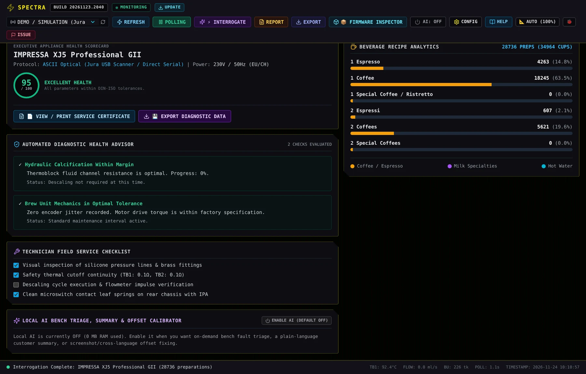

- **Automated Diagnostic Health Advisor** — checks hydraulic scale wear, brew unit encoder behavior, and key indicators, giving plain-English recommendations.
- **Technician Field Service Checklist** — interactive checkboxes (hoses, thermal cutoffs, descaling check, cleaning drip tray contacts with IPA) you can tick off as you work.
- **Local AI Bench Triage, Summary & Offset Calibrator** — click **`ENABLE AI`** whenever you want a plain-English customer summary, smart fault triage, or counter offset calibration (details in [Chapter 7](#7-local-ai-fixing-wrong-drink-counters-offsets)).

---

### `02 // SENSORS & OSCILLOSCOPE` *(Everyday Work / Diagnostics)*

Live inspection of every physical sensor and mechanical component inside the coffee machine.

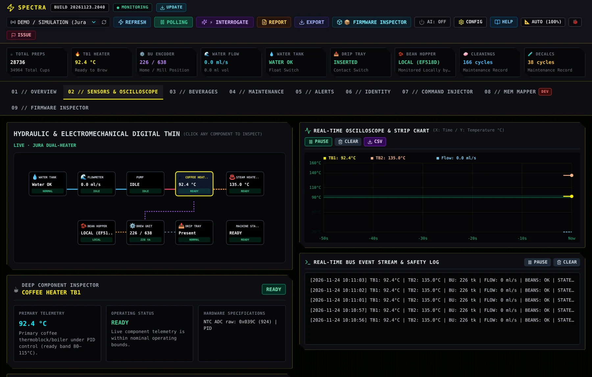

- **Hydraulic & Electromechanical Digital Twin (left)** — an interactive live diagram of the machine. **Click any part on the diagram** (TB1 Heater, TB2 Steam Heater, Brew Unit, Flowmeter, Water Tank, Drip Tray, Bean Hopper) to display its detailed measurements and status in the **Deep Component Inspector** below.
- **Real-Time Oscilloscope & Strip Chart (right)** — plots live heater temperatures (TB1, TB2) and water flow over time. Great for spotting unstable temperature sensors or heating dropouts during a test brew. Use **`PAUSE`** / **`RESUME`** and **`CLEAR`** anytime.
- **Real-Time Bus Event Stream** — timestamped live log of incoming sensor packets.

Scroll down on `02 // SENSORS & OSCILLOSCOPE` to inspect individual switches and safety circuits:

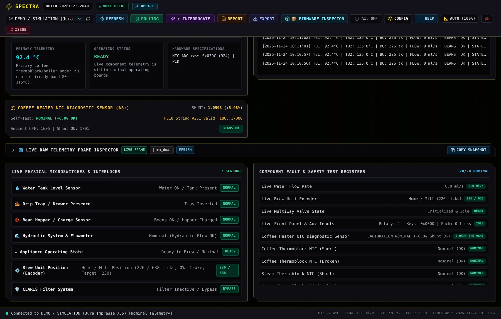

- **Coffee Heater NTC Diagnostic Sensor (`AS:`)** — verifies the coffee heater temperature sensor using the board's built-in `+6.0%` calibration shunt resistor. Green **`NOMINAL (+6.0% OK)`** confirms healthy NTC readings.
- **Live Raw Telemetry Frame Inspector** — expandable technical frame view with a one-click **`COPY SNAPSHOT`** button if support ever asks for raw telemetry.
- **Live Physical Microswitches & Interlocks** — clear status row for every physical switch (water tank, drip tray, beans, flowmeter, brew state, encoder, CLARIS filter).
- **Component Fault & Safety Test Registers** — live check across 20 safety registers (heater NTC short/open checks, rotary valve state, front panel keys, etc.).

---

### `03 // BEVERAGES` *(Everyday Work)*

Full table of every beverage counter stored in the machine's memory, with search box, exact quantities, share percentages, and serving category.

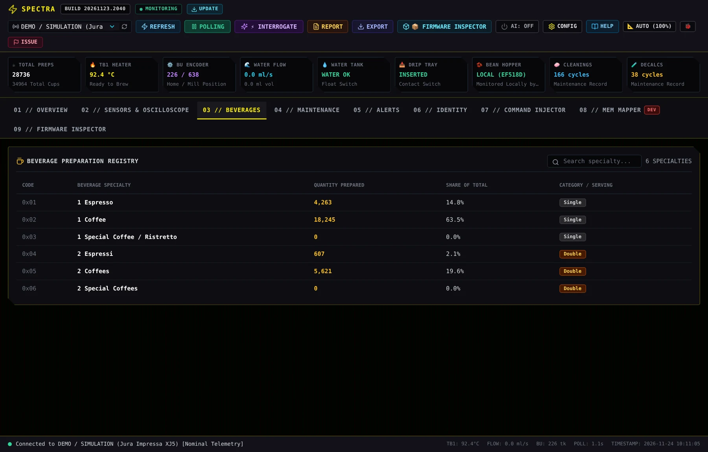

> [!NOTE]
> **Why do "Total Preps" and "Total Cups" sometimes differ?**
> - **Total Preps** includes every single dispense — including standalone hot water, tea water, steam, or milk foam.
> - **Total Coffee Cups** counts only coffee-based drinks (espresso, coffee, ristretto, cappuccino, latte macchiato, etc.). Double coffee drinks (`2 Espressi`, `2 Coffees`) count as 1 preparation and 2 cups.

---

### `04 // MAINTENANCE` *(Everyday Work)*

Shows all completed maintenance cycles (coffee cleaning, thermoblock descaling, CLARIS filter status, milk-system cleaning) plus wear bars.

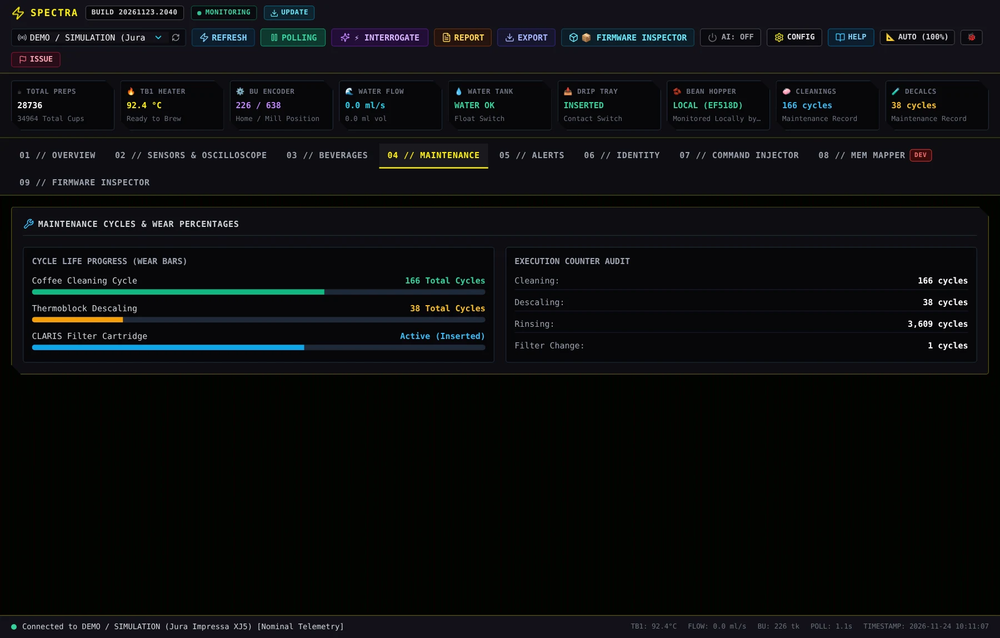

This tab makes it easy to review maintenance history with a customer and verify whether regular cleaning and descaling have been performed.

---

### `05 // ALERTS` *(Everyday Work)*

Displays active blocking alerts (e.g., drip tray missing, empty water tank, full grounds container) alongside historical hardware fault register status.

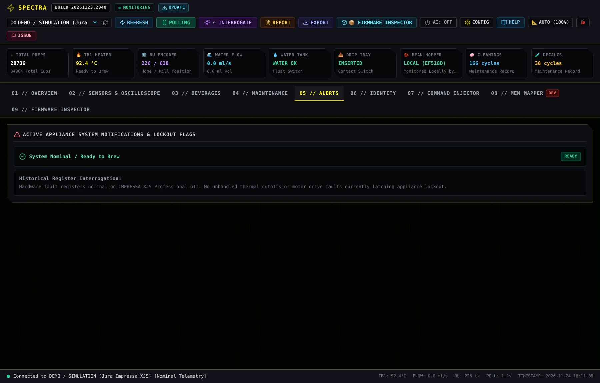

- When everything is healthy, you see a green checkmark with **`READY`** (`System Nominal / Ready to Brew`).
- If something blocks brewing, a red **`ALARM`** card explains exactly what needs attention.

---

### `06 // IDENTITY` *(Everyday Work)*

The machine's electronic "birth certificate" — all identification details gathered in one place.

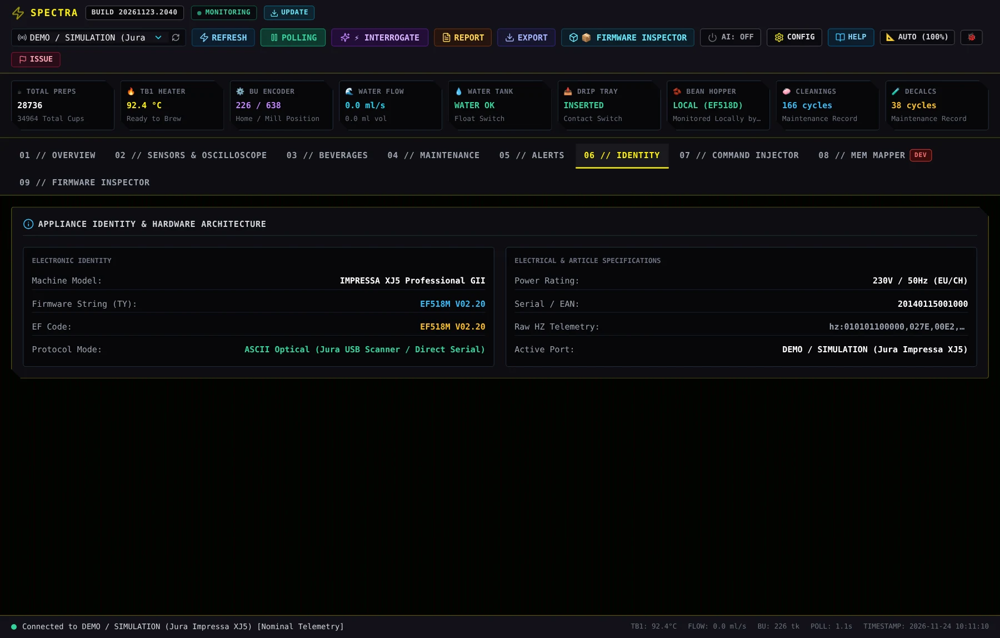

Includes **Machine Model**, **Firmware String (`TY:`)**, **EF Code** *(essential when ordering replacement logic boards!)*, **Protocol Mode**, **Power Rating**, **Serial / EAN**, and **Active Port**.

---

### `07 // COMMAND INJECTOR` *(Advanced Tool)*

*You do not need this tab for routine service work.* It lets experienced technicians send direct read-only diagnostic commands (`TY:`, `HZ:`, `CS:`, `IC:`, `RT:0000`, etc.) to the board and inspect raw replies.

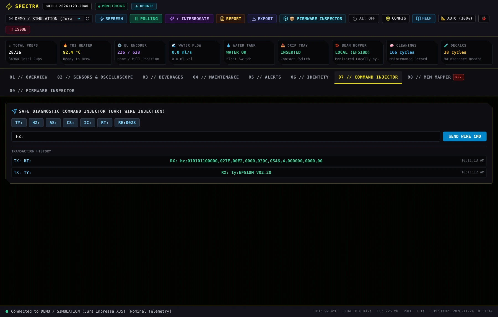

> [!WARNING]
> **Use with care:** Certain manual commands can power off the machine (`AN:`), erase fault latches (`FA:01`), or write to memory. Stick to the safe read buttons (`TY:`, `HZ:`, `CS:`, `RT:`) unless you know the exact command you are sending.

---

### `08 // MEM MAPPER [DEV]` *(Advanced Tool)*

*Developer & reverse-engineering tool used to map memory layouts of brand-new coffee machine models.*

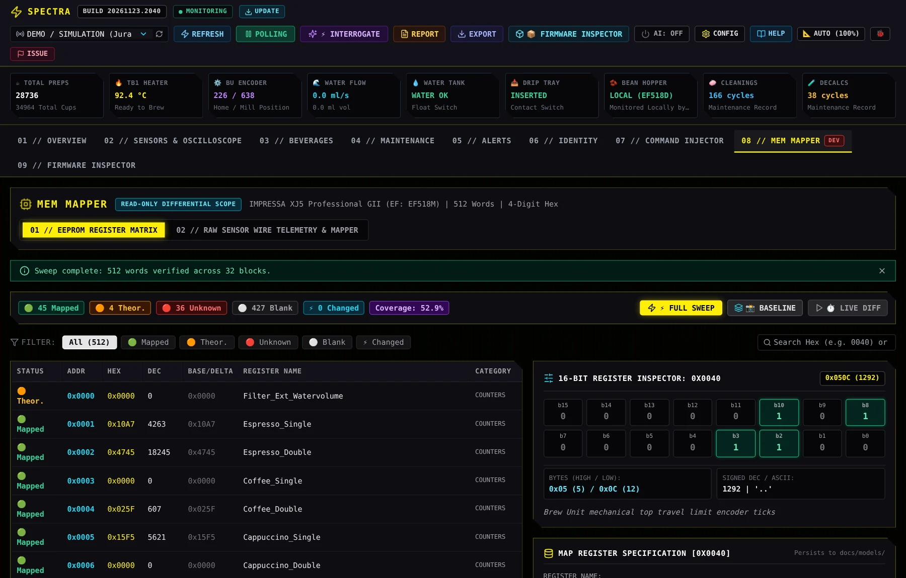

Reads all 512 words of EEPROM memory into a color-coded grid, lets you click any word to inspect its 16-bit/decimal/binary values, and supports differential scanning (**Diff**) before and after making a drink to locate which address incremented by `+1`.

---

### `09 // FIRMWARE INSPECTOR` *(Advanced Tool)*

*Specialist tool for auditing touchscreen display firmware & translation packs (HMI / Android panels via USB/ADB or local firmware files).*

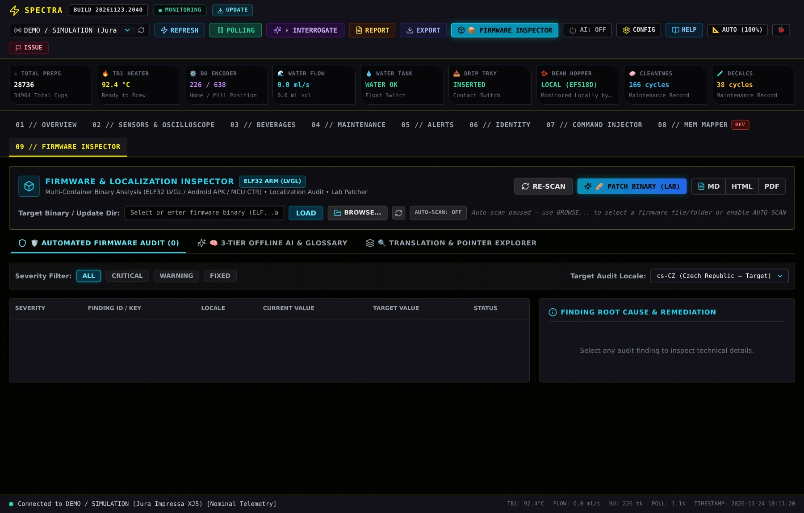

Automatically detects swapped translation strings, typos, inverted On/Off labels, and broken pointers. You do not need this tab for standard Jura service port diagnostics.

---

## 5. Printing a Customer Service Certificate (Print & PDF)

Whenever you want to hand a customer a clean, professional inspection report with their repaired coffee machine, click the amber **`REPORT`** button in the top bar (or **`VIEW / PRINT SERVICE CERTIFICATE`** on the Overview tab).

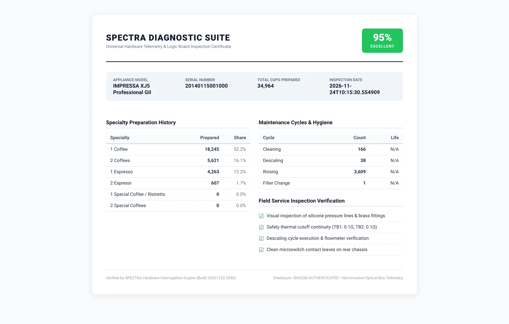

### How to Print or Save as PDF

1. First read the machine with **`⚡ INTERROGATE`**.
2. Click **`REPORT`** — a clean, white, print-friendly A4 document opens automatically (designed to save printer ink).
3. Press **`Ctrl + P`** (or click the print button at the top of the certificate):
   - Select your workshop printer to print a paper copy, or
   - Select **Save as PDF** to attach the certificate to an email or digital invoice.

> [!TIP]
> If you turn on Local AI and generate a **Customer Summary** first, it is automatically included right inside the printable certificate!

---

## 6. Exporting Data, Ticket Numbers & Diagnostic Bundles

Click **`EXPORT`** in the top bar to save machine data to your computer or capture a complete EEPROM backup.

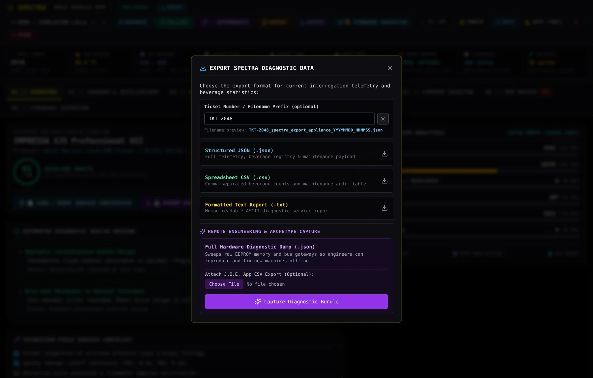

### 1. Ticket Number / Custom Filename Prefix

At the very top of the Export window, type your job ticket or customer label into **Ticket Number / Filename Prefix (optional)** — for example **`TKT-2048`**.
- Right underneath, SPECTRA shows a live preview of the exact filename it will create, e.g.:
  `TKT-2048_IMPRESSA_XJ5_Professional_GII_20261124_075049.json`
- That prefix is applied automatically to every export below — no manual file renaming needed!

### 2. Quick File Exports (One Click)

| Button | File Type | Best Used For |
| :--- | :--- | :--- |
| **Structured JSON (`.json`)** | `.json` | Complete structured telemetry archive or sharing with technical support. |
| **Spreadsheet CSV (`.csv`)** | `.csv` | Opens straight in **Microsoft Excel** or **LibreOffice Calc** (clean drink & maintenance table). |
| **Formatted Text Report (`.txt`)** | `.txt` | Plain readable report easy to paste into a workshop ticket system or email. |

### 3. Full Hardware Diagnostic Bundle (Complete EEPROM Backup)

The lower purple section (**Remote Engineering & Archetype Capture**) sweeps the machine's full 512-word EEPROM memory into one `.json` snapshot. Use this when:
- You want a full backup before servicing a board,
- You encounter an unsupported or brand-new machine model, or
- You want to submit data to map wrong drink counters.

**Steps:**
1. *(Optional)* If you exported a `.csv` file from the **Jura J.O.E.** app with real drink counts, attach it under **Attach J.O.E. App CSV Export**.
2. Click **`Capture Diagnostic Bundle`**.
3. Once ready, choose between **two clear destinations**:

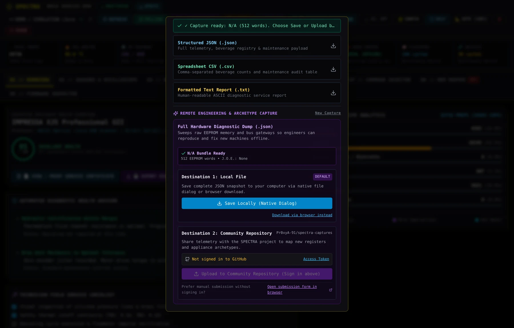

- **Destination 1: Local File (`Default`)** — click **`Save Locally (Native Dialog)`** (or **`Download via browser instead`**) to keep the complete JSON backup strictly on your computer.
- **Destination 2: Community Repository (`Pr0xyA-91/spectra-captures`)** — optional sharing to help add support for new coffee machine models:
  - If signed in to GitHub (see [Chapter 8](#8-how-to-connect-to-github-step-by-step)), click **`Upload to Community Repository`** to upload in one click.
  - Without signing in, click **`Open submission form in browser`** to submit manually on the web.

> [!IMPORTANT]
> SPECTRA **never** uploads machine data automatically in the background. Nothing leaves your computer unless you explicitly click an upload button.

---

## 7. Local AI & Fixing Wrong Drink Counters (Offsets)

SPECTRA includes an optional Local AI assistant that runs **100% offline on your own computer** (via Ollama) — **no customer data is ever sent to cloud servers**.

### Turning AI On & Picking the Right Model

By default, Local AI is **OFF (`AI: OFF`)**, using **0 MB RAM** so your laptop stays fast.

1. Open **`CONFIG` → `Local AI & Models`**.
2. Check engine status and pick a model matching your computer's RAM:

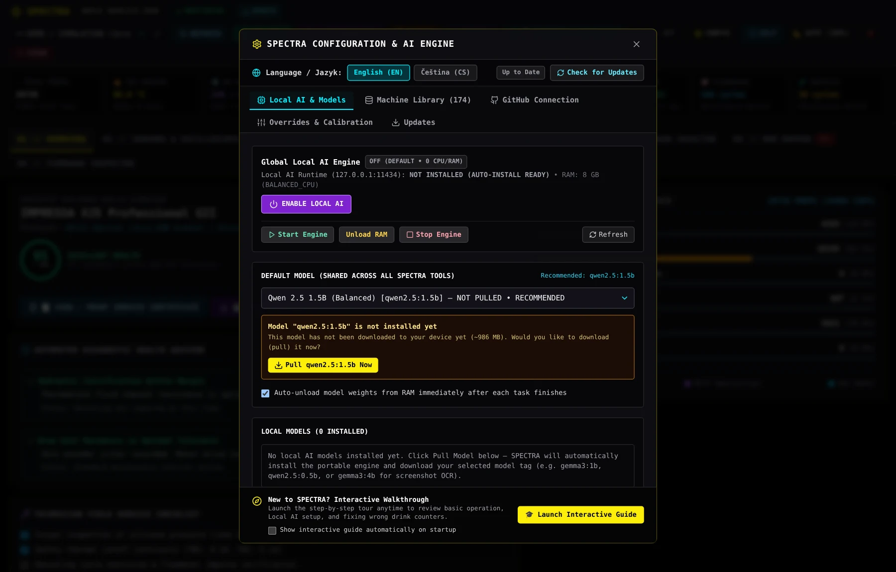

| Computer Hardware (RAM) | Recommended Model | Best For |
| :--- | :--- | :--- |
| **Standard office laptop (8 GB RAM)** | `qwen2.5:0.5b` or `gemma3:1b` | Fast customer handoff summaries and basic bench triage. |
| **Modern workshop PC / laptop (16 GB RAM)** | `gemma3:4b` *(Vision)* | **Recommended!** Can read photos/screenshots (e.g., J.O.E. app screenshot or LCD photo) to fix wrong drink counters automatically. |
| **High-memory workstation (16–32 GB RAM)** | `qwen2.5:7b` / `llama3.1:8b` | Highest-detail fault triage and multi-language explanations. |

3. Turn AI on anytime with **`AI: OFF`** in the top bar (switches to **`AI: ON`**), or click **`ENABLE AI`** at the bottom of `01 // OVERVIEW`. Click again to turn it off and immediately free RAM.

### Fixing Wrong Counters (Offset Calibration)

If a coffee machine shows `0` or obviously mismatched drink numbers (common on newer board revisions):

1. Click **`⚡ INTERROGATE`** to read the machine.
2. Turn Local AI ON (**`AI: ON`**).
3. Scroll to the bottom of **`01 // OVERVIEW`** → **Wrong Counters or Machine Name? Fix Offsets & Identity**.
4. Upload either:
   - A **`.csv` export from the J.O.E. app**, or
   - A **photo / screenshot** showing the real drink counts *(uses a Vision model like `gemma3:4b`)*.
5. Click **`CALIBRATE OFFSETS & IDENTITY`**, verify the matched counts preview, and click **`APPLY LOCALLY NOW`**.

### Managing Saved Overrides & Calibrations

All locally saved counter fixes live in **`CONFIG` → `Overrides & Calibration`**:

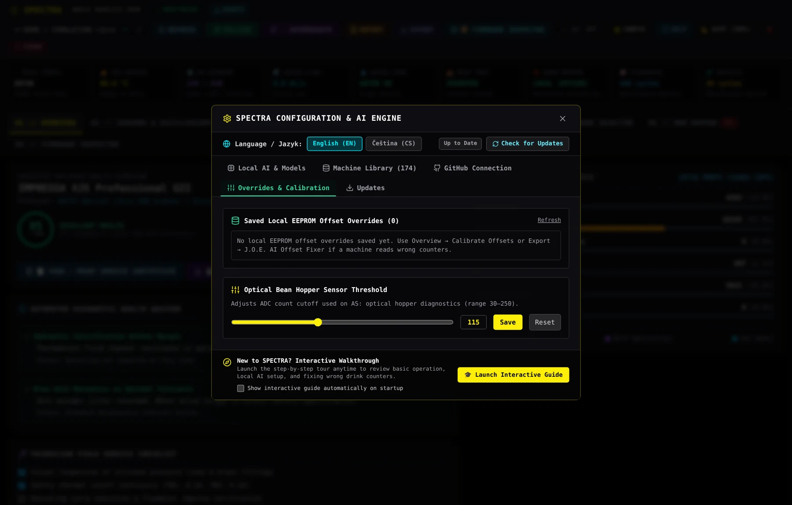

- Review every saved local offset fix and click **`Revert`** anytime to restore the factory default map.
- On compatible models, you can also tune the **Optical Bean Hopper Sensor Threshold** (click **`Reset`** to restore default `115`).

---

## 8. How to Connect to GitHub (Step-by-Step)

### Do I Even Need a GitHub Account?

- **NO**, if you only read coffee machines, print customer certificates, and save exports to your local computer.
- **YES**, if you want to **submit bug reports in one click** (**`ISSUE`** button) or **upload diagnostic bundles** for new models straight from SPECTRA.

You only set this up **once** — SPECTRA remembers your login securely and signs you in automatically every time you launch the app.

---

### Step 1: Create a Personal Access Token on GitHub

*(If you don't have a GitHub account yet, create a free one first at [github.com/signup](https://github.com/signup).)*

1. Sign in at [github.com](https://github.com) in your web browser.
2. Click your **profile avatar in the top-right corner** → choose **Settings**.
3. Scroll all the way to the bottom of the left sidebar and click **Developer settings**.
4. Expand **Personal access tokens** → click **Tokens (classic)**.
   > [!IMPORTANT]
   > Choose **Tokens (classic)** — **not** *Fine-grained tokens*! Classic tokens let you select the exact two permissions SPECTRA needs cleanly.
5. Click **Generate new token** → **Generate new token (classic)**.
6. Fill in the short form:
   - **Note**: enter a label you'll recognize, e.g. `SPECTRA workshop`.
   - **Expiration**: pick e.g. `90 days` or `No expiration`.
   - **Select scopes** — **check these exact two boxes**:
     - ✅ **`public_repo`** *(inside `repo` — or check full `repo` if you also submit to private team repos)*
     - ✅ **`gist`** *(allows safe attachment of longer diagnostic logs)*
7. Scroll down and click the green **Generate token** button.
8. GitHub shows a token starting with **`ghp_...`**. **Copy it right away!** *(Once you leave the page, GitHub will not display it again.)*

---

### Step 2: Paste the Token Into SPECTRA

1. Click **`CONFIG`** in the top bar → open the **`GitHub Connection`** tab (shows orange **`DISCONNECTED`**):

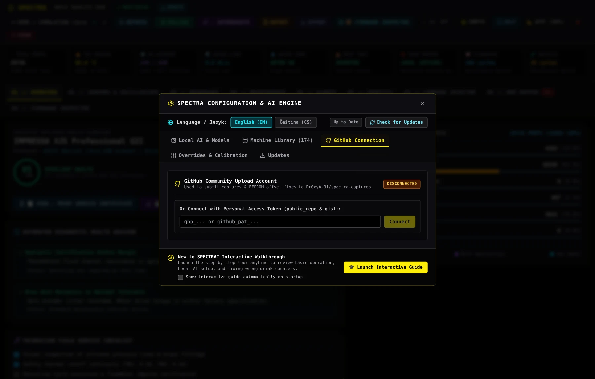

2. Paste your copied `ghp_...` token into the **`ghp_... or github_pat_...`** box (`Ctrl + V`).
3. Click the yellow **`Connect`** button.
4. Within a second, SPECTRA verifies the token and switches to green **`CONNECTED: @your_username`**:

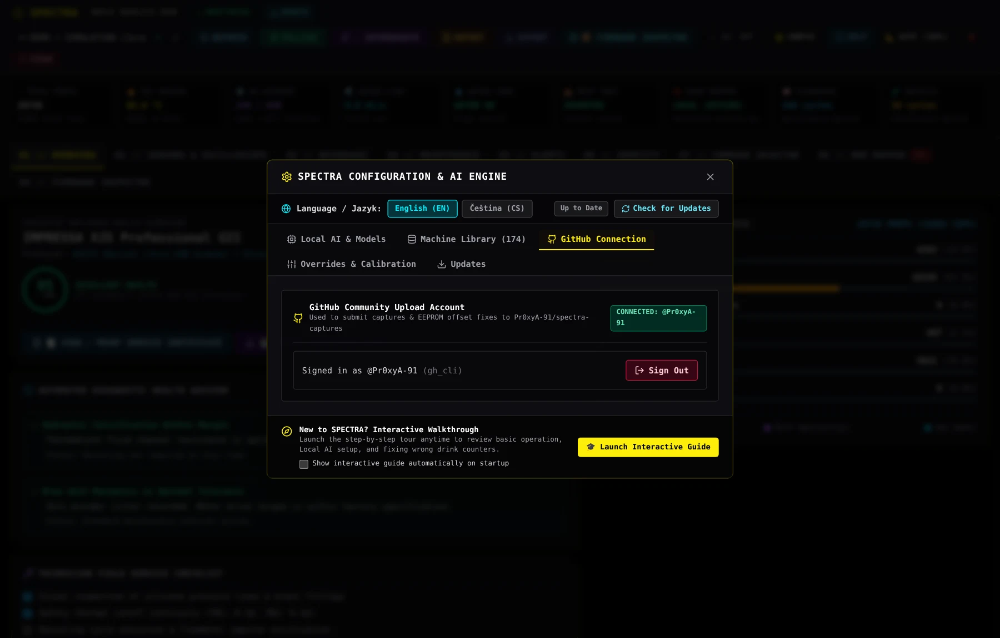

### All Set — Good to Know

- **Automatic Sign-In:** From now on, SPECTRA signs in automatically every time you start the app — you do not need to open `CONFIG` first before reporting an issue.
- **Token Security:** Your token is stored securely in your operating system keyring (Windows Credential Manager / Linux Keyring) or a private user-only config file. It is never written to logs or exported files.
- **Signing Out:** Sharing a workshop PC? Click **`Sign Out`** anytime under `CONFIG → GitHub Connection`.

---

## 9. How to Report a Bug or Request a Feature

Whenever you run into a glitch, wrong counter, unsupported model, or have an idea that would make workshop life easier, send us a report straight from SPECTRA!

1. Click the red **`ISSUE`** button at the right end of the top bar.
2. The **`REPORT AN ISSUE TO GITHUB`** window opens:

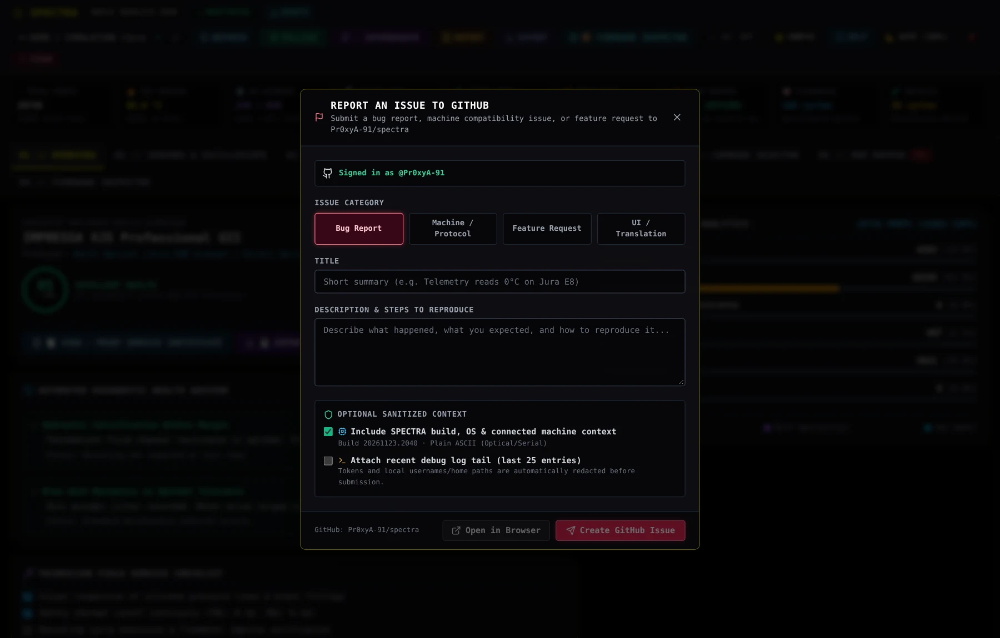

3. **Pick an Issue Category**:
   - **Bug Report** — something broke, froze, or showed an error message.
   - **Machine / Protocol** — connection issue, wrong drink counters, or a new coffee machine model.
   - **Feature Request** — an idea for a new capability or workflow shortcut.
   - **UI / Translation** — layout glitch or wording/translation improvement.
4. Enter a clear **Title** *(e.g., "Jura WE6 shows 0 cleaning cycles")*.
5. Fill in **Description & Steps to Reproduce** in plain English: which coffee machine was connected, what you clicked, and what happened instead of what you expected.
6. Leave **Optional Sanitized Context** checked — SPECTRA attaches the build number, OS, connected machine model, and recent debug lines automatically.
   > [!TIP]
   > **Automatic Privacy Protection:** Before submitting, SPECTRA **automatically redacts** all GitHub tokens, passwords, and local PC usernames/folder paths.
7. Submit your report:
   - Signed in to GitHub (green `Signed in as @...`)? Click **`Create GitHub Issue`** — the issue is filed immediately and you get a direct link.
   - Not signed in? Click **`Open in Browser`** — GitHub opens in your browser with the whole report pre-filled so you can submit in one click.

---

## 10. Settings, Machine Library & One-Click Updates

Inside **`CONFIG`**, two additional tabs help you manage machine profiles and keep SPECTRA current:

### Machine Library (174+ Models)

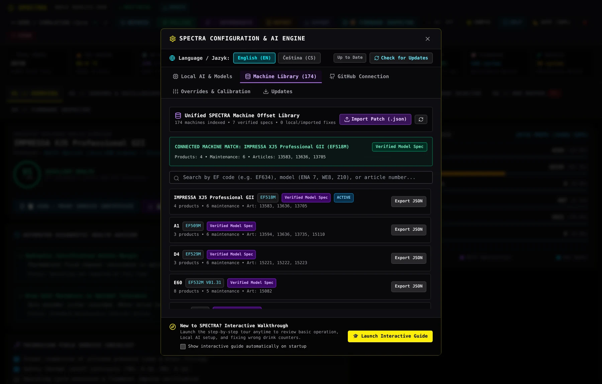

- Browse or search all supported coffee machines by model name, EF board code, or article number.
- Click **`Import Patch (.json)`** to load a custom machine profile shared by a coworker, or **`Export JSON`** on any entry to share a profile with your team.

### One-Click Software Updates

SPECTRA automatically checks for new builds at startup and highlights **`UPDATE`** in the top bar when a newer build is ready. You can also check manually under **`CONFIG` → `Updates`**:

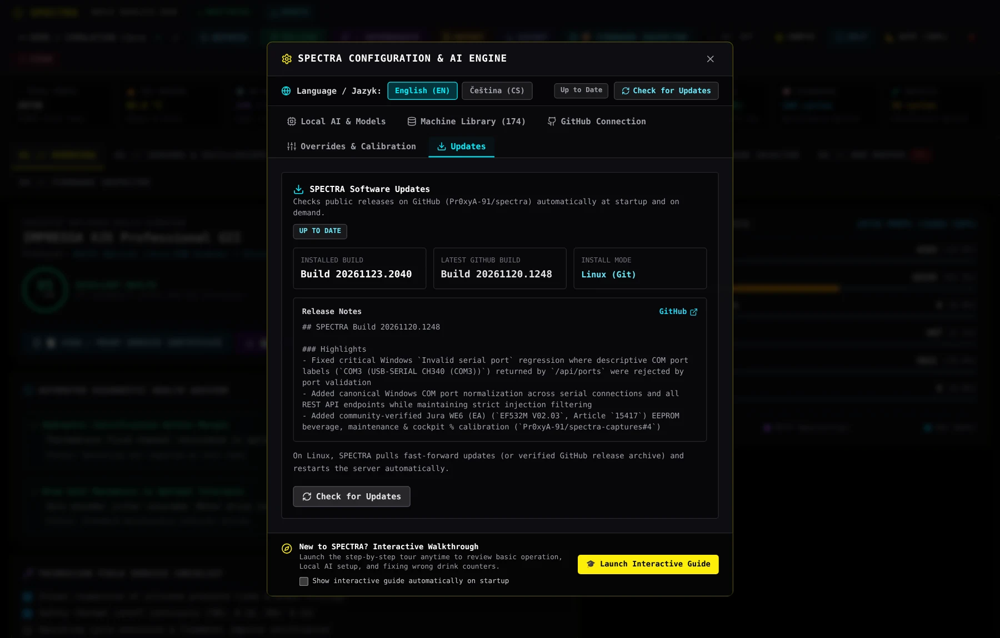

1. Click **`Check for Updates`** (or **`UPDATE`** in the top bar).
2. If a newer build is available, click **`Update Now`**.
3. SPECTRA verifies the package, installs the update, **safely cleans up retired obsolete files from older builds**, and relaunches automatically.

> [!NOTE]
> **Your preferences are always preserved:** Updating never erases your chosen language, GitHub login, or locally saved offset calibrations.

---

## 11. Debug Console (`🐞`) & Quick Troubleshooting (FAQ)

### What Is the Bug Icon (`🐞`) in the Top Bar?

Clicking the small red **`🐞`** icon (or pressing **`Ctrl + Shift + D`** / **`F12`**) opens the **SPECTRA Process & Diagnostics Monitor**:

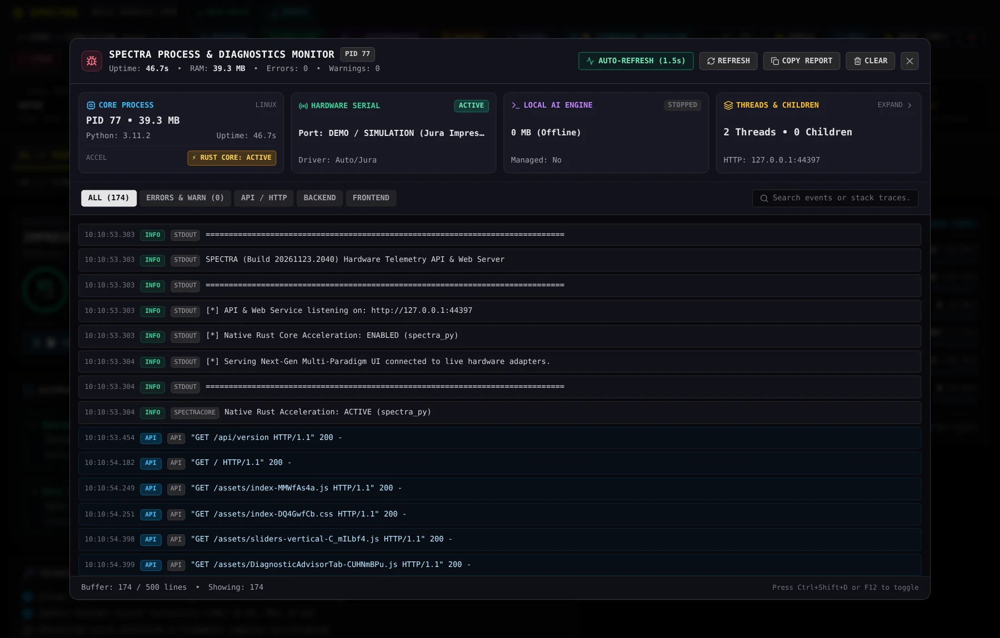

It shows live serial driver status, active threads, Local AI status, and recent event logs. If support asks for diagnostic output, click **`COPY REPORT`** and paste it into your email or issue report.

---

### Quick Troubleshooting Table (FAQ)

| Problem / Question | Likely Cause & Simple Fix |
| :--- | :--- |
| **I plugged in the USB cable, but it doesn't appear in the port list.** | 1. Click the refresh icon **`↻`** right next to the port dropdown. 2. Try another USB port on your computer. 3. On Windows, check *Device Manager → Ports (COM & LPT)* to make sure the USB-serial driver (FTDI / CH340 / CP210x) is installed. |
| **Clicking `INTERROGATE` shows `COMM ERROR` or blank numbers.** | 1. Check that the coffee machine is plugged in and its main power switch is **ON**. 2. Reseat the service connector (optical scanner N 010 must sit flush against the service window). 3. Close any other service app that might be holding the serial port open. |
| **On a Jura XJ5 / XJ9, Bean Hopper says `LOCAL (EF518D)` — is the sensor broken?** | **No — that is completely normal!** On EF518 machines (XJ5/XJ9), the optical bean sensor connects only to the front display board (`EF518D`) and is never sent over the main board's service cable. Watch the machine's LCD screen for "Fill Beans". |
| **Drink counters don't match the machine display or the J.O.E. app.** | The machine likely uses a newer board revision with shifted EEPROM addresses. Follow [Chapter 7 (Fixing Wrong Counters)](#fixing-wrong-counters-offset-calibration), or capture a **Diagnostic Bundle** ([Chapter 6](#3-full-hardware-diagnostic-bundle-complete-eeprom-backup)) and report it via **`ISSUE`**. |
| **GitHub returns `403 Forbidden` or says my token is invalid.** | The token is missing required scopes or expired. Generate a fresh **Tokens (classic)** key following [Chapter 8](#step-1-create-a-personal-access-token-on-github) and make sure **both `public_repo` and `gist`** are checked. |
| **SPECTRA says I'm not signed in to GitHub.** | Open **`CONFIG` → `GitHub Connection`**. If it shows `DISCONNECTED`, paste your `ghp_...` token and click **`Connect`**. Starting with Build `20261123.2040`, SPECTRA automatically restores your sign-in at startup. |
| **My laptop slows down when Local AI is turned on.** | Local AI runs directly on your CPU/RAM. Switch to a lighter model (`qwen2.5:0.5b` or `gemma3:1b`) in **`CONFIG` → `Local AI & Models`**, and turn AI off (`AI: ON → AI: OFF`) in the top bar once you finish. |
| **Text or buttons feel too small / clipped on my laptop screen.** | Click **`📐 AUTO (100%)`** in the top-right bar to cycle screen scaling (`85%`, `100%`, `115%`, `AUTO`) until the workspace fits nicely. |
| **I want to practice without connecting a real coffee machine.** | Choose **`DEMO / SIMULATION (Jura Impressa XJ5)`** in the port dropdown and click **`⚡ INTERROGATE`**. |

---

*Have an idea to make this manual even clearer? Click **`ISSUE`** in the top bar and pick **UI / Translation** or **Feature Request**.*
